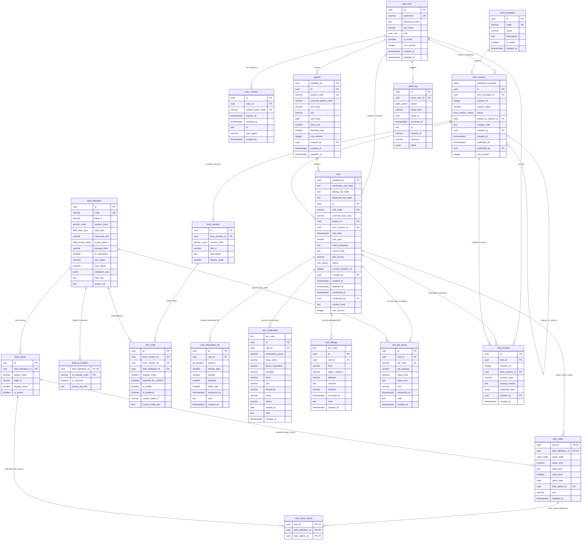

# Thiết kế ERD và Phân tích Chuẩn hóa 3NF (`erd.md`)

**Tài liệu căn cứ:** `CONTRACT.md` (Mục 1, 3, 4), `CR-W1-01.md`, `BAN-GIAO-DEV-web-suy-tim-hai-luong-2026-11-19.md` (Mục 3, 6.1).  
**Phạm vi CSDL:** PostgreSQL 16+ (đã kiểm chứng trên PostgreSQL 18.6) — `21` bảng chuẩn hóa 3NF, `10` kiểu `ENUM`, `13` hàm PL/pgSQL, `20` trigger bảo toàn dữ liệu.

---

## 1. Sơ đồ Thực thể – Quan hệ (Mermaid `erDiagram`)

    patient_care_assignment {
        uuid id PK
        uuid patient_id FK
        uuid doctor_user_id FK
        timestamptz assigned_at
        uuid assigned_by FK
        text reason
        timestamptz revoked_at
        uuid revoked_by FK
    }
    visit_diagnosis {
        uuid id PK
        uuid visit_id FK
        text code
        text display
        text role
    }
    patient ||--o{ patient_care_assignment : care_history
    app_user ||--o{ patient_care_assignment : doctor
    visit ||--o{ visit_diagnosis : diagnoses

---

## 2. Phân tích Chuẩn hóa 3NF từng bảng (19/19 bảng)

> **Quy tắc kiểm tra:** Một quan hệ $R$ đạt **1NF** nếu mọi thuộc tính đều nguyên tử (không chứa mảng/nhóm lặp trong 1 ô); đạt **2NF** nếu đạt 1NF và không có thuộc tính không khóa nào phụ thuộc bộ phận vào một khóa ứng viên (Candidate Key - CK); đạt **3NF** nếu đạt 2NF và không có phụ thuộc bắc cầu $X \to A$ mà $X$ không phải siêu khóa (Superkey) và $A$ không phải thuộc tính khóa (Prime attribute).

| # | Bảng | Khóa ứng viên (Candidate Keys) | Phụ thuộc hàm phi tầm thường (Non-trivial FDs) | Kết luận 1NF / 2NF / 3NF & Giải trình chi tiết |
|---:|---|---|---|---|
| 1 | `app_user` | `CK1 = {id}` `CK2 = {username}` | `id -> {username, password_hash, full_name, role, is_active, row_version, created_at, updated_at}` `username -> {id, password_hash, full_name, role, is_active, row_version, created_at, updated_at}` | **Đạt 3NF & BCNF.** Mọi định thức bên trái của FD đều là siêu khóa (`id` hoặc `username`). Một tài khoản chỉ giữ 1 vai trò (`role`), không tách thừa bảng `role`/`user_role`. |
| 2 | `user_session` | `CK1 = {id}` `CK2 = {refresh_token_hash}` | `id -> {user_id, refresh_token_hash, expires_at, revoked_at, ip, user_agent, created_at}` `refresh_token_hash -> {id, user_id, ...}` | **Đạt 3NF & BCNF.** Chỉ lưu băm token, không phụ thuộc bắc cầu giữa thuộc tính không khóa. |
| 3 | `patient` | `CK1 = {id}` `CK2 = {patient_code}` | `id -> {patient_code, external_patient_code, full_name, sex, birth_date, birth_year, declared_age, row_version, created_by, created_at, updated_at}` `patient_code -> {id, ...}` | **Đạt 3NF & BCNF.** Cố ý **không** lưu cột `dob_precision` hay `age_computed` vì chúng phụ thuộc hàm vào `(birth_date, birth_year, declared_age)` và `visit_date`. Ràng buộc `num_nonnulls(birth_date, birth_year, declared_age) <= 1` chặn phụ thuộc chéo/mâu thuẫn giữa 3 mức độ chính xác tuổi. |
| 4 | `field_definition` | `CK1 = {id}` `CK2 = {code}` | `id -> {code, label_vi, section_code, data_type, canonical_unit, scope_status, storage_level, is_calculated, min_value, max_value, validation_rule, help_text, source_ref, created_at, updated_at}` `code -> {id, ...}` | **Đạt 3NF & BCNF.** Tách hoàn toàn metadata định nghĩa trường khỏi vị trí trên từng version (`form_field`) và khỏi lựa chọn (`field_option`). `code` là CK tự nhiên nên `visit_lab_result.lab_code` tham chiếu hợp lệ mà không phá 3NF. |
| 5 | `field_option` | `CK1 = {id}` `CK2 = {field_definition_id, option_code}` `CK3 = {field_definition_id, display_order}` | `id -> {field_definition_id, option_code, label_vi, display_order, is_active}` `{field_definition_id, option_code} -> {id, label_vi, display_order, is_active}` `{field_definition_id, display_order} -> {id, option_code, label_vi, is_active}` | **Đạt 3NF & BCNF.** Mọi định thức đều là siêu khóa. Ràng buộc `UNIQUE (id, field_definition_id)` là khóa siêu khóa phục vụ FK tổng hợp từ `visit_value` và `visit_value_option`. |
| 6 | `field_ai_module` | `CK1 = {field_definition_id, ai_module_code}` | `{field_definition_id, ai_module_code} -> {is_required, source_stt_refs}` | **Đạt 3NF & BCNF.** Bảng nối n-n thuần túy; không phụ thuộc bộ phận vào 1 phần khóa. |
| 7 | `form_template` | `CK1 = {id}` `CK2 = {code}` | `id -> {code, name, description, is_active, created_at}` `code -> {id, name, description, is_active, created_at}` | **Đạt 3NF & BCNF.** |
| 8 | `form_version` | `CK1 = {id}` `CK2 = {form_template_id, version_no}` | `id -> {form_template_id, version_no, version_label, status, based_on_version_id, change_note, created_by, created_at, published_at, published_by, row_version}` `{form_template_id, version_no} -> {id, ...}` | **Đạt 3NF** (lưu ý `version_no -> version_label` nếu quy ước `1 -> 'v1.0'`; để đạt BCNF tuyệt đối có thể sinh `version_label` ở view/app, nhưng giữ `version_label` ở đây chỉ là nhãn hiển thị có thể ghi chú dạng `'v1.0-hotfix'`, không phụ thuộc hàm cứng vào `version_no`). |
| 9 | `form_section` | `CK1 = {id}` `CK2 = {form_version_id, section_code}` `CK3 = {form_version_id, display_order}` | `id -> {form_version_id, section_code, title_vi, description, display_order}` `{form_version_id, section_code} -> {id, title_vi, description, display_order}` `{form_version_id, display_order} -> {id, section_code, title_vi, description}` | **Đạt 3NF & BCNF.** Mỗi nhóm trong 1 version có thứ tự và tiêu đề riêng cho version đó; không phụ thuộc bắc cầu. |
| 10 | `form_field` | `CK1 = {id}` `CK2 = {form_version_id, field_definition_id}` `CK3 = {form_section_id, display_order}` | `id -> {form_version_id, form_section_id, field_definition_id, ...}` `{form_version_id, field_definition_id} -> {id, form_section_id, display_order, ...}` `{form_section_id, display_order} -> {id, form_version_id, field_definition_id, ...}` **Phụ thuộc đáng chú ý:** `form_section_id -> form_version_id` | **Đạt 3NF (chủ đích kiểm soát so với BCNF).** Trong `form_section_id -> form_version_id`, vế trái `form_section_id` không phải siêu khóa, nhưng vế phải `form_version_id` là **thuộc tính khóa** (prime attribute thuộc `CK2 = {form_version_id, field_definition_id}`), nên bảng vẫn **đạt chuẩn 3NF**. Việc giữ `form_version_id` là chủ đích kỹ thuật để đặt `UNIQUE (form_version_id, field_definition_id)` và `FOREIGN KEY (form_section_id, form_version_id) REFERENCES form_section(id, form_version_id)` ở mức DDL thuần, chặn một trường xuất hiện 2 lần trong cùng phiên bản. |
| 11 | `visit` | `CK1 = {id}` `CK2 = {visit_code}` | `id -> {visit_code, external_visit_code, patient_id, form_version_id, visit_date, visit_type, chief_complaint, clinical_note, info_source, status, current_revision_no, created_by, created_at, updated_at, confirmed_at, confirmed_by, confirm_note, row_version}` `visit_code -> {id, ...}` | **Đạt 3NF & BCNF.** Không lưu dư thừa các trường dẫn xuất của `patient` (như tên/giới tính/tuổi bệnh nhân) hay `form_version` (như `version_no`). |
| 12 | `visit_value` | `CK1 = {visit_id, field_definition_id}` | `{visit_id, field_definition_id} -> {value_state, value_num, value_text, value_bool, value_date, field_option_id, unit, updated_at}` | **Đạt 3NF & BCNF.** Không sao chép `data_type` hay `section_code` từ `field_definition` sang `visit_value` để tránh phụ thuộc bắc cầu `{visit_id, field_definition_id} -> field_definition_id -> data_type`. Các kiểu dữ liệu khác nhau nằm ở cột có kiểu nguyên tử riêng (`value_num`, `value_text`, `value_bool`, `value_date`, `field_option_id`), và các lựa chọn `multi_choice` được tách sang `visit_value_option`. |
| 13 | `visit_value_option` | `CK1 = {visit_id, field_definition_id, field_option_id}` | Toàn khóa (`all-key relation`); không có thuộc tính không khóa | **Đạt 3NF & BCNF (quan hệ toàn khóa).** Tách từ `visit_value` theo `CR-W1-01` để đáp ứng 1NF cho kiểu `multi_choice` mà không nhồi chuỗi/JSON vào `value_text`. |
| 14 | `visit_orthostatic_bp` | `CK1 = {id}` *(tùy nghiệp vụ: `{visit_id, position, measured_at}` có thể lặp nếu đo lại cùng phút nên dùng `id` surrogate)* | `id -> {visit_id, position, minute_after, systolic, diastolic, heart_rate, measured_at, note, created_at}` | **Đạt 3NF & BCNF.** Chuẩn hóa 1NF thay thế 9 cột phẳng của bản cũ và tách `systolic`, `diastolic`, `position`, `measured_at` thành cột nguyên tử độc lập. |
| 15 | `visit_medication` | `CK1 = {id}` | `id -> {visit_id, medication_group, drug_name, active_ingredient, strength, dose, unit, frequency, route, status, started_at, note, created_at}` | **Đạt 3NF & BCNF.** Mỗi dòng thuốc là một bản ghi nguyên tử gắn `visit_id`, không sao chép sang lượt khác. *(Xem phần Giả định về danh mục thuốc chuẩn hóa).* |
| 16 | `visit_allergy` | `CK1 = {id}` | `id -> {visit_id, kind, agent_category, allergen, reaction, severity, recorded_at, note, created_at}` | **Đạt 3NF & BCNF.** Tách rõ `kind` (`allergy`/`adr`/`intolerance`) và `agent_category` (`therapeutic_drug`/`contrast_media`/`other`). |
| 17 | `visit_lab_result` | `CK1 = {id}` | `id -> {visit_id, lab_code, lab_subtype, value_num, value_text, unit, measured_at, note, created_at}` | **Đạt 3NF & BCNF.** Tách biệt `cls_bnp` vs `cls_nt_probnp`, `cls_creatinin` vs `cls_egfr`, `cls_lvef` vs `cls_sieu_am_tim_ket_luan` qua `lab_code REFERENCES field_definition(code)`. Không lưu dư thừa `section_code` hay `label_vi` của xét nghiệm. |
| 18 | `visit_revision` | `CK1 = {id}` `CK2 = {visit_id, revision_no}` | `id -> {visit_id, revision_no, form_version_id, revision_type, change_reason, snapshot_data, created_by, created_at}` `{visit_id, revision_no} -> {id, ...}` | **Đạt 3NF ở mức quan hệ kiểm toán; có ngoại lệ JSONB có chủ đích cho `snapshot_data`.** Giải trình: `snapshot_data` là ảnh chụp bất biến (point-in-time archival payload) tại thời điểm xác nhận/sửa đổi để tái lập nguyên trạng đầu vào AI theo Mục 3.2 bàn giao; dữ liệu sống luôn được lưu và truy vấn qua các bảng quan hệ chuẩn hóa (`visit_value`, `visit_orthostatic_bp`, `visit_medication`, `visit_allergy`, `visit_lab_result`). |
| 19 | `audit_log` | `CK1 = {id}` | `id -> {actor_user_id, action, entity_type, entity_id, occurred_at, ip, request_id, outcome, detail}` | **Đạt 3NF ở mức sự kiện kiểm toán.** Cột `detail` (`JSONB`) chỉ chứa siêu dữ liệu kỹ thuật không đồng nhất theo từng `action` (ví dụ diff field version, lý do khóa user), có trigger chặn tuyệt đối các khóa lâm sàng và mật khẩu theo Chốt K8. |

---

## 3. Giả định và Giới hạn thiết kế

1. **Chưa chuẩn hóa danh mục Dược thư quốc gia (`drug_catalog`) cho `visit_medication`:** Hiện nguồn `TL01`–`TL06` chưa cung cấp danh mục mã hóa thuốc/hoạt chất chuẩn (ATC/RxNorm/Dược thư BYT), nên `visit_medication` lưu trực tiếp `drug_name`, `active_ingredient`, `strength` dưới dạng chuỗi kiểm tra rỗng/kiểu tại lượt khám. Nếu giai đoạn sau nối danh mục dược chuẩn, cần bổ sung bảng `drug_catalog(code, active_ingredient, ...)` và FK tùy chọn để giữ 3NF hoàn toàn giữa `drug_name` và `active_ingredient`.
2. **Đơn vị xét nghiệm trên `visit_lab_result`:** Một xét nghiệm như `cls_creatinin` có thể nhận `umol/L` hoặc `mg/dL` tùy phiếu xét nghiệm bệnh viện trả về, nên `unit` được lưu trên từng dòng `visit_lab_result` kèm `CHECK` bắt buộc không rỗng khi có `value_num`, thay vì cố định cứng 1 đơn vị ở `field_definition.canonical_unit`. Tầng AI/dịch vụ quy đổi đơn vị dựa vào cặp `(value_num, unit)`.
3. **Khóa lịch sử sau xác nhận (Chốt K5 & Câu hỏi Q3):** Theo mặc định của `CONTRACT.md` K5, trigger DB (`trg_visit_lifecycle_guard` và các trigger bảng con) **khóa tuyệt đối** mọi sửa/xóa trực tiếp trên `visit` đã `confirmed` và các bảng con lâm sàng của nó. Cơ chế `visit_revision` được thiết kế sẵn ở trạng thái append-only để lưu `revision_no = 1` ngay khi `confirmVisit` và sẵn sàng lưu `post_confirm_amendment` nếu người dùng chọn phương án mở khóa có kiểm toán ở Q3 (lúc đó sẽ phát hành CR mở quy trình tạo bản nháp revision/lượt bổ sung qua stored procedure an toàn thay vì cho phép `UPDATE` trực tiếp).
4. **Trạng thái "Chưa điền" vs "Chưa rõ" (Chốt K2):** Ở mức lưu trữ EAV (`visit_value`), không tồn tại dòng tương ứng với `(visit_id, field_definition_id)` đồng nghĩa với **Chưa điền** (`unfilled`). Do đó không được dùng `LEFT JOIN` biến thiếu thành `0` hoặc `false`.
5. **Nhóm dữ liệu chưa xác nhận (`can_xac_nhan` = 26 mã):** Đã có mặt trong `field_definition` và `form_field` (`is_visible = false`) để bảo toàn truy vết, nhưng các thang đo cụ thể (Frailty, MMSE/MoCA, ADL/IADL, ngưỡng đa thuốc) giữ kiểu mở (`text`/`integer`) và không tự bịa danh mục lựa chọn cho tới khi có xác nhận chính thức của nhóm AI/bệnh viện.

---

## 4. Ma trận Phân tầng Bảo đảm Tính toàn vẹn (DDL vs Trigger vs Transaction vs Application)

| Bảo đảm / Ràng buộc nghiệp vụ | Tầng DDL / Constraint | Tầng DB Trigger | Tầng DB Transaction | Tầng Application / API |
|---|---|---|---|---|
| **Định dạng `patient_code` (`BN-\d{5}`), duy nhất & bất biến** | `UNIQUE`, `CHECK (patient_code ~ '^BN-[0-9]{5}$')` | `trg_patient_immutable_code` chặn `UPDATE` đổi `patient_code` | Sinh mã tuần tự/an toàn trong transaction tạo BN | Server tự cấp, không nhận `patient_code` từ client |
| **3 mức chính xác tuổi (`birth_date` / `birth_year` / `declared_age`) không bịa `01/01`** | `CHECK (num_nonnulls(...) <= 1)` + miền `1900..2100`, `0..120` | — | — | Tính `luot_tuoi` tại thời điểm `visit_date`; không tự tạo `01/01` |
| **3 trạng thái `visit_value` (`unfilled` / `unknown` / `answered` kể cả `0`/`false`)** | `chk_visit_value_state_cols` (`unknown` => mọi cột giá trị `NULL`) | `trg_visit_value_guard` kiểm tra khớp đúng `data_type`, `min_value..max_value`, `storage_level` | Lưu đồng thời `visit_value` + `visit_value_option` trong cùng giao dịch `DEFERRABLE` | Map DTO từ JSON sang `value_state` tường minh |
| **Option thuộc đúng field (`field_option` ↔ `visit_value` / `visit_value_option`)** | Composite FK `(field_option_id, field_definition_id) REFERENCES field_option(id, field_definition_id)` | `trg_visit_value_option_guard` kiểm tra `multi_choice` & `answered` | — | Lọc option active theo `field_definition_id` |
| **Dữ liệu gắn đúng `form_version` của `visit`** | `visit.form_version_id` FK `RESTRICT` | `trg_visit_lifecycle_guard` ép `form_version.status = 'published'` khi `INSERT`; `trg_visit_value_guard` ép field thuộc `form_field` của `visit.form_version_id` | Gắn `form_version` đang `published` trong transaction `createVisit` | Không nhận `form_version_id` tùy ý từ client khi tạo lượt |
| **Bất biến `form_version` đã `published`/`retired` hoặc đã có `visit`** | `ux_form_version_one_published` (tối đa 1 bản `published`/template) | `trg_form_version_immutable`, `trg_form_section_immutable`, `trg_form_field_immutable` | Chuyển `published -> retired` của bản cũ và `draft -> published` của bản mới trong 1 transaction nguyên tử | Khóa nút sửa ở M7, trả `409 Conflict` |
| **Khóa cứng `visit` đã `confirmed` & giữ nguyên snapshot AI** | `chk_visit_confirm_meta` (`confirmed_at`, `confirmed_by` `NOT NULL`) | `trg_visit_lifecycle_guard` + `trg_visit_*_guard` chặn `UPDATE/DELETE` mọi bảng lâm sàng khi `confirmed`; `trg_visit_revision_append_only` | `confirmVisit` cập nhật `visit.status='confirmed'` + chèn `visit_revision` + ghi `audit_log` trong 1 transaction | Kiểm tra điều kiện tầng 3 (`required_for_confirm`, không lỗi 422) trước khi commit `confirmVisit` |
| **Chống ghi đè đồng thời (Optimistic Concurrency)** | `row_version > 0` trên `app_user`, `patient`, `form_version`, `visit` | `trg_app_user_row_version` (BEFORE UPDATE) | `UPDATE ... WHERE id = $1 AND row_version = $expected` | Kiểm tra header `If-Match` / ETag, trả `409 Conflict` |
| **Đơn vị bắt buộc cho xét nghiệm định lượng & tách BNP/Creatinin** | `chk_lab_unit_required_for_num`, `lab_code REFERENCES field_definition(code)` | `trg_visit_lab_guard` ép `storage_level = 'lab_result'` | — | Dropdown chọn loại XN tách biệt (`cls_bnp` vs `cls_nt_probnp`) và đơn vị hợp lệ |
| **Admin không đọc bệnh án lâm sàng & nhật ký sạch PHI lâm sàng** | `chk_audit_detail_object` | `trg_audit_log_no_clinical_data` + `trg_audit_log_append_only` | Ghi `audit_log` cùng transaction tác vụ chính | Middleware RBAC tách route `doctor` / `admin`, trả `403` và log vi phạm |

## Cập nhật v1.1

`patient.updated_by`, `visit.updated_by` tham chiếu `app_user`; `form_version.definition_overrides` lưu cấu hình theo phiên bản. `visit` thêm trạng thái danh sách thuốc, dị ứng và chẩn đoán; `visit_medication`/`visit_allergy` thêm `atc_code`. Khởi tạo có v1.0 retired và v1.1 published; chỉ một phiên bản published mỗi template.
