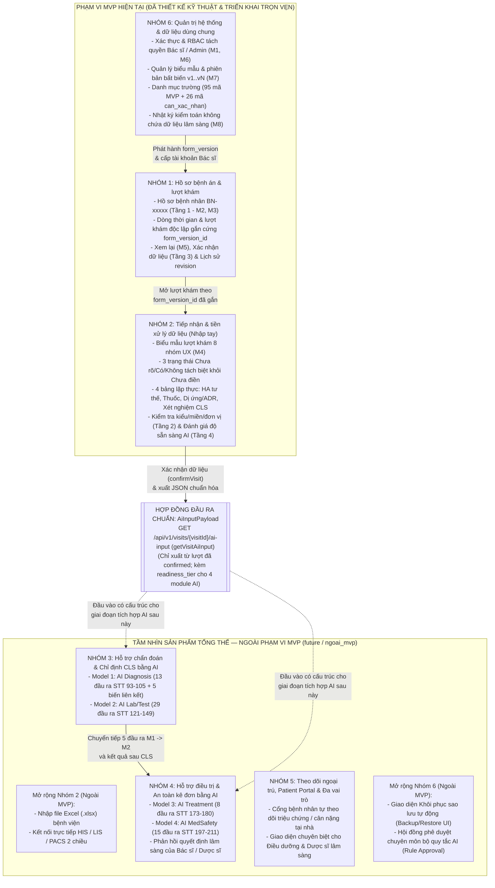

# Phạm vi sản phẩm · HFCARE MVP

- **Dự án:** Hệ thống Thu thập, Kiểm tra, Lưu trữ và Xác nhận Dữ liệu Lâm sàng Bệnh nhân Suy tim có Cấu trúc (Trước AI)
- **Nhóm thực hiện:** Nhóm 27 (`suy_tim_nhom27`) — Chặng C (`W4 docs-rtm-architect`)
- **Ngày cập nhật:** `2026-11-21`
- **Căn cứ khóa cứng:**
  - `CONTRACT.md` — Hợp đồng kiến trúc & đặt tên Chặng C (Chốt `K1`–`K10`, Mục 1–4).
  - `BAN-GIAO-DEV-web-suy-tim-hai-luong-2026-11-19.md` — Mục 1, 2, 3, 4, 6, 8, 9.
  - Hồ sơ kiểm kê nguồn Chặng A (`source-inventory.md`, `module-io-tl03.md`, `coverage-by-source.md`, `mvp-groups-proposal.md`) và Đặc tả UX/UI Chặng B (`01-dac-ta-hai-luong-ux-ui.md`, `02-ma-tran-man-hinh-thao-tac-du-lieu.md`).
  - Tài liệu trên `HEAD` (`8ba44c5a78eab921faf549f97cee3d21088770c1`) của nhánh `submit/suy_tim-nhom27`: `submissions/suy_tim_nhom27/docs/SRS_v1.0.md`.

---

## 1. Bối cảnh và Nguyên tắc Phân định Phạm vi

Trong các tài liệu giai đoạn Tuần 2–3 (`SRS_v1.0.md`, `Bao_cao_tuan3.md`), hệ thống được mô tả theo **tầm nhìn hệ thống hỗ trợ quyết định lâm sàng (AI-CDSS) toàn diện** xoay quanh 4 phân hệ AI (`Diagnosis`, `Lab/Test`, `Treatment`, `MedSafety`) chạy bản mẫu `stub` trong bộ nhớ RAM với 11 chỉ số minh họa.

Tuy nhiên, theo định hướng thiết kế lại đã chốt tại **Mục 1 & Mục 6.4 của `BAN-GIAO-DEV-web-suy-tim-hai-luong-2026-11-19.md`** và **Chốt `K1`–`K10` của `CONTRACT.md`**:
1. **Mục tiêu cốt lõi của MVP hiện tại:** Xây dựng **ứng dụng web độc lập để thu thập, kiểm tra, lưu trữ và xác nhận dữ liệu bệnh nhân suy tim có cấu trúc**, đóng vai trò tầng dữ liệu nguồn đáng tin cậy (có kiểm soát phiên bản biểu mẫu, lịch sử chỉnh sửa và nhật ký kiểm toán) để cung cấp **hợp đồng dữ liệu đầu vào chuẩn (`AiInputPayload`)** cho nhóm phát triển 4 module AI tích hợp ở giai đoạn sau.
2. **Không xóa bỏ tầm nhìn dài hạn, nhưng không mô tả giả là đã code trong MVP:** Sơ đồ phân cấp 6 nhóm chức năng mô tả **sản phẩm tổng thể dài hạn**. Bản MVP hiện tại chỉ tập trung giải quyết trọn vẹn và thực chất **Nhóm chức năng 1, Nhóm chức năng 2 (phần nhập tay có cấu trúc & xuất hợp đồng đầu vào AI) và Nhóm chức năng 6 (phần quản trị tài khoản, biểu mẫu có phiên bản & nhật ký hệ thống)**.
3. **Loại bỏ triệt để các thành phần giả lập hoặc vượt phạm vi khỏi MVP (`Chốt K9`):** Không có endpoint, bảng CSDL, lớp UML hay màn hình UI nào trong MVP thực hiện nhập file Excel/HIS, cổng bệnh nhân (Patient Portal), hay chạy/trả kết quả dự đoán AI giả (`stub`/`mock`).

> [!IMPORTANT]
> **Ghi chú minh bạch về nguồn định nghĩa 6 nhóm chức năng & tên 4 module AI (theo `CONTRACT.md` §1.2 – §1.3):**
> - **Tên nguyên văn Nhóm 1, Nhóm 2, Nhóm 6** được trích dẫn chính xác từ **Mục 1 `BAN-GIAO-DEV-web-suy-tim-hai-luong-2026-11-19.md`**:
>   - **Nhóm 1:** *Hồ sơ bệnh án và lượt khám*
>   - **Nhóm 2:** *Tiếp nhận và tiền xử lý dữ liệu*
>   - **Nhóm 6:** *Quản trị hệ thống và dữ liệu dùng chung*
> - **Tên nguyên văn 4 module AI** được trích dẫn chính xác từ **`TL03` (`SUY TIM (3).docx`)** và **`TL06` (`DATA_DICTIONARY_SUY_TIM_AI_CDSS- sửa (2).xlsx`)**:
>   - `MODEL 1: AI DIAGNOSIS – HỖ TRỢ CHẨN ĐOÁN` (mã kỹ thuật trong `field_ai_module.ai_module_code`: `ai_diagnosis` / `ai_module_1`)
>   - `MODEL 2: AI LAB/TEST – GỢI Ý CHỈ ĐỊNH TỪ KẾT QUẢ CẬN LÂM SÀNG` (mã kỹ thuật: `ai_lab_test` / `ai_module_2`)
>   - `MODEL 3: AI TREATMENT – HỖ TRỢ ĐIỀU TRỊ VÀ CÁ THỂ HÓA (THEO GUIDELINE CỦA BYT)` (mã kỹ thuật: `ai_treatment` / `ai_module_3`)
>   - `MODEL 4: AI MEDSAFETY – CẢNH BÁO TƯƠNG TÁC THUỐC VÀ AN TOÀN KÊ ĐƠN` (mã kỹ thuật: `ai_medsafety` / `ai_module_4`)
> - **Tên phân rã chi tiết của Nhóm 3, Nhóm 4, Nhóm 5 trong sơ đồ 6 nhóm:** Do hai tệp quy trình khám chữa bệnh **`QT01`, `QT02`** và sơ đồ phân cấp 6 nhóm gốc trên Drive hiện **chưa được cung cấp (`nguon_chua_co`)**, tên của Nhóm 3, Nhóm 4 và Nhóm 5 dưới đây được tổng hợp bám sát ranh giới tại `BAN-GIAO` (Mục 1, 6.2, 6.4), `TL03`, `TL04` và `SRS_v1.0.md`, đồng thời đánh dấu rõ trạng thái nguồn `nguon_chua_co` đối với phần phụ thuộc `QT01/QT02`.

---

## 2. Sơ đồ Kiến trúc Phạm vi: Tầm nhìn Tổng thể 6 Nhóm vs Ranh giới MVP (Nhóm 1, 2, 6)

---

## 3. Bảng Phân định Chi tiết 6 Nhóm Chức năng (Tầm nhìn Tổng thể vs Phạm vi MVP)

| Nhóm chức năng | Định nghĩa & Nguồn tham chiếu | Hạng mục thuộc Phạm vi **MVP** (`Trong MVP — Đã thiết kế CSDL / API / UX`) | Hạng mục thuộc **Tầm nhìn Dài hạn / Ngoài MVP** (`future / ngoai_mvp`) | Lý do & Ranh giới kỹ thuật bắt buộc (`CONTRACT.md` & `BAN-GIAO`) |
|---|---|---|---|---|
| **Nhóm 1: Hồ sơ bệnh án và lượt khám** | Quản lý hồ sơ hành chính người bệnh suy tim, dòng thời gian khám chữa bệnh và vòng đời lượt khám. *Nguồn:* `BAN-GIAO` §1, §3, §4.1; `TL04` Bảng 1; `TL05` Sheet 1. | - Tìm kiếm, liệt kê và tạo hồ sơ bệnh nhân với mã tự sinh `BN-\d{5}` (`patient_code`), tên hiển thị/giả lập, giới tính, ngày sinh/năm sinh/tuổi giữ đúng độ chính xác (`Tầng 1`). - Cập nhật thông tin hành chính có kiểm soát đồng thời (`If-Match` / `row_version`). - Xem trang hồ sơ BN, tóm tắt lâm sàng có gắn nguồn lượt khám (chỉ hiện khi có ghi nhận) và timeline các lượt khám (`listPatientVisits`). - Tạo lượt khám mới (`createVisit`) gắn cứng `form_version_id` đang `published`, tuyệt đối không tự chép số đo cũ sang lượt mới. - Quy trình 3 bước tách biệt: **Lưu nháp (`saveVisitDraft`) → Xem lại (`getVisitReview`) → Xác nhận dữ liệu (`confirmVisit`)**. - Quản lý lịch sử phiên bản dữ liệu lượt khám (`visit_revision` / `createVisitRevision`) khi sửa sau xác nhận, giữ nguyên bản đã xác nhận trước đó. | - Quản lý đợt điều trị nội trú dài ngày có giường bệnh/buồng bệnh, chuyển khoa/chuyển viện. - Đồng bộ tự động danh sách lượt khám từ hệ thống HIS bệnh viện. - Đối chiếu thời điểm tạo/cập nhật lượt theo sơ đồ quy trình viện `QT01`, `QT02` *(đánh dấu `nguon_chua_co`)*. | Đảm bảo mỗi bệnh nhân có một mã `BN-xxxxx` duy nhất (`K10`), mỗi lượt khám là một bản ghi độc lập gắn cứng phiên bản biểu mẫu tại thời điểm tạo (`K3`), xác nhận dữ liệu là xác nhận tính đúng đắn của dữ liệu thu thập tại lượt khám chứ không phải xác nhận chẩn đoán hay phác đồ điều trị. |
| **Nhóm 2: Tiếp nhận và tiền xử lý dữ liệu** | Thu thập dữ liệu lâm sàng/cận lâm sàng/thuốc/lão khoa, chuẩn hóa kiểu, kiểm tra miền giá trị, xử lý dữ liệu thiếu và đóng gói đầu vào chuẩn cho AI. *Nguồn:* `BAN-GIAO` §1, §2, §3; `TL01`–`TL06`; `XLS` (chỉ đối chiếu cấu trúc). | - **Nhập tay có cấu trúc** trên biểu mẫu 8 nhóm UX (`hanh_chinh`, `trieu_chung_dien_bien`, `sinh_ton_kham`, `benh_su_dong_mac`, `thuoc_di_ung`, `can_lam_sang`, `lao_khoa`, `ghi_chu`). - Biểu diễn chuẩn 3 trạng thái câu trả lời (`Chưa điền` = không có dòng `visit_value`; `Chưa rõ` = `value_state='unknown'`; `Có câu trả lời` = `value_state='answered'` kèm giá trị, kể cả `0` hoặc `false` — `Chốt K2`). - Lưu trữ chuẩn hóa 3NF cho **4 bảng con lặp**: Huyết áp theo tư thế (`visit_orthostatic_bp`), Thuốc đang dùng (`visit_medication`), Dị ứng & ADR (`visit_allergy`), Kết quả cận lâm sàng có loại/đơn vị/thời điểm (`visit_lab_result`) (`Chốt K6`). - Tách bạch mã chỉ số cận lâm sàng: `BNP` ≠ `NT-proBNP`, `Creatinin` ≠ `eGFR`, `LVEF` ≠ kết luận siêu âm (`Chốt K7`). - Tự động tính có quy tắc cho `tuổi tại lượt khám`, `BMI` (chỉ khi đủ chiều cao & cân nặng `> 0`), `số lượng thuốc đồng thời`. - Kiểm tra ràng buộc kỹ thuật Tầng 2 (cho lưu nháp khi thiếu trường lâm sàng, chặn sai kiểu/vượt miền) và Tầng 3 (`required_for_confirm`, không có dòng lặp mồ côi). - Tính toán trạng thái sẵn sàng Tầng 4 (`readiness_tier = ai_ready` theo bảng `field_ai_module`) và xuất hợp đồng **`AiInputPayload`** qua `getVisitAiInput`. | - **Luồng nhập file Excel (`.xlsx`)** trực tiếp trên giao diện web (file `XLS` bệnh viện chỉ dùng ở Chặng A để đối chiếu tên cột/đơn vị). - **Tích hợp trực tiếp HIS / LIS / PACS / FHIR** để tự động kéo kết quả xét nghiệm, điện tim, siêu âm hoặc đẩy dữ liệu ngược về bệnh viện. - Kích hoạt tự động `26` mã trường `can_xac_nhan` trên biểu mẫu chính trước khi nhóm AI và bệnh viện chốt thang đo/ngưỡng. | Tuân thủ `Chốt K1, K2, K6, K7, K9`: Tập trung làm sạch dữ liệu ngay từ khâu bác sĩ nhập tay; khắc phục triệt để lỗi tự biến ô trống thành `0` hoặc `"Không"` từng xảy ra ở luồng import Excel cũ; tách biệt hoàn toàn điều kiện xác nhận dữ liệu (Tầng 3) với điều kiện đủ tham số cho từng module AI (Tầng 4). |
| **Nhóm 3: Hỗ trợ chẩn đoán & Gợi ý chỉ định cận lâm sàng bằng AI** | Phân tích dữ liệu lượt khám để ước tính khả năng suy tim, phân giai đoạn A–D, kiểu hình EF, cảnh báo cấp cứu/giả suy tim và đề xuất xét nghiệm cần làm theo mức ưu tiên. *Nguồn:* `TL03` `[P2–P200]`; `TL04` Bảng 2–3; `TL06` `STT 93–110, 121–149`; `SRS_v1.0.md` `FR-08..FR-15`. | - **Không triển khai xử lý AI hoặc giao diện kết quả AI trong MVP.** - Phần duy nhất thuộc MVP phục vụ Nhóm 3 là: lưu ánh xạ trường đầu vào với `ai_diagnosis` (`ai_module_1`) và `ai_lab_test` (`ai_module_2`) trong bảng `field_ai_module`, và trả danh sách `missingFieldCodes[]` kèm cờ `ready` trong `AiInputPayload.modules[]` của endpoint `getVisitAiInput`. | - **`MODEL 1: AI DIAGNOSIS – HỖ TRỢ CHẨN ĐOÁN`** (`13` biến đầu ra `STT 93–105`: xác suất/giai đoạn A–D, kiểu hình EF, bệnh cảnh cấp/mạn/worsening/decompensated, xếp hạng nguyên nhân, cảnh báo giả suy tim, frailty, dự báo 6 nguy cơ, cảnh báo cấp cứu). - **Cầu nối `Model 1 → Model 2`** (`5` biến đầu ra M1 làm đầu vào M2 `STT 106–110`). - **`MODEL 2: AI LAB/TEST – GỢI Ý CHỈ ĐỊNH TỪ KẾT QUẢ CẬN LÂM SÀNG`** (`29` biến đầu ra `STT 121–149`: gợi ý 12 XN cơ bản, 7 XN nguyên nhân, 6 XN phân biệt, phân loại kết quả, xếp mức ưu tiên cấp cứu/24h/đợt khám/định kỳ, cảnh báo chống chỉ định xâm lấn). | Tuân thủ `Chốt K9` và Mục 1 `BAN-GIAO`: Không chạy hoặc tạo kết quả giả cho `Diagnosis` và `Lab/Test`; không đưa `13 + 5 + 29 = 47` dòng kết quả AI này thành trường nhập tay của bác sĩ trên biểu mẫu. |
| **Nhóm 4: Hỗ trợ điều trị cá thể hóa & Cảnh báo an toàn kê đơn bằng AI** | Đề xuất hướng điều trị theo giai đoạn A–D / kiểu hình EF, cá thể hóa cho người cao tuổi, kiểm tra tương tác thuốc, chống chỉ định, sai liều và ghi nhận quyết định của bác sĩ. *Nguồn:* `TL03` `[P201–P342]`; `TL04` Bảng 4–5; `TL06` `STT 173–180, 197–211`; `SRS_v1.0.md` `FR-16..FR-23`. | - **Không triển khai xử lý AI điều trị/cảnh báo thuốc hoặc luồng duyệt khuyến nghị AI trong MVP.** - Phần duy nhất thuộc MVP phục vụ Nhóm 4 là: thu thập đầy đủ danh sách thuốc đang dùng (kê đơn + OTC/TPCN/YHCT), dị ứng/ADR/không dung nạp thuốc, chức năng thận (`Creatinin`, `eGFR`), điện giải (`Kali`, `Natri`), huyết áp tư thế và đặc điểm lão khoa; kiểm tra độ sẵn sàng đầu vào cho `ai_treatment` (`ai_module_3`) và `ai_medsafety` (`ai_module_4`) trong `getVisitAiInput`. | - **`MODEL 3: AI TREATMENT – HỖ TRỢ ĐIỀU TRỊ VÀ CÁ THỂ HÓA (THEO GUIDELINE CỦA BYT)`** (`8` biến đầu ra `STT 173–180`: điều trị Stage A/B/C/D, tứ trụ theo EF, cá thể hóa người cao tuổi, xử trí worsening/decompensated HF, kế hoạch theo dõi). - **`MODEL 4: AI MEDSAFETY – CẢNH BÁO TƯƠNG TÁC THUỐC VÀ AN TOÀN KÊ ĐƠN`** (`15` biến đầu ra `STT 197–211`: phát hiện đa thuốc, tương tác thuốc–thuốc/thuốc–bệnh, chống chỉ định, sai liều, chỉnh liều theo eGFR/gan/HA/frailty, cảnh báo 11 nguy cơ, cảnh báo NSAID/tăng kali/digoxin, đơn giản hóa phác đồ, phân tầng cảnh báo). - Luồng bác sĩ chấp nhận / điều chỉnh / từ chối khuyến nghị AI kèm lý do (`STT 211` `xac_nhan_bac_si`, `FR-22..FR-23`). | Tuân thủ `Chốt K9` và Mục 1 `BAN-GIAO`: Không sinh cảnh báo thuốc giả hay gợi ý phác đồ giả khi chưa tích hợp module AI thật; không đưa `8 + 15 = 23` dòng đầu ra của Model 3 & Model 4 vào biểu mẫu nhập liệu MVP. |
| **Nhóm 5: Theo dõi dọc ngoại trú, Cổng thông tin bệnh nhân (Patient Portal) & Phối hợp đa vai trò mở rộng** | Mở rộng hệ thống cho bệnh nhân ngoại trú tự theo dõi tại nhà và phối hợp liên chuyên khoa (Bác sĩ – Điều dưỡng – Dược sĩ – Người chăm sóc). *Nguồn:* `BAN-GIAO` §1, §6.2, §6.4; `SRS_v1.0.md` §2.2. | - **Không có tính năng nào của Nhóm 5 trong MVP.** - Trong MVP, thông tin người chăm sóc, khả năng tuân thủ tái khám và khả năng tự sử dụng thuốc được **bác sĩ hỏi và ghi nhận trực tiếp** trong Nhóm 7 (`lao_khoa`) của biểu mẫu lượt khám. | - **Cổng thông tin bệnh nhân (Patient Portal / Mobile App):** Bệnh nhân hoặc người chăm sóc tự nhập cân nặng hàng ngày, huyết áp tại nhà, triệu chứng khó thở/phù và lịch uống thuốc. - **Cổng làm việc chuyên biệt cho Dược sĩ lâm sàng (`pharmacist`) và Điều dưỡng (`nurse`):** Dược sĩ duyệt đơn thuốc độc lập, điều dưỡng nhập sinh hiệu/chăm sóc theo ca. - Cảnh báo sớm mất bù ngoại trú, nhắc lịch tái khám và xuất báo cáo tóm tắt cho bệnh nhân (`FR-26`). | Tuân thủ `Chốt K9` và Mục 1 `BAN-GIAO`: *"Không có portal bệnh nhân, điều dưỡng, dược sĩ trong demo sớm"*; MVP chỉ có đúng 2 vai trò đăng nhập là **Bác sĩ (`doctor`)** và **Quản trị viên (`admin`)**. |
| **Nhóm 6: Quản trị hệ thống và dữ liệu dùng chung** | Quản lý định danh, xác thực, phân quyền truy cập, cấu hình danh mục dữ liệu y tế dùng chung, quản lý phiên bản biểu mẫu và nhật ký kiểm toán hệ thống. *Nguồn:* `BAN-GIAO` §1, §3.2, §4.2; `CONTRACT.md` `K3, K4, K8`. | - **Xác thực & Phiên làm việc (M1):** Một màn đăng nhập chung (`login`, `refreshToken`, `logout`, `getCurrentUser`); server quyết định vai trò (`doctor` hoặc `admin`). - **Quản lý tài khoản & Quyền (M6):** Admin xem danh sách (`listUsers`), xem chi tiết (`getUser`), xem trước quyền trước khi lưu (`previewUserPermissions`), tạo tài khoản bác sĩ (`createUser`), cập nhật/khóa/mở khóa/đặt lại mật khẩu (`updateUser`). - **Tách biệt quyền lâm sàng (`Chốt K8`):** Role `admin` bị chặn hoàn toàn (`403 Forbidden`) ở mọi API đọc/ghi bệnh nhân và lượt khám lâm sàng. - **Quản lý biểu mẫu & Dữ liệu dùng chung (M7):** Xem danh mục trường chuẩn (`listFieldDefinitions`), danh sách biểu mẫu & phiên bản (`listForms`, `listFormVersions`, `getFormVersion`), tạo bản nháp từ bản hiện hành (`createFormVersionDraft`), chỉnh sửa bản nháp (`updateFormVersion`), xem trước dưới góc nhìn bác sĩ (`previewFormVersion`), so sánh thay đổi (`diffFormVersion`) và phát hành phiên bản mới (`publishFormVersion`). Khóa bất biến bản `published` bằng trigger CSDL (`Chốt K4`). - **Tra cứu nhật ký hệ thống (M8):** Admin tra cứu `audit_log` (`listAuditLogs`) theo người, thời điểm, đối tượng, hành động; `detail` JSONB tuyệt đối không chứa mật khẩu hay dữ liệu lâm sàng. | - **Giao diện Sao lưu & Khôi phục dữ liệu tự động (Backup & Restore UI):** Theo `BAN-GIAO` §4.2.5, không dựng nút *"Khôi phục"* giả trên giao diện khi chưa có quy trình vận hành, phân quyền đặc biệt và môi trường chạy thử an toàn. - **Quản trị vòng đời bộ quy tắc AI (`Rule Engine Versioning & Clinical Approval` — `FR-27` cũ):** Tạo/kiểm thử/phê duyệt chuyên môn các ngưỡng suy luận của 4 module AI (thuộc giai đoạn sau khi nối AI). | Tuân thủ `Chốt K3, K4, K8` và Mục 4.2 `BAN-GIAO`: Đảm bảo Admin vận hành được toàn bộ cấu hình biểu mẫu và tài khoản bác sĩ mà không vi phạm quyền riêng tư bệnh án lâm sàng, đồng thời bảo toàn tính bất biến của các phiên bản biểu mẫu đã phát hành. |

---

## 4. Tổng hợp Định lượng Phạm vi Dữ liệu Từ điển `TL06` (206 dòng) sang Thiết kế MVP

Để đảm bảo không một biến đầu ra AI nào lọt vào biểu mẫu nhập tay của bác sĩ (`CONTRACT.md` §1.1), toàn bộ `206` dòng của `TL06` (`141` dòng đầu vào + `65` dòng đầu ra) đã được đối chiếu và khóa phạm vi như sau:

| Phân nhóm phạm vi dữ liệu | Số dòng trong `TL06` | Số mã trường đích (`field_definition.code`) | Cách xử lý trong CSDL (`stage-c/database/`) & API (`stage-c/api/`) |
|---|---:|---:|---|
| **1. Trường nhập tay / tự tính trong MVP (`scope_status = 'mvp'`)** | **`99` dòng** *(100% thuộc 141 dòng đầu vào)* | **`95` mã đích** *(do nhiều dòng M2–M4 tái sử dụng chung trường với M1)* | Nạp đầy đủ vào `field_definition` (với `scope_status = 'mvp'`), `field_option`, `field_ai_module` và gắn vào 8 `form_section` của `form_version` `v1` (`published`) trong `seed.sql` (+ các trường biểu diễn qua 4 bảng con lặp `visit_orthostatic_bp`, `visit_medication`, `visit_allergy`, `visit_lab_result`). |
| **2. Trường đầu vào chờ nhóm AI / Bệnh viện chốt (`scope_status = 'can_xac_nhan'`)** | **`37` dòng** *(100% thuộc 141 dòng đầu vào)* | **`26` mã đích** | Nạp vào danh mục `field_definition` với `scope_status = 'can_xac_nhan'` (theo mặc định Q2 tại `CONTRACT.md` §3 & §5), **không** bật `required_for_confirm` ở Tầng 3 và không tự bịa thang điểm lão khoa hay ngưỡng phân loại. |
| **3. Đầu ra của 4 module AI & biến liên kết AI (`giai_doan_sau` / `ngoai_mvp`)** | **`70` dòng** *(`65` dòng chiều `Đầu ra` + `5` dòng `STT 106–110` kết quả `AI Diagnosis` chuyển sang `AI Lab/Test`)* | **`0` mã trong `field_definition` MVP** *(70 mã `ai_*` giữ ở tài liệu tầm nhìn)* | **Loại bỏ 100% khỏi `seed.sql` và biểu mẫu nhập tay MVP.** Kiểm thử tĩnh CSDL chứng minh `0` mã nào trong `field_definition` xuất phát từ 65 dòng đầu ra AI hay 5 dòng liên kết kết quả AI. |
| **TỔNG CỘNG** | **`206` dòng** | **`121` mã trong catalog (`95 mvp + 26 can_xac_nhan`)** | Khớp tuyệt đối công thức nghiệm thu BOSS: `141 + 65 = 206` và `99 + 37 + 70 = 206`. |

---

## 5. Tài liệu MVP trong repository

| Tài liệu | Nội dung |
| --- | --- |
| [SRS](SRS.md) | Yêu cầu chức năng, phi chức năng và quy tắc nghiệp vụ |
| [User Stories và Use Cases](Use_Cases.md) | Luồng bác sĩ và quản trị, kèm tiêu chí nghiệm thu |
| [RTM](RTM.md) · [Excel](RTM.xlsx) | Truy vết yêu cầu, API, dữ liệu và ca kiểm thử |
| [Kiến trúc phần mềm và UML](architecture/Software_Architecture.md) | Kiến trúc, ERD, sơ đồ lớp và sơ đồ tuần tự |
| [Từ điển dữ liệu](../database/data_dictionary.md) · [ERD](../database/erd.md) · [Ánh xạ nguồn](../database/source_mapping.md) | Lược đồ PostgreSQL và ánh xạ dữ liệu đầu vào |
| [Hợp đồng REST API](../api/README.md) · [OpenAPI](../api/openapi.yaml) | Endpoint, phân quyền và cấu trúc dữ liệu |
