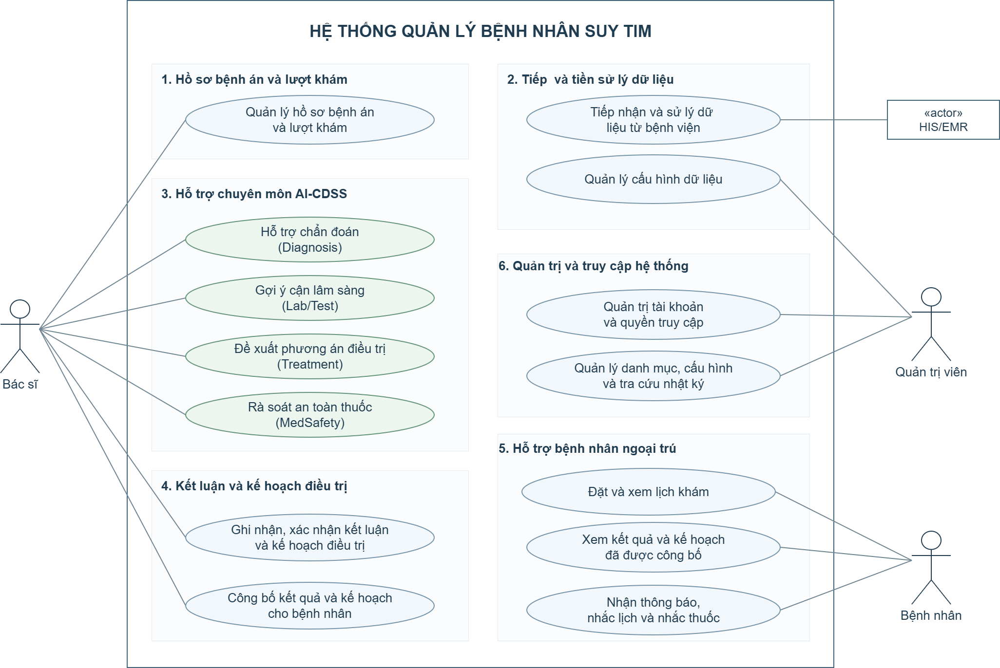
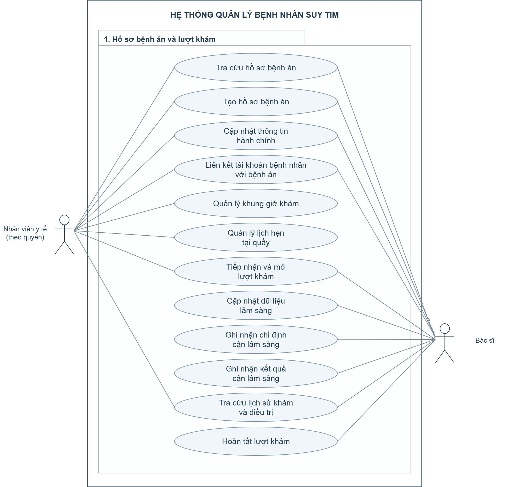
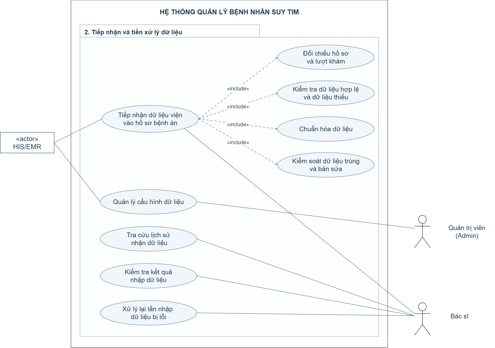
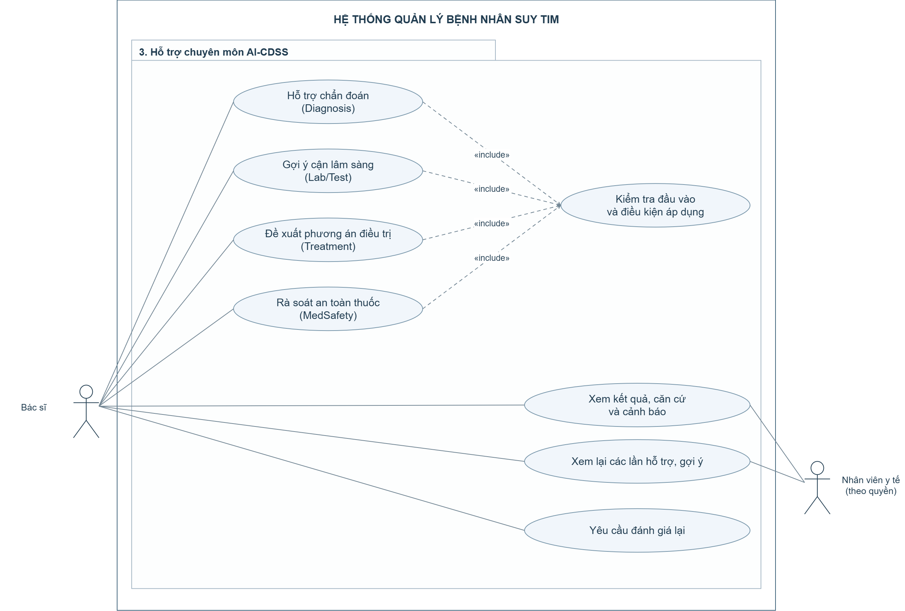
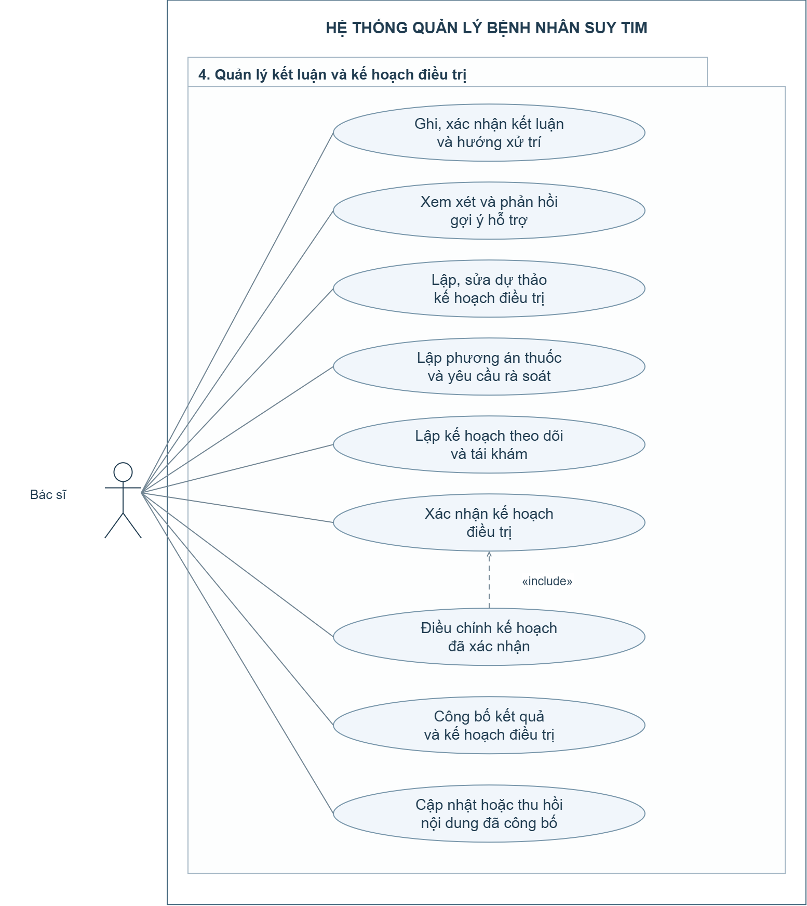
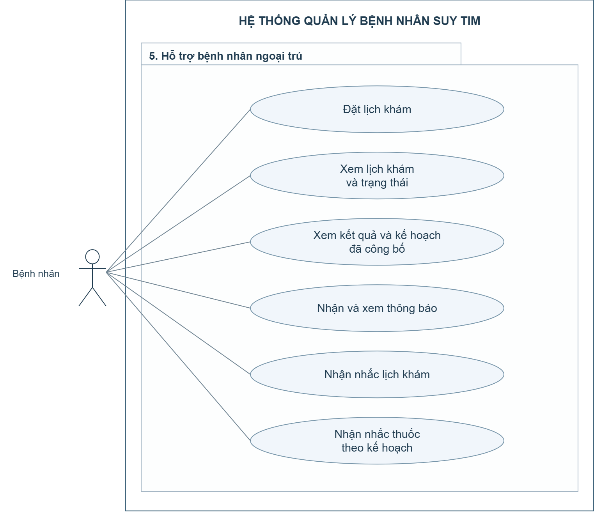
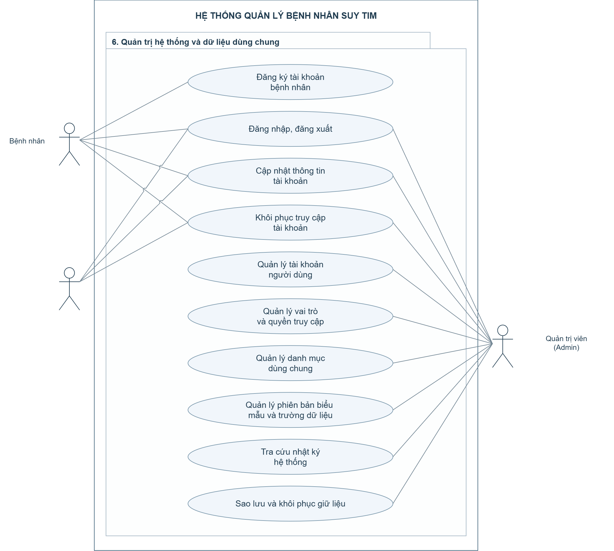
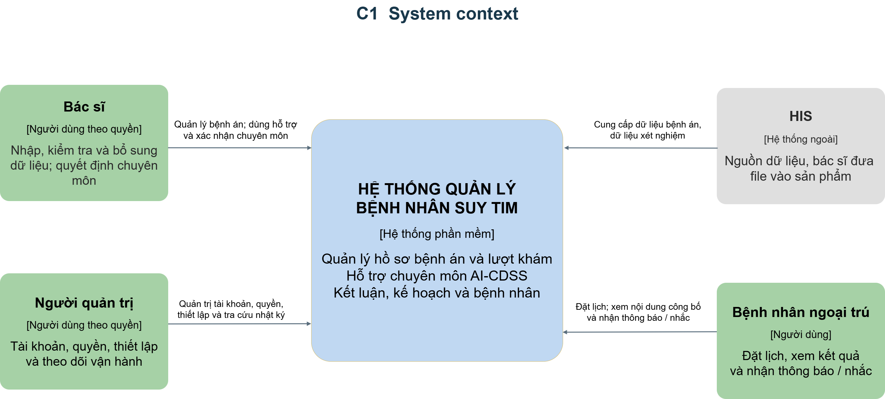
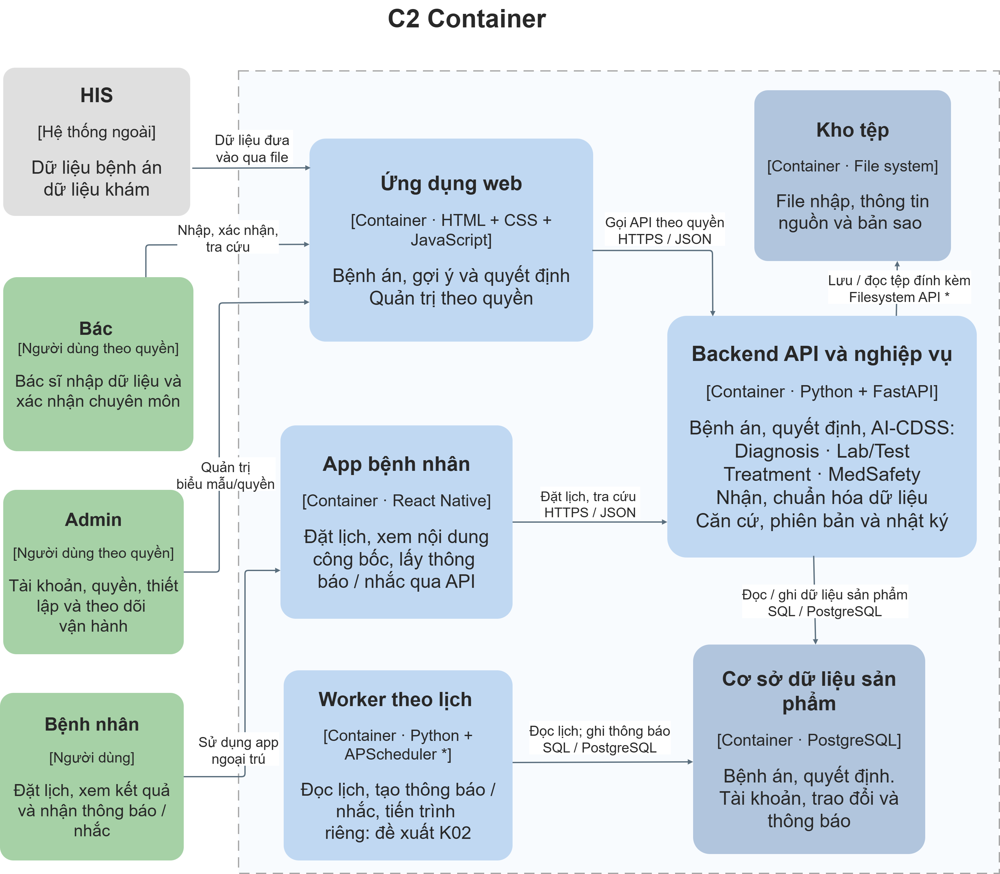

# Đặc tả yêu cầu phần mềm SRS

Hệ thống quản lý bệnh nhân suy tim

Nhóm 27  |  Môn Kỹ thuật phần mềm ứng dụng  |  Phiên bản 1.0  |  Ngày 31/10/2026

Tài liệu xác định phạm vi, hành vi và tiêu chí kiểm tra của sản phẩm để trưởng nhóm, giảng viên, bên chuyên môn và nhóm phát triển cùng rà soát. Nền tảng hồ sơ, biểu mẫu, nhập file và quản trị được xây trước; AI và chức năng bệnh nhân phát triển theo giai đoạn. Bản SRS này chưa là biên bản nghiệm thu hoặc phê duyệt triển khai tại bệnh viện.

## Mục lục

- [1 Giới thiệu](#gioi-thieu)
- [2 Mô tả tổng quan](#tong-quan)
- [3 Yêu cầu giao diện](#giao-dien)
- [4 Yêu cầu chức năng](#chuc-nang)
- [5 Yêu cầu dữ liệu](#du-lieu)
- [6 Quy tắc nghiệp vụ và trạng thái](#quy-tac)
- [7 Yêu cầu phi chức năng](#phi-chuc-nang)
- [8 Use Case và User Story](#use-case-story)
- [9 Tiêu chí nghiệm thu](#nghiem-thu)
- [10 Ma trận truy vết yêu cầu](#truy-vet)
- [11 Vấn đề còn mở và kiểm soát thay đổi](#van-de-mo)
- [12 Tài liệu tham chiếu và phụ lục](#tham-chieu)
- [Use Case tổng quan](#uc-tong-quan)
- [Sáu nhóm Use Case chi tiết](#uc-chi-tiet)
- [C1 Ngữ cảnh hệ thống](#kien-truc-c1)
- [C2 Các container](#kien-truc-c2)

## 1 Giới thiệu

### 1.1 Mục đích và người đọc

SRS là căn cứ thiết kế, lập trình, xây bộ ca thử và đánh giá sản phẩm. Trưởng nhóm dùng để kiểm soát thay đổi; giảng viên và bệnh viện kiểm tra phạm vi/nghiệp vụ; nhóm phát triển dùng mã yêu cầu và tiêu chí nghiệm thu để hiện thực. ERD, API chi tiết, giao diện màn hình và thuật toán cụ thể được thiết kế từ các yêu cầu này.

### 1.2 Phạm vi và trạng thái nội dung

Sản phẩm là web chuyên suy tim, lấy hồ sơ và dữ liệu theo lượt khám làm trung tâm, có biểu mẫu nhập tay và tiếp nhận file vào cùng bệnh án. Bốn module Diagnosis, Lab/Test, Treatment và MedSafety hỗ trợ bác sĩ; quyết định chuyên môn được bác sĩ xác nhận và lưu tại sản phẩm. App ngoại trú phục vụ các chức năng bệnh nhân được triển khai sau.

| Trạng thái | Nội dung |
| --- | --- |
| Định hướng đã thống nhất | Tên mô tả sản phẩm; sáu nhóm chức năng; nguồn file từ HIS qua bác sĩ; một trang đăng nhập theo vai trò; ưu tiên nhánh 1, 2, 6; giữ bác sĩ quyết định cuối cùng. |
| Đặc tả để rà soát | Các bảng FR/NFR/UC/US, quy tắc dữ liệu, phân quyền và nghiệm thu tổng hợp trong SRS. Chỉ được coi là baseline khi trưởng nhóm chốt phần tương ứng. |
| Điều kiện chưa chốt | Chi tiết file/mẫu, ngưỡng đo hiệu năng, điều kiện hoàn tất/xác nhận, bộ quy tắc y khoa và kênh nhắc được quản lý ở mục 11; chưa được tự coi là đã xác nhận. |

Không mở rộng thành hệ thống quản lý toàn viện hoặc đủ năm bệnh. Nội trú ở mức liên kết/tóm tắt được cung cấp; chưa đi sâu giường bệnh, thực hiện thuốc và chăm sóc hằng ngày. Người chăm sóc, nhật ký uống thuốc/tuân thủ, thanh toán và chọn bác sĩ chưa thuộc phạm vi được cam kết.

### 1.3 Thuật ngữ và quy ước

| Thuật ngữ | Ý nghĩa trong SRS |
| --- | --- |
| SRS | Đặc tả yêu cầu phần mềm; FR là yêu cầu chức năng, NFR là yêu cầu chất lượng/ràng buộc. |
| Hồ sơ bệnh nhân và bệnh án | Hồ sơ định danh người bệnh và dữ liệu khám/điều trị theo thời gian. Trên giao diện dùng “Hồ sơ bệnh nhân”; dữ liệu chuyên môn của từng lượt nằm trong hồ sơ bệnh án. |
| Lượt khám | Đơn vị ghi nhận lần khám/đánh giá, có mã, thời điểm, trạng thái và phiên bản mẫu; khác một lịch hẹn. |
| HIS, LIS, PACS/RIS, EMR | HIS: thông tin bệnh viện; LIS: xét nghiệm; PACS/RIS: ảnh/chẩn đoán hình ảnh; EMR: bệnh án điện tử. Hiện HIS được xét là nguồn file, không phải kết nối API. |
| AI-CDSS | Hỗ trợ quyết định lâm sàng. Từ “AI/module” chưa đồng nghĩa đã có mô hình học máy huấn luyện hoặc đã kiểm định. |
| NULL | Chưa có/chưa biết/chưa đánh giá theo định nghĩa trường; khác 0, Không, không áp dụng và danh sách đã xác nhận rỗng. |
| Xác nhận và công bố | Xác nhận nhập: ghi dữ liệu file; xác nhận chuyên môn: quyết định bác sĩ; công bố: cấp phạm vi nội dung cho bệnh nhân. |
| Phiên bản và hiệu lực | Phiên bản nhận diện cấu trúc/nội dung đã dùng; hiệu lực xác định bản được áp dụng theo thời điểm. |
| UC, US, BDD, RTM | Use Case; User Story; kịch bản Given–When–Then; ma trận liên kết yêu cầu với mục tiêu, ca sử dụng, kiểm tra và thành phần liên quan. |

Mỗi dòng FR biểu thị hành vi phần mềm cần hỗ trợ trong giai đoạn áp dụng. Mã FR01–FR46 và NFR01–NFR13 được giữ để truy vết; Use Case theo bộ ảnh trưởng nhóm cung cấp và đặc tả v0.4. Mã US và UC có khoảng trống do giữ lịch sử, không đánh lại mã để lấp chỗ.

### 1.4 Phiên bản và căn cứ

SRS 1.0 đồng bộ nội dung theo nguyên bộ bảy ảnh Use Case trưởng nhóm cung cấp: 54 ca thuộc sáu nhóm, cùng hai sơ đồ C1/C2 đã thống nhất ngày 31/10. Tên chức năng, phạm vi tác nhân, luồng nhập file, quan hệ include và mức gộp các ca được thống nhất trong danh mục, đặc tả v0.4 và RTM.

## 2 Mô tả tổng quan

### 2.1 Bối cảnh và ranh giới sản phẩm

Dữ liệu được thu thập trên biểu mẫu suy tim. Bác sĩ tạo/chọn hồ sơ và lượt, nhập tay hoặc tải file từ HIS, kiểm tra và bổ sung phần thiếu trước khi sử dụng. File được xem trước rồi xác nhận ghi vào bệnh án sản phẩm. Trong bản demo, bệnh án của sản phẩm là nơi lưu/cập nhật; chưa mô phỏng HIS/LIS/PACS, mở ca từ HIS hoặc ghi trả viện.

Dữ liệu đã ghi là nguồn dùng chung của bốn module. Lab/Test gợi ý cận lâm sàng; kết quả thực hiện được ghi nhận hoặc nhập qua file; bác sĩ đánh giá lại, lập và xác nhận quyết định. Mục tiêu giảm thời gian đánh giá và lựa chọn xét nghiệm cần được đo trên bộ ca phù hợp; chưa gắn một tỷ lệ cải thiện khi chưa có bằng chứng.

### 2.2 Sáu nhóm chức năng

| Nhóm | Phạm vi |
| --- | --- |
| Quản lý hồ sơ bệnh án, lượt khám | Quản lý thông tin người bệnh, lịch/lượt, dữ liệu khám và lịch sử. |
| Tiếp nhận và tiền xử lý dữ liệu | Nhận file, đối chiếu, kiểm tra/chuẩn hóa, xác nhận nhập và theo dõi lần nhập. |
| Hỗ trợ chuyên môn AI-CDSS | Bốn module hỗ trợ và kết quả/căn cứ/cảnh báo có phiên bản. |
| Quản lý kết luận và kế hoạch điều trị | Bác sĩ ghi kết luận, lập/chỉnh/xác nhận kế hoạch và công bố. |
| Hỗ trợ bệnh nhân ngoại trú | Đặt/xem lịch, xem thông tin công bố, nhận thông báo/nhắc. |
| Quản trị hệ thống và dữ liệu dùng chung | Tài khoản/quyền, biểu mẫu/dữ liệu chung, nhật ký và sao lưu/khôi phục. |

### 2.3 Người dùng và quyền

Tác nhân nghiệp vụ gồm Bác sĩ, Nhân viên y tế theo quyền, Admin và Bệnh nhân. Nhân viên y tế hỗ trợ các công việc được giao trên hình chi tiết; chỉ Bác sĩ xác nhận kết luận và kế hoạch. Bản demo hiện vẫn dùng hai loại tài khoản Bác sĩ và Admin; công việc hỗ trợ được cấp cho tài khoản phù hợp, chưa tạo một loại đăng nhập riêng. HIS/EMR cung cấp file và quy ước dữ liệu nguồn, không đăng nhập vào sản phẩm.

| Công việc | Bác sĩ | Nhân viên y tế theo quyền | Admin | Bệnh nhân |
| --- | --- | --- | --- | --- |
| Tra cứu/tạo bệnh án, hành chính, liên kết tài khoản | Theo quyền | Theo phân công | Quản trị theo quyền, không tự tạo thay Bác sĩ trong demo | Chỉ xem phần công bố sau xác minh |
| Khung giờ và lịch hẹn tại quầy | Khi được giao công việc hỗ trợ | Theo phân công | Quản lý theo quyền vận hành | Đặt/xem lịch của mình |
| Tiếp nhận, mở lượt và nhập lâm sàng | Theo quyền | Theo phân công | Không nhập hoặc xác nhận lâm sàng | Không |
| Ghi chỉ định/kết quả; hoàn tất lượt | Theo quyền | Không tự quyết định/chốt | Không | Không |
| Nhập file, kiểm tra kết quả, xử lý lại | Theo quyền | Không thuộc luồng nhập file đã vẽ | Cấu hình nguồn/ánh xạ | Không |
| Yêu cầu AI, ghi/xác nhận kết luận/kế hoạch | Theo quyền | Không xác nhận chuyên môn | Không | Không |
| Xem kết quả và lịch sử hỗ trợ | Theo quyền | Chỉ đọc đúng phạm vi | Không là người quyết định lâm sàng | Chỉ phần đã công bố |
| Công bố/thay thế/thu hồi | Theo quyền | Không | Không | Xem nội dung được cấp |
| Quản trị tài khoản/quyền, mẫu/danh mục, nhật ký, bản sao | Tài khoản cá nhân | Tài khoản cá nhân | Theo quyền kỹ thuật | Tài khoản cá nhân khi triển khai |

Khôi phục dữ liệu là quyền kỹ thuật có phạm vi và nhật ký, không phải quyền sửa/xác nhận chuyên môn hằng ngày. Phạm vi hồ sơ và điều kiện cấp quyền còn phải cụ thể hóa; không coi mọi bác sĩ hoặc mọi tài khoản Admin có mọi quyền.

### 2.4 Trình tự triển khai

| Giai đoạn | Phần được xây và chứng minh |
| --- | --- |
| Nền tảng nhập tay | Một trang đăng nhập Bác sĩ/Admin; tạo/chọn hồ sơ và lượt; nhập theo mẫu, lưu/mở lại; quản lý trường và phiên bản, tra dữ liệu theo quyền. |
| Hoàn thiện nền tảng | Nhập file vào cùng biểu mẫu; xem trước/đối chiếu/xác nhận; theo dõi lỗi, thử lại, nhật ký và kiểm tra sao lưu/khôi phục. Các mục lịch ở nhánh 1 được triển khai theo kế hoạch cụ thể. |
| AI và quyết định chuyên môn | Kiểm chứng lần lượt bốn module với bộ dữ liệu/quy tắc đủ điều kiện; bác sĩ xem xét, lập/chỉnh/xác nhận kết luận và kế hoạch. |
| Bệnh nhân ngoại trú | Liên kết tài khoản đã xác minh, app, lịch hẹn, nội dung công bố và nhắc. Các ca bệnh nhân tại nhánh 1/6 cũng theo giai đoạn này. |

Ưu tiên P1/P2/P3 áp dụng khi nghiệm thu phần chức năng tương ứng; không đồng nghĩa thứ tự triển khai hoặc đã hoàn thành. FR và US nhóm kết luận/kế hoạch cùng ghi P1. Trình tự xây vẫn là nhóm 1, 2, 6 trước, AI và kế hoạch sau dữ liệu ổn định, bệnh nhân sau luồng chính.

### 2.5 Môi trường và phụ thuộc

Web dùng Chrome/Edge; hướng hiện thực hiện tại là HTML/CSS/JavaScript, Backend Python/FastAPI và PostgreSQL. Bốn module nằm trong Backend theo thiết kế C2. App React Native và công việc theo lịch Python/APScheduler thuộc giai đoạn sau. Kho tệp lưu các tệp cần thiết; Docker Compose là cách đóng gói khi cấu hình được hoàn thiện, không phải một chức năng nghiệp vụ hoặc bằng chứng đã triển khai.

Dữ liệu phát triển là ca giả lập hoặc dữ liệu được bệnh viện cho phép. Cấu trúc nguồn, định danh, đơn vị, thời điểm và ý nghĩa trường phải đối chiếu tệp mẫu. Nhóm phụ thuộc nguồn chuyên môn và người rà soát để chốt thuật toán/điều kiện kiểm thử AI. Việc kết nối, nhúng hoặc sử dụng thật tại viện là phạm vi thỏa thuận riêng.

## 3 Yêu cầu giao diện

### 3.1 Giao diện người dùng

| Mã | Yêu cầu giao diện | Liên quan |
| --- | --- | --- |
| IF01 | Hệ thống dùng một trang đăng nhập, chuyển chức năng theo vai trò; có tên mô tả ứng dụng. Bác sĩ/Admin thấy cùng dữ liệu hồ sơ trong phạm vi được cấp. | FR40, FR42 |
| IF02 | Trang “Hồ sơ bệnh nhân” nhận diện mã BN và hành chính, thông tin bệnh/thuốc có thời điểm và danh sách lượt. Mở lượt vẫn hiển thị đúng người/lượt; ICD gắn ngữ cảnh lượt phù hợp. | FR01, FR04, FR07 |
| IF03 | Biểu mẫu giữ nhóm mục để tra cứu; trường nhập trình bày theo một cột dọc, có nhãn, đơn vị/lựa chọn và trạng thái thiếu phù hợp. Phải truy cập được mọi điều khiển khi cuộn/phóng to. | FR05, FR06, FR41, NFR10 |
| IF04 | Màn hình nhập file chỉ rõ nguồn, đích hồ sơ/lượt, ánh xạ đang dùng, giá trị nguồn/đích, phần lỗi/thiếu/xung đột và phần sẽ ghi. Hành động xem trước khác xác nhận nhập. | FR08–FR15 |
| IF05 | Giao diện AI phân biệt gợi ý, căn cứ, cảnh báo, phần chưa đánh giá và phiên bản. Màn hình xác nhận thể hiện đúng dự thảo, quyết định và trạng thái công bố. | FR16–FR34 |
| IF06 | App chỉ hiển thị lịch/nội dung được phép của đúng bệnh nhân; phần công bố có ngày khám, thời điểm/hiệu lực và hướng dẫn. | FR35–FR39 |

### 3.2 Giao diện nhập file

Sản phẩm phải nhận file theo đặc tả đầu vào được hỗ trợ; không suy rằng hỗ trợ mọi loại file. Admin quản lý cấu hình/ánh xạ chung; Bác sĩ chọn cấu hình, tải file, đối chiếu và xác nhận ghi. Không yêu cầu dựng hệ thống viện mô phỏng hoặc có API viện để chứng minh luồng này.

| Thông tin giao diện | Hành vi cần bảo đảm |
| --- | --- |
| Định danh đích | File/cấu hình phải chỉ rõ cách nhận diện hồ sơ/người bệnh và lượt. Mã nguồn được ánh xạ với mã BN/mã lượt đã xác minh; tên hoặc lượt đang mở chưa đủ để tự gán. |
| Nội dung và ý nghĩa | Đặc tả xác định trường/cột, kiểu, đơn vị, danh mục, ngày giờ, múi giờ khi cần và cách biểu diễn dữ liệu thiếu. Giá trị gốc/quy tắc chuyển đổi được truy vết. |
| Kết quả tiếp nhận | Có mã lần nhập và phần đã ghi/chưa ghi, lỗi/chờ/xung đột. Không thông báo thành công chỉ vì tải file hoặc xem trước được. |
| Thay đổi và thử lại | Đối chiếu lại nếu đích/cấu hình liên quan đổi. Phân biệt thử lại cùng thao tác với lần nhập mới từ cùng nội dung file. |
| Phạm vi lỗi | Báo theo phần lỗi có thể nhận diện. Lưu phần hợp lệ chỉ khi được Bác sĩ chọn/xác nhận; kết quả phản ánh đúng từng phần đã lưu. |

### 3.3 Giao diện giữa các module

Đây là hợp đồng logic bên trong sản phẩm, chưa quy định endpoint hoặc một thuật toán cụ thể. Mỗi yêu cầu hỗ trợ phải xác định hồ sơ/lượt, module, dữ liệu/phiên bản và phương pháp được phép. Kết quả lưu lần chạy, trạng thái, dữ liệu hoặc tham chiếu đầu vào, đầu ra, căn cứ/cảnh báo và phần thiếu/giới hạn. Đầu ra liên quan có thể phục vụ module sau; dữ liệu thực đo vẫn lấy từ bệnh án.

| Module | Dữ liệu sử dụng và đầu ra |
| --- | --- |
| Diagnosis | Dữ liệu lâm sàng, tiền sử, thuốc và kết quả đã có theo phạm vi áp dụng; hỗ trợ nhận định/phân loại và các đầu ra được đặc tả. |
| Lab/Test | Dữ liệu bệnh án và kết quả Diagnosis liên quan; gợi ý xét nghiệm/thăm dò, lý do và ưu tiên. Không tạo chỉ định chính thức hoặc kết quả đo. |
| Treatment | Bệnh cảnh, dữ liệu thực đo, thuốc/bệnh đồng mắc và đầu ra liên quan; gợi ý phương án, điều kiện cá thể hóa, theo dõi và giới hạn. |
| MedSafety | Thuốc đang dùng và phương án dự thảo đúng phiên bản cùng dữ liệu an toàn liên quan; cảnh báo, căn cứ và phần chưa kiểm tra được. |

### 3.4 Giao tiếp và lưu trữ

Web/app gọi Backend qua giao diện được kiểm soát; API kiểm tra quyền, dữ liệu và phiên bản. PostgreSQL và kho tệp do Backend/công việc nền có quyền truy cập, không cấp truy cập trực tiếp cho web/app. Nội dung truyền/lưu/log cần bảo vệ theo NFR02. Giao thức và endpoint chi tiết được đặc tả khi thiết kế API; không mặc định có API HIS, SSO hoặc HL7/FHIR trong bản demo.

Bệnh án sản phẩm lưu dữ liệu và quyết định; kết quả/cảnh báo AI lưu riêng theo lần chạy và tham chiếu tới dữ liệu. Lưu nội bộ không tự công bố cho bệnh nhân. Mọi đường dẫn mở nội dung hoặc tải tệp phải kiểm tra quyền hiện hành, kể cả liên kết lấy từ thông báo cũ.

## 4 Yêu cầu chức năng

Bảng có 46 mã FR, giữ cấu trúc truy vết và mức ưu tiên. Nội dung được đồng bộ theo bộ Use Case hiện hành, gồm quyền hỗ trợ nhập/xem, quản lý danh mục và điều kiện hoàn tất điều chỉnh kế hoạch. Tiêu chí cần được kiểm tra bằng ca thử với dữ liệu và kết quả kỳ vọng.

### 4.1 Quản lý hồ sơ bệnh án, lượt khám

| Mã | Yêu cầu | Tiêu chí nghiệm thu | Ưu tiên |
| --- | --- | --- | --- |
| FR01 | Tra cứu/tạo hồ sơ bệnh án theo người bệnh, cấp mã BN-xxxxx; lưu hành chính, mã nguồn khi có và thời điểm tạo. | Mã duy nhất, ổn định; không buộc có CCCD hoặc dữ liệu khám mới tạo được; cảnh báo trùng định danh. | P1 |
| FR02 | Liên kết tài khoản bệnh nhân với hồ sơ sau xác minh để xem phần đã công bố. | Không khớp/chưa xác minh chưa cấp quyền; CCCD đơn lẻ không đủ quyền xem. | P3 |
| FR03 | Quản lý khung giờ, sức chứa và lịch hẹn; tra cứu, cập nhật theo quyền. | Không vượt sức chứa; lịch hẹn chưa tự tạo lượt khám; quản lý nhân viên và kênh bệnh nhân dùng chung dữ liệu. | P1 |
| FR04 | Mở/liên kết lượt với hồ sơ, thời điểm, mã lượt/mã nguồn; quản lý trạng thái đến hoàn tất. | Đúng người/lượt; xem không tự mở lượt; đủ điều kiện đã quy định mới hoàn tất; có cách liên kết mã nguồn khi cần. | P1 |
| FR05 | Bác sĩ hoặc nhân viên y tế có quyền nhập, lưu và bổ sung lâm sàng, tiền sử, dị ứng, thuốc và lão khoa phù hợp trên biểu mẫu. | Lưu/mở lại đúng dữ liệu và mẫu; NULL khác 0/Không/rỗng theo kiểu; có nguồn, người và thời điểm. | P1 |
| FR06 | Ghi chỉ định bác sĩ; nhập/cập nhật kết quả cận lâm sàng vào đúng lượt. | Phân biệt gợi ý, chỉ định và kết quả thực đo; giữ đơn vị, thời điểm, nguồn; không tự tạo kết quả đo. | P1 |
| FR07 | Tra cứu bệnh án, thuốc và lịch sử khám/điều trị theo lượt, nguồn và phiên bản. | Dữ liệu cũ không hiện như mới; nhận diện rõ bệnh nhân/lượt; nội trú ở mức tóm tắt được cung cấp. | P1 |

### 4.2 Tiếp nhận và tiền xử lý dữ liệu

| Mã | Yêu cầu | Tiêu chí nghiệm thu | Ưu tiên |
| --- | --- | --- | --- |
| FR08 | Nhận file từ HIS qua người có quyền; lưu nguồn, thời điểm và mã lần nhập, báo lỗi đọc. | Đọc tệp đúng mẫu; lỗi chỉ rõ; không tự yêu cầu kết nối hoặc mô phỏng HIS/LIS/PACS. | P1 |
| FR09 | Cấu hình/áp dụng ánh xạ cột và đối chiếu mã người bệnh, lượt với liên kết đã xác minh. | Mơ hồ/sai mã chưa ghi; không đoán theo tên hay lượt đang mở; cấu hình có phạm vi và phiên bản. | P1 |
| FR10 | Kiểm tra cấu trúc, kiểu, giá trị, đơn vị và thông tin định danh cần cho lần nhập. | Chỉ rõ dòng/trường lỗi hoặc thiếu; dữ liệu lỗi không được ghi như hợp lệ. | P1 |
| FR11 | Chuẩn hóa tên/mã/đơn vị/ngày giờ theo quy tắc đã xác định, giữ giá trị gốc và dấu vết. | Truy được quy tắc; phép đổi chưa rõ giữ chờ; NULL không tự thay thành giá trị bình thường. | P1 |
| FR12 | Kiểm soát dữ liệu trùng, bản sửa và xung đột với dữ liệu hiện có. | Thử lại cùng thao tác không nhân bản; thay đổi mới được đối chiếu, không bỏ qua chỉ vì từng nhập cùng tệp. | P1 |
| FR13 | Hiển thị xem trước; bác sĩ chọn phần đủ điều kiện và xác nhận ghi vào bệnh án sản phẩm. | Thấy đúng hồ sơ/lượt, giá trị mới/cũ và xung đột; không ghi trước xác nhận; thông báo đúng phần đã lưu. | P1 |
| FR14 | Tra cứu lần nhập theo mã, nguồn, hồ sơ/lượt, thời gian, trạng thái và lỗi. | Truy được phần đã ghi/chưa ghi; chưa rõ kết quả không báo thành công; giới hạn dữ liệu theo quyền. | P1 |
| FR15 | Khắc phục và xử lý lại lần nhập lỗi/chờ; kiểm tra trạng thái trước thử lại. | Không ghi trùng hoặc ghi đè dữ liệu đã sửa mà không đối chiếu; giữ lịch sử từng lần xử lý. | P1 |

### 4.3 Hỗ trợ chuyên môn AI-CDSS

| Mã | Yêu cầu | Tiêu chí nghiệm thu | Ưu tiên |
| --- | --- | --- | --- |
| FR16 | Lấy dữ liệu bệnh án, kiểm tra đối tượng và điều kiện đầu vào Diagnosis. | Nêu phần thiếu/ngoài phạm vi; chỉ tạo kết quả được phép theo điều kiện. | P2 |
| FR17 | Diagnosis cung cấp nhận định/phân loại và các đầu ra đã đặc tả, kèm căn cứ hoặc giới hạn. | Đối chiếu ca kỳ vọng được rà soát; dự báo chỉ bật khi có phương pháp và kiểm định phù hợp. | P2 |
| FR18 | Lab/Test gợi ý xét nghiệm/thăm dò, lý do và ưu tiên theo dữ liệu, kết quả Diagnosis liên quan. | Gợi ý chưa là chỉ định hoặc kết quả thực đo; có căn cứ và điều kiện áp dụng. | P2 |
| FR19 | Đánh giá lại hỗ trợ khi có kết quả mới hoặc dữ liệu liên quan thay đổi. | Tạo lần đánh giá mới, giữ bản cũ; xét thời điểm kết quả theo quy tắc đã xác định. | P2 |
| FR20 | Treatment gợi ý phương án theo bệnh cảnh, dữ liệu thực đo, bệnh đồng mắc và thuốc. | Gợi ý không tự thành kế hoạch/đơn chính thức; không dùng xét nghiệm được đề xuất như kết quả đo. | P2 |
| FR21 | Nêu điều kiện cá thể hóa, giới hạn và yêu cầu theo dõi đi cùng phương án Treatment. | Gắn đúng phương án; chưa có quyết định bác sĩ không tự tạo lịch hoặc nhắc thuốc chính thức. | P2 |
| FR22 | MedSafety rà soát tương tác, chống chỉ định, trùng, liều/nguy cơ theo quy tắc và dữ liệu liên quan. | Nêu phần thiếu/chưa kiểm tra được; không kết luận toàn bộ phương án an toàn khi căn cứ chưa đủ. | P2 |
| FR23 | Hiển thị thuốc/yếu tố liên quan, mức cảnh báo, lý do, căn cứ và gợi ý xử lý khi nguồn có. | Truy được căn cứ; không tự đổi/ngừng thuốc hoặc thay liều. | P2 |
| FR24 | Liên kết dữ liệu và đầu ra liên quan theo Diagnosis → Lab/Test → Treatment → MedSafety. | Truy được phiên bản đầu vào; không buộc mọi ca chạy đủ bốn module. | P2 |
| FR25 | Lưu và cho Bác sĩ/nhân viên y tế có quyền xem các lần hỗ trợ, đầu vào/phiên bản, kết quả, căn cứ/cảnh báo và trạng thái cần xem lại. | Đổi dữ liệu không xóa kết quả cũ; nhận biết kết quả còn phù hợp với dữ liệu hiện hành. | P2 |
| FR26 | Báo lỗi, quá thời gian hoặc chưa hỗ trợ khi không đánh giá được; giữ dữ liệu đã nhập. | Không hiện lỗi như bình thường/an toàn; không mất dữ liệu hoặc dự thảo. | P2 |

### 4.4 Quản lý kết luận và kế hoạch điều trị

| Mã | Yêu cầu | Tiêu chí nghiệm thu | Ưu tiên |
| --- | --- | --- | --- |
| FR27 | Bác sĩ ghi/xác nhận kết luận hoặc chưa đủ bằng chứng và hướng xử trí trong bệnh án. | Đúng lượt, người và thời điểm; gợi ý không tự thành kết luận chính thức. | P1 |
| FR28 | Ghi phản hồi chấp nhận, điều chỉnh hoặc từ chối gợi ý liên quan. | Gắn đúng gợi ý/phiên bản; phản hồi chưa tự xác nhận toàn bộ kế hoạch hoặc huấn luyện lại. | P1 |
| FR29 | Lập/sửa dự thảo; bác sĩ xem xét và xác nhận phiên bản kế hoạch cụ thể. | Kiểm tra quyền và bản hiện hành; phân biệt dự thảo/đã xác nhận; lưu trong bệnh án sản phẩm. | P1 |
| FR30 | Nhập/sửa phương án thuốc, yêu cầu MedSafety và xem lại khi dữ liệu ảnh hưởng đổi. | Rà soát gắn đúng phương án; không tự sửa thuốc hoặc xác nhận đơn. | P1 |
| FR31 | Ghi hướng dẫn, nội dung theo dõi và mốc/điều kiện tái khám trong kế hoạch. | Xem lại được; mốc tái khám dự kiến khác lịch hẹn đã xác nhận. | P1 |
| FR32 | Điều chỉnh kế hoạch đã xác nhận bằng phiên bản mới, có lý do và xác nhận lại. | Giữ bản cũ và lý do; ca điều chỉnh chỉ hoàn tất sau xác nhận lại, bản nháp chưa thay hiệu lực; công bố/nhắc dùng đúng bản hiện hành. | P1 |
| FR33 | Chọn và công bố phần kết quả, kế hoạch đã xác nhận được phép cho bệnh nhân. | Đúng người/phạm vi; không lộ dự thảo; trạng thái công bố khác xác nhận bác sĩ. | P1 |
| FR34 | Thay thế hoặc thu hồi nội dung đã công bố, giữ lý do và lịch sử. | Ngừng truy cập bản bị thu hồi; không tự ngừng thuốc do thu hồi hiển thị. | P1 |

### 4.5 Hỗ trợ bệnh nhân ngoại trú

| Mã | Yêu cầu | Tiêu chí nghiệm thu | Ưu tiên |
| --- | --- | --- | --- |
| FR35 | Bệnh nhân chọn khám mới/tái khám, thông tin cơ bản và khung giờ còn chỗ; đặt/xem lịch. | Chỉ xem lịch mình; kiểm tra sức chứa khi xác nhận; dùng chung lịch quản lý ở FR03. | P3 |
| FR36 | Xem kết quả, thuốc, hướng dẫn và kế hoạch theo dõi đã công bố, có thời điểm áp dụng. | Đúng bệnh nhân; không lộ dự thảo hoặc cho sửa lâm sàng; phân biệt bản cũ/hiện hành. | P3 |
| FR37 | Tạo/hiển thị thông báo theo sự kiện được chọn, quản lý chưa đọc/đã đọc. | Đúng người, tránh trùng; mở nội dung kiểm tra quyền hiện hành; đã đọc không chứng minh đã thực hiện. | P3 |
| FR38 | Nhắc lịch hẹn đã xác nhận; cập nhật/hủy nhắc tương lai khi lịch đổi. | Nhắc đúng lịch, không dùng lịch đã hủy/đổi; trạng thái gửi phản ánh đúng kênh. | P3 |
| FR39 | Nhắc thuốc theo kế hoạch hiện hành đã xác nhận, được công bố và đủ thời điểm dùng. | Không suy giờ khi thiếu; đổi/ngừng kế hoạch cập nhật nhắc tương lai; không tự đánh dấu đã uống. | P3 |

### 4.6 Quản trị hệ thống và dữ liệu dùng chung

| Mã | Yêu cầu | Tiêu chí nghiệm thu | Ưu tiên |
| --- | --- | --- | --- |
| FR40 | Quản lý tài khoản, đăng nhập/đăng xuất, khóa/mở khóa; dùng một trang đăng nhập theo vai trò. | Admin/Bác sĩ nhận đúng quyền; tài khoản khóa bị chặn; bệnh nhân tự đăng ký ở giai đoạn sau. | P1 |
| FR41 | Admin quản lý mẫu, trường dữ liệu và danh mục dùng chung: mã, nhãn, kiểu, đơn vị, lựa chọn, trạng thái; có nguồn chuyên môn khi cần. | Bác sĩ không sửa định nghĩa; xem trước/kiểm tra mã và kiểu; danh mục ngừng dùng vẫn đọc được lịch sử; không xóa dữ liệu cũ hoặc tự phê duyệt quy tắc lâm sàng. | P1 |
| FR42 | Cấp, thay đổi, thu hồi vai trò/quyền theo thao tác và phạm vi hồ sơ. | Kiểm soát cả giao diện và API; quyền Admin không mặc nhiên ghi/xác nhận dữ liệu lâm sàng. | P1 |
| FR43 | Lưu phiên bản mẫu và gắn mỗi lượt với cấu trúc đã dùng; áp dụng mẫu mới cho lượt mới. | Lượt cũ đọc/nhập đúng mẫu; sửa toàn cục không đổi ngầm cấu trúc lịch sử; chuyển mẫu có kiểm soát nếu triển khai. | P1 |
| FR44 | Sao lưu và khôi phục dữ liệu ứng dụng cùng mẫu/phiên bản và tham chiếu tệp cần thiết. | Khôi phục thử vào môi trường riêng, đối chiếu hồ sơ/lượt/mẫu; có quyền, nhật ký và kết quả rõ. | P1 |
| FR45 | Ghi/tra cứu nhật ký theo người, thời gian, thao tác, đối tượng và lần nhập liên quan. | Truy được thay đổi cần kiểm toán; không lộ bí mật hoặc dữ liệu ngoài quyền; bảo vệ lịch sử. | P1 |
| FR46 | Khôi phục truy cập qua phương thức xác minh hoặc người hỗ trợ có quyền. | Chưa đủ bằng chứng không đổi quyền/liên kết; thao tác hỗ trợ có dấu vết. | P1 |

## 5 Yêu cầu dữ liệu

### 5.1 Nhóm dữ liệu logic

Bảng này xác định thông tin và quan hệ cần quản lý, chưa thay ERD hoặc thiết kế bảng vật lý. Tên nhóm không buộc trở thành tên bảng. Trường chuyên môn tiếp tục đối chiếu TL03–TL06, đặc biệt kiểu, đơn vị, đối tượng áp dụng và đầu vào/đầu ra từng module.

| Mã | Nhóm dữ liệu | Thông tin và ràng buộc | Liên quan |
| --- | --- | --- | --- |
| DT01 | Tài khoản, vai trò và liên kết | Tài khoản, trạng thái/phiên/quyền và liên kết đã xác minh với hồ sơ; không gộp tài khoản với bệnh án. | FR02, FR40, FR42, FR46 |
| DT02 | Hồ sơ bệnh nhân | Mã BN, thông tin hành chính, CCCD/BHYT khi có, mã nguồn, người/thời điểm tạo và lịch sử thay đổi. | FR01, FR07 |
| DT03 | Lượt khám | Mã lượt, hồ sơ chủ, thời điểm/mã nguồn, trạng thái và phiên bản mẫu; nội dung khám/ICD thuộc đúng lượt. | FR04–FR07 |
| DT04 | Mẫu, nhóm và trường | Mã/nhãn, kiểu, đơn vị/lựa chọn, thứ tự/trạng thái, phiên bản và bản đang áp dụng; giữ cấu trúc cũ. | FR41, FR43 |
| DT05 | Giá trị khám và kết quả | Giá trị lâm sàng, tiền sử/thuốc/dị ứng và kết quả thực đo; đơn vị, nguồn, thời điểm, người ghi, lượt/mẫu. | FR05–FR07 |
| DT06 | Chỉ định cận lâm sàng | Nội dung Bác sĩ quyết định và thời điểm; khác gợi ý AI, có liên kết kết quả khi được cung cấp. | FR06, FR18 |
| DT07 | Kết luận và kế hoạch | Kết luận/hướng xử trí, dự thảo, thuốc, hướng dẫn/theo dõi/tái khám, phiên bản, hiệu lực và xác nhận. | FR27–FR32 |
| DT08 | Nội dung công bố | Đúng phiên bản/phạm vi được chia sẻ, người/thời điểm, trạng thái thay thế/thu hồi; không là bản bệnh án riêng. | FR33, FR34, FR36 |
| DT09 | Lần hỗ trợ AI | Module, phiên bản đầu vào/phương pháp, kết quả, trạng thái, căn cứ/cảnh báo/giới hạn và phản hồi. | FR16–FR26, FR28 |
| DT10 | Lần nhập file và cấu hình | Nguồn/file hoặc tham chiếu, ánh xạ/phiên bản, mã lần nhập, xem trước, lỗi/xung đột và phần đã ghi. | FR08–FR15 |
| DT11 | Khung giờ và lịch hẹn | Đơn vị/thời gian, sức chứa, lịch thuộc đúng người/tài khoản và trạng thái; chưa tự tạo lượt. | FR03, FR35 |
| DT12 | Thông báo và nhắc | Sự kiện, người nhận, nội dung/tham chiếu, lịch/kế hoạch nguồn, thời điểm, trạng thái tạo/gửi/đọc. | FR37–FR39 |
| DT13 | Nhật ký và bản sao | Sự kiện thao tác/người/đối tượng/thời gian; thông tin bản sao, thành phần, phiên bản và kiểm tra khôi phục. | FR44, FR45 |

### 5.2 Trạng thái dữ liệu và tính bắt buộc

Mỗi trường phải có định nghĩa rõ kiểu, ý nghĩa, đơn vị/lựa chọn, cách ghi thiếu/không áp dụng và điều kiện bắt buộc theo thao tác. Không yêu cầu đầy đủ mọi dữ liệu y khoa để tạo hồ sơ hoặc lưu nháp. Kết quả do module sinh không mặc nhiên trở thành trường Bác sĩ phải nhập; các module dùng chung dữ liệu đã có, tránh nhập lại cùng một chỉ số.

Khi có ngày sinh, cách tính tuổi phải gắn mốc thời gian phù hợp với lần khám; khi chưa có ngày sinh mà ghi tuổi thì giữ nguồn và thời điểm, không suy ra ngày sinh giả. Thuốc đã dùng/đang dùng, phương án dự thảo và kế hoạch đã xác nhận cần phân biệt; không sao chép thuốc cũ như quyết định mới mà chưa được xem xét.

### 5.3 Nguồn gốc và vòng đời dữ liệu

Hệ thống phải truy được dữ liệu đến từ nhập tay, file hoặc đầu ra module; có người/thời điểm và liên hệ với hồ sơ/lượt, mẫu và phiên bản liên quan. Bản sửa giữ lịch sử, không xóa dấu vết đã dùng để đánh giá/xác nhận. Chính sách giữ file gốc, thời gian lưu, ngừng dùng/xóa và quyền tải tệp được xác định trước khi dùng dữ liệu thật; chưa tự đặt một thời hạn khi chưa thống nhất.

## 6 Quy tắc nghiệp vụ và trạng thái

| Mã | Quy tắc phải bảo đảm | Truy vết |
| --- | --- | --- |
| BR01 | Mã BN duy nhất và ổn định, mỗi lượt có mã riêng; CCCD hoặc tên đơn lẻ không đủ để tự gộp hồ sơ/cấp quyền. | FR01, FR02, FR04 |
| BR02 | Mở xem hồ sơ/lịch không tự bắt đầu lượt; hoàn tất một lượt không đóng toàn bộ lịch sử bệnh nhân. | FR04, FR07 |
| BR03 | Admin quản trị mẫu/cấu hình/danh mục theo quyền; Bác sĩ hoặc nhân viên y tế có quyền ghi dữ liệu theo phân công; chỉ Bác sĩ xác nhận kết luận và kế hoạch. | FR05, FR13, FR27–FR34, FR41–FR42 |
| BR04 | NULL khác 0/Không/rỗng/không áp dụng theo kiểu trường; thiếu dữ liệu không tự suy thành bình thường hoặc an toàn. | FR05, FR10–FR11, FR16, FR22 |
| BR05 | Mẫu đã gắn với lượt giữ ý nghĩa cũ; thay mẫu mặc định không tự chuyển các lượt cũ. | FR41, FR43 |
| BR06 | Tải file/xem trước chỉ tạo lần nhập; ghi vào bệnh án phải có Bác sĩ chọn/xác nhận đúng đích và phiên bản. | FR08–FR13 |
| BR07 | Dữ liệu lỗi/mơ hồ hoặc thiếu quy tắc không được ghi như hợp lệ; NULL từ file không tự xóa giá trị đang có. | FR09–FR13 |
| BR08 | Thử lại cùng thao tác không nhân bản; lần nhập mới với đích đã đổi phải được đối chiếu lại. | FR12–FR15 |
| BR09 | Sửa đồng thời hoặc dữ liệu đổi sau xem trước phải được phát hiện, không ghi đè âm thầm. | FR05, FR12–FR13, FR29, NFR03 |
| BR10 | Bốn module dùng đầu ra liên quan và dữ liệu bệnh án; không ép mọi ca chạy đủ chuỗi hoặc tạo kết quả đo giả. | FR17–FR24 |
| BR11 | Thiếu điều kiện/module lỗi phải nêu chưa đánh giá; không dùng nhãn bình thường/an toàn thay cho lỗi. | FR16, FR22–FR26 |
| BR12 | Gợi ý không tự thành kết luận/đơn chính thức, chỉ định hay hành động đổi/ngừng thuốc; Bác sĩ quyết định cuối. | FR18, FR20–FR23, FR27–FR30 |
| BR13 | Lập/sửa thuốc dự thảo trước rà soát; kết quả MedSafety gắn đúng phiên bản thuốc và dữ liệu ảnh hưởng. | FR22–FR23, FR30 |
| BR14 | Điều chỉnh kế hoạch đã xác nhận giữ bản cũ và tạo phiên bản mới; luồng thành công bắt buộc xác nhận lại qua UC4.06. Lưu nháp/hủy chưa hoàn tất điều chỉnh hoặc đổi hiệu lực. | FR29, FR32 |
| BR15 | Xác nhận nhập, phản hồi gợi ý, xác nhận chuyên môn, hoàn tất lượt và công bố có ý nghĩa riêng. | FR04, FR13, FR28–FR34 |
| BR16 | Bệnh nhân chỉ xem phần công bố của mình sau xác minh liên kết; mở từ liên kết cũ vẫn kiểm tra quyền. | FR02, FR33–FR36 |
| BR17 | Lịch hẹn dùng sức chứa chung; tái khám dự kiến không là lịch đã xác nhận. Nhắc theo lịch/kế hoạch hiện hành, không tự ghi đã uống. | FR03, FR31, FR35–FR39 |
| BR18 | Sao lưu/khôi phục có quyền kỹ thuật, phạm vi và nhật ký; bản sao chỉ được coi khôi phục được sau kiểm tra thích hợp. | FR44–FR45, NFR09 |

### 6.1 Phân biệt trạng thái

Bảng mô tả ý nghĩa nghiệp vụ cần phân biệt, chưa chốt mã trạng thái hay máy trạng thái vật lý. Trạng thái sức khỏe chưa biết được giữ theo định nghĩa trường; không dùng NULL để thay thông báo thất bại hoặc chưa rõ kết quả của một thao tác lưu.

| Đối tượng | Ý nghĩa cần phân biệt |
| --- | --- |
| Lượt khám | Chờ xử lý, đang xử lý, hoàn tất theo thao tác/quyền; xem hồ sơ không đổi trạng thái. |
| Nhập file | Đang đọc/xem trước; chờ đối chiếu hoặc xử lý lỗi; phần đủ điều kiện; phần đã ghi/chưa ghi; chưa rõ kết quả nếu chưa có bằng chứng lưu. |
| Hỗ trợ AI | Có kết quả trong phạm vi, đánh giá có giới hạn, chưa đánh giá/lỗi và cần xem lại khi dữ liệu đổi. |
| Kế hoạch | Dự thảo, bản đã được bác sĩ xác nhận và bản/hiệu lực hiện hành; bản điều chỉnh còn nháp chưa thay bản cũ. |
| Công bố và nhắc | Được công bố/thay thế/thu hồi; nhắc được tạo, gửi, nhận/đọc nếu kênh chứng minh được. Đã đọc không phải đã uống thuốc. |

## 7 Yêu cầu phi chức năng

Giữ 13 mã NFR đã có. Mỗi tiêu chí được kiểm tra bằng ca chức năng, phép đo hoặc biên bản rà soát tương ứng. Các ngưỡng chưa chốt được ghi ở mục 11; chưa được báo đạt NFR chỉ từ một mô tả định tính.

| Mã | Yêu cầu và tiêu chí | Ưu tiên |
| --- | --- | --- |
| NFR01 | Kiểm soát tài khoản, phiên và quyền; từ chối truy cập ngoài vai trò/phạm vi, kể cả gọi API trực tiếp. | P1 |
| NFR02 | Bảo vệ dữ liệu và bí mật khi truyền/lưu/ghi log; không lộ mật khẩu, khóa hoặc bệnh án ngoài quyền; dữ liệu thử tách biệt. | P1 |
| NFR03 | Lưu đúng bệnh nhân/lượt, nhất quán và kiểm soát sửa đồng thời; lỗi lưu không để trạng thái dở dang hoặc ghi đè âm thầm. | P1 |
| NFR04 | Thử lại cùng thao tác không tạo trùng; lần nhập mới sau khi dữ liệu đích đổi phải được đối chiếu lại. Nhắc không trùng khi triển khai nhánh 5. | P1 |
| NFR05 | Truy được nguồn, người, thời điểm và phiên bản; bảo vệ nhật ký và cấu trúc mẫu lịch sử khỏi thay đổi ngầm. | P1 |
| NFR06 | AI tuân thủ điều kiện áp dụng, bác sĩ quyết định cuối; thiếu dữ liệu/lỗi không được hiển thị như bình thường hoặc an toàn. | P2 |
| NFR07 | Quy tắc/mô hình có nguồn, phiên bản và bộ ca rà soát; chỉ dùng bản được phép, không tự học lại từ phản hồi. | P2 |
| NFR08 | Đo thời gian phản hồi và tỷ lệ lỗi của lưu/tra cứu/nhập tệp theo cấu hình, dung lượng và tải xác định; chốt ngưỡng trước nghiệm thu. | P1 |
| NFR09 | Sao lưu có thể khôi phục; thử trên môi trường riêng và đối chiếu dữ liệu, mẫu/phiên bản, quyền và tệp cần thiết. | P1 |
| NFR10 | Giao diện tiếng Việt rõ, nhận diện đúng người/lượt; cuộn được đến mọi điều khiển, dùng được khi phóng to 200%, cảnh báo không chỉ bằng màu. | P1 |
| NFR11 | Kiểm tra luồng nền tảng trên Chrome/Edge ở phiên bản ghi trong bộ thử; kiểm tra nền tảng app khi triển khai nhánh 5. | P1 |
| NFR12 | Nhập file theo đặc tả có phiên bản; quy tắc cột/mã/đơn vị truy vết được, tách khỏi nghiệp vụ để thay mẫu nguồn có kiểm soát. | P1 |
| NFR13 | Cài đặt lại được từ hướng dẫn và môi trường phụ thuộc xác định; FR/NFR được liên kết với ca thử và bằng chứng đúng phiên bản. | P1 |

### 7.1 Điều kiện đo và bằng chứng

Khi đo NFR08, phải ghi phiên bản mã, máy/môi trường, cấu hình, dung lượng/số dòng file, số hồ sơ và mức tải đồng thời; đo riêng tra cứu, lưu và nhập file. Thống nhất cách tổng hợp thời gian, tỷ lệ lỗi và ngưỡng chấp nhận trước nghiệm thu. Không tự gán các con số hiệu năng vào SRS này khi chưa có cơ sở.

NFR09 cần khôi phục thử vào môi trường riêng và đối chiếu cả dữ liệu/mẫu/quyền/tệp. NFR10 kiểm tra được cuộn tới mọi điều khiển, hiển thị tiếng Việt, nhận diện người/lượt và phóng to 200%; NFR11 ghi rõ phiên bản Chrome/Edge. NFR13 cần thử cài lại từ hướng dẫn và lưu bằng chứng đúng phiên bản.

## 8 Use Case và User Story

### 8.1 Use Case tổng quan

Hình tổng quan biểu diễn sáu nhóm chức năng của hệ thống. Hình chi tiết và các đặc tả bên dưới phân rã phạm vi đó; phần nhập liệu và quyết định chuyên môn do người dùng có quyền thực hiện. AI là thành phần trong hệ thống. HIS/EMR cung cấp dữ liệu qua file do Bác sĩ đưa vào sản phẩm; không biểu diễn kết nối API hoặc ghi trả viện.

Đặc tả đầy đủ 54 ca: [Đặc tả Use Case v0.4 trên GitHub](https://github.com/tnhh175/ktpmud-project/blob/submit/suy_tim-nhom27/submissions/suy_tim_nhom27/docs/%C4%90%E1%BA%B7c%20t%E1%BA%A3%20usecase%20%C4%91%E1%BA%A7y%20%C4%91%E1%BB%A7.md). Bản đi kèm: [Đặc tả Use Case đầy đủ](<Đặc tả usecase đầy đủ.md>). Mỗi mã ở danh mục 8.3 dẫn trực tiếp đến bảng sáu trường tương ứng.

### 8.2 Use Case chi tiết theo sáu nhóm

#### Nhóm 1 Quản lý hồ sơ bệnh án, lượt khám

Nhóm 1 có 12 ca được đặc tả tại mục 8.3 và tài liệu v0.4. Các chức năng phát triển sau vẫn được thể hiện trong phạm vi toàn sản phẩm; chưa được xem là đã hiện thực.

#### Nhóm 2 Tiếp nhận và tiền xử lý dữ liệu

Nhóm 2 có 9 ca được đặc tả tại mục 8.3 và tài liệu v0.4. Các chức năng phát triển sau vẫn được thể hiện trong phạm vi toàn sản phẩm; chưa được xem là đã hiện thực.

#### Nhóm 3 Hỗ trợ chuyên môn AI-CDSS

Nhóm 3 có 8 ca được đặc tả tại mục 8.3 và tài liệu v0.4. Các chức năng phát triển sau vẫn được thể hiện trong phạm vi toàn sản phẩm; chưa được xem là đã hiện thực.

#### Nhóm 4 Quản lý kết luận và kế hoạch điều trị

Nhóm 4 có 9 ca được đặc tả tại mục 8.3 và tài liệu v0.4. Các chức năng phát triển sau vẫn được thể hiện trong phạm vi toàn sản phẩm; chưa được xem là đã hiện thực.

#### Nhóm 5 Hỗ trợ bệnh nhân ngoại trú

Nhóm 5 có 6 ca được đặc tả tại mục 8.3 và tài liệu v0.4. Các chức năng phát triển sau vẫn được thể hiện trong phạm vi toàn sản phẩm; chưa được xem là đã hiện thực.

#### Nhóm 6 Quản trị hệ thống và dữ liệu dùng chung

Nhóm 6 có 10 ca được đặc tả tại mục 8.3 và tài liệu v0.4. Các chức năng phát triển sau vẫn được thể hiện trong phạm vi toàn sản phẩm; chưa được xem là đã hiện thực.

### 8.3 Danh mục và liên kết đặc tả Use Case

Danh mục 54 ca theo sáu hình chi tiết, phân bố 12/9/8/9/6/10. Mã được giữ ổn định; các mã đã gộp có liên kết chuyển tiếp trong file đặc tả, không tính là ca độc lập. Tên nghiệp vụ “hồ sơ bệnh án” bao gồm thông tin người bệnh và dữ liệu các lượt; màn hình có thể đặt nhãn “Hồ sơ bệnh nhân”.

#### Nhóm 1 Quản lý hồ sơ bệnh án, lượt khám

| Mã | Ca sử dụng | Tác nhân |
| --- | --- | --- |
| [UC1.01](https://github.com/tnhh175/ktpmud-project/blob/submit/suy_tim-nhom27/submissions/suy_tim_nhom27/docs/%C4%90%E1%BA%B7c%20t%E1%BA%A3%20usecase%20%C4%91%E1%BA%A7y%20%C4%91%E1%BB%A7.md#uc1-01) | Tra cứu hồ sơ bệnh án | Bác sĩ, Nhân viên y tế (theo quyền) |
| [UC1.02](https://github.com/tnhh175/ktpmud-project/blob/submit/suy_tim-nhom27/submissions/suy_tim_nhom27/docs/%C4%90%E1%BA%B7c%20t%E1%BA%A3%20usecase%20%C4%91%E1%BA%A7y%20%C4%91%E1%BB%A7.md#uc1-02) | Tạo hồ sơ bệnh án | Bác sĩ, Nhân viên y tế (theo quyền) |
| [UC1.03](https://github.com/tnhh175/ktpmud-project/blob/submit/suy_tim-nhom27/submissions/suy_tim_nhom27/docs/%C4%90%E1%BA%B7c%20t%E1%BA%A3%20usecase%20%C4%91%E1%BA%A7y%20%C4%91%E1%BB%A7.md#uc1-03) | Cập nhật thông tin hành chính | Bác sĩ, Nhân viên y tế (theo quyền) |
| [UC1.04](https://github.com/tnhh175/ktpmud-project/blob/submit/suy_tim-nhom27/submissions/suy_tim_nhom27/docs/%C4%90%E1%BA%B7c%20t%E1%BA%A3%20usecase%20%C4%91%E1%BA%A7y%20%C4%91%E1%BB%A7.md#uc1-04) | Liên kết tài khoản bệnh nhân với bệnh án | Bác sĩ, Nhân viên y tế (theo quyền) |
| [UC1.05](https://github.com/tnhh175/ktpmud-project/blob/submit/suy_tim-nhom27/submissions/suy_tim_nhom27/docs/%C4%90%E1%BA%B7c%20t%E1%BA%A3%20usecase%20%C4%91%E1%BA%A7y%20%C4%91%E1%BB%A7.md#uc1-05) | Quản lý khung giờ khám | Nhân viên y tế (theo quyền) |
| [UC1.06](https://github.com/tnhh175/ktpmud-project/blob/submit/suy_tim-nhom27/submissions/suy_tim_nhom27/docs/%C4%90%E1%BA%B7c%20t%E1%BA%A3%20usecase%20%C4%91%E1%BA%A7y%20%C4%91%E1%BB%A7.md#uc1-06) | Quản lý lịch hẹn tại quầy | Nhân viên y tế (theo quyền) |
| [UC1.07](https://github.com/tnhh175/ktpmud-project/blob/submit/suy_tim-nhom27/submissions/suy_tim_nhom27/docs/%C4%90%E1%BA%B7c%20t%E1%BA%A3%20usecase%20%C4%91%E1%BA%A7y%20%C4%91%E1%BB%A7.md#uc1-07) | Tiếp nhận và mở lượt khám | Bác sĩ, Nhân viên y tế (theo quyền) |
| [UC1.08](https://github.com/tnhh175/ktpmud-project/blob/submit/suy_tim-nhom27/submissions/suy_tim_nhom27/docs/%C4%90%E1%BA%B7c%20t%E1%BA%A3%20usecase%20%C4%91%E1%BA%A7y%20%C4%91%E1%BB%A7.md#uc1-08) | Cập nhật dữ liệu lâm sàng | Bác sĩ, Nhân viên y tế (theo quyền) |
| [UC1.09](https://github.com/tnhh175/ktpmud-project/blob/submit/suy_tim-nhom27/submissions/suy_tim_nhom27/docs/%C4%90%E1%BA%B7c%20t%E1%BA%A3%20usecase%20%C4%91%E1%BA%A7y%20%C4%91%E1%BB%A7.md#uc1-09) | Ghi nhận chỉ định cận lâm sàng | Bác sĩ |
| [UC1.10](https://github.com/tnhh175/ktpmud-project/blob/submit/suy_tim-nhom27/submissions/suy_tim_nhom27/docs/%C4%90%E1%BA%B7c%20t%E1%BA%A3%20usecase%20%C4%91%E1%BA%A7y%20%C4%91%E1%BB%A7.md#uc1-10) | Ghi nhận kết quả cận lâm sàng | Bác sĩ |
| [UC1.11](https://github.com/tnhh175/ktpmud-project/blob/submit/suy_tim-nhom27/submissions/suy_tim_nhom27/docs/%C4%90%E1%BA%B7c%20t%E1%BA%A3%20usecase%20%C4%91%E1%BA%A7y%20%C4%91%E1%BB%A7.md#uc1-11) | Tra cứu lịch sử khám và điều trị | Bác sĩ, Nhân viên y tế (theo quyền) |
| [UC1.12](https://github.com/tnhh175/ktpmud-project/blob/submit/suy_tim-nhom27/submissions/suy_tim_nhom27/docs/%C4%90%E1%BA%B7c%20t%E1%BA%A3%20usecase%20%C4%91%E1%BA%A7y%20%C4%91%E1%BB%A7.md#uc1-12) | Hoàn tất lượt khám | Bác sĩ |

#### Nhóm 2 Tiếp nhận và tiền xử lý dữ liệu

| Mã | Ca sử dụng | Tác nhân |
| --- | --- | --- |
| [UC2.01](https://github.com/tnhh175/ktpmud-project/blob/submit/suy_tim-nhom27/submissions/suy_tim_nhom27/docs/%C4%90%E1%BA%B7c%20t%E1%BA%A3%20usecase%20%C4%91%E1%BA%A7y%20%C4%91%E1%BB%A7.md#uc2-01) | Tiếp nhận dữ liệu viện vào hồ sơ bệnh án | Bác sĩ, HIS/EMR nguồn file |
| [UC2.02](https://github.com/tnhh175/ktpmud-project/blob/submit/suy_tim-nhom27/submissions/suy_tim_nhom27/docs/%C4%90%E1%BA%B7c%20t%E1%BA%A3%20usecase%20%C4%91%E1%BA%A7y%20%C4%91%E1%BB%A7.md#uc2-02) | Đối chiếu hồ sơ và lượt khám | Qua ca gọi, không khởi tạo độc lập |
| [UC2.03](https://github.com/tnhh175/ktpmud-project/blob/submit/suy_tim-nhom27/submissions/suy_tim_nhom27/docs/%C4%90%E1%BA%B7c%20t%E1%BA%A3%20usecase%20%C4%91%E1%BA%A7y%20%C4%91%E1%BB%A7.md#uc2-03) | Kiểm tra dữ liệu hợp lệ và dữ liệu thiếu | Qua ca gọi, không khởi tạo độc lập |
| [UC2.04](https://github.com/tnhh175/ktpmud-project/blob/submit/suy_tim-nhom27/submissions/suy_tim_nhom27/docs/%C4%90%E1%BA%B7c%20t%E1%BA%A3%20usecase%20%C4%91%E1%BA%A7y%20%C4%91%E1%BB%A7.md#uc2-04) | Chuẩn hóa dữ liệu | Qua ca gọi, không khởi tạo độc lập |
| [UC2.05](https://github.com/tnhh175/ktpmud-project/blob/submit/suy_tim-nhom27/submissions/suy_tim_nhom27/docs/%C4%90%E1%BA%B7c%20t%E1%BA%A3%20usecase%20%C4%91%E1%BA%A7y%20%C4%91%E1%BB%A7.md#uc2-05) | Kiểm soát dữ liệu trùng và bản sửa | Qua ca gọi, không khởi tạo độc lập |
| [UC2.07](https://github.com/tnhh175/ktpmud-project/blob/submit/suy_tim-nhom27/submissions/suy_tim_nhom27/docs/%C4%90%E1%BA%B7c%20t%E1%BA%A3%20usecase%20%C4%91%E1%BA%A7y%20%C4%91%E1%BB%A7.md#uc2-07) | Tra cứu lịch sử nhận dữ liệu | Bác sĩ |
| [UC2.09](https://github.com/tnhh175/ktpmud-project/blob/submit/suy_tim-nhom27/submissions/suy_tim_nhom27/docs/%C4%90%E1%BA%B7c%20t%E1%BA%A3%20usecase%20%C4%91%E1%BA%A7y%20%C4%91%E1%BB%A7.md#uc2-09) | Xử lý lại lần nhập dữ liệu bị lỗi | Bác sĩ |
| [UC2.11](https://github.com/tnhh175/ktpmud-project/blob/submit/suy_tim-nhom27/submissions/suy_tim_nhom27/docs/%C4%90%E1%BA%B7c%20t%E1%BA%A3%20usecase%20%C4%91%E1%BA%A7y%20%C4%91%E1%BB%A7.md#uc2-11) | Quản lý cấu hình dữ liệu | Admin, HIS/EMR nguồn file |
| [UC2.12](https://github.com/tnhh175/ktpmud-project/blob/submit/suy_tim-nhom27/submissions/suy_tim_nhom27/docs/%C4%90%E1%BA%B7c%20t%E1%BA%A3%20usecase%20%C4%91%E1%BA%A7y%20%C4%91%E1%BB%A7.md#uc2-12) | Kiểm tra kết quả nhập dữ liệu | Bác sĩ |

#### Nhóm 3 Hỗ trợ chuyên môn AI-CDSS

| Mã | Ca sử dụng | Tác nhân |
| --- | --- | --- |
| [UC3.01](https://github.com/tnhh175/ktpmud-project/blob/submit/suy_tim-nhom27/submissions/suy_tim_nhom27/docs/%C4%90%E1%BA%B7c%20t%E1%BA%A3%20usecase%20%C4%91%E1%BA%A7y%20%C4%91%E1%BB%A7.md#uc3-01) | Hỗ trợ chẩn đoán (Diagnosis) | Bác sĩ |
| [UC3.02](https://github.com/tnhh175/ktpmud-project/blob/submit/suy_tim-nhom27/submissions/suy_tim_nhom27/docs/%C4%90%E1%BA%B7c%20t%E1%BA%A3%20usecase%20%C4%91%E1%BA%A7y%20%C4%91%E1%BB%A7.md#uc3-02) | Gợi ý cận lâm sàng (Lab/Test) | Bác sĩ |
| [UC3.03](https://github.com/tnhh175/ktpmud-project/blob/submit/suy_tim-nhom27/submissions/suy_tim_nhom27/docs/%C4%90%E1%BA%B7c%20t%E1%BA%A3%20usecase%20%C4%91%E1%BA%A7y%20%C4%91%E1%BB%A7.md#uc3-03) | Đề xuất phương án điều trị (Treatment) | Bác sĩ |
| [UC3.04](https://github.com/tnhh175/ktpmud-project/blob/submit/suy_tim-nhom27/submissions/suy_tim_nhom27/docs/%C4%90%E1%BA%B7c%20t%E1%BA%A3%20usecase%20%C4%91%E1%BA%A7y%20%C4%91%E1%BB%A7.md#uc3-04) | Rà soát an toàn thuốc (MedSafety) | Bác sĩ |
| [UC3.05](https://github.com/tnhh175/ktpmud-project/blob/submit/suy_tim-nhom27/submissions/suy_tim_nhom27/docs/%C4%90%E1%BA%B7c%20t%E1%BA%A3%20usecase%20%C4%91%E1%BA%A7y%20%C4%91%E1%BB%A7.md#uc3-05) | Kiểm tra đầu vào và điều kiện áp dụng | Qua ca gọi, không khởi tạo độc lập |
| [UC3.06](https://github.com/tnhh175/ktpmud-project/blob/submit/suy_tim-nhom27/submissions/suy_tim_nhom27/docs/%C4%90%E1%BA%B7c%20t%E1%BA%A3%20usecase%20%C4%91%E1%BA%A7y%20%C4%91%E1%BB%A7.md#uc3-06) | Xem kết quả, căn cứ và cảnh báo | Bác sĩ, Nhân viên y tế (theo quyền) |
| [UC3.07](https://github.com/tnhh175/ktpmud-project/blob/submit/suy_tim-nhom27/submissions/suy_tim_nhom27/docs/%C4%90%E1%BA%B7c%20t%E1%BA%A3%20usecase%20%C4%91%E1%BA%A7y%20%C4%91%E1%BB%A7.md#uc3-07) | Xem lại các lần hỗ trợ, gợi ý | Bác sĩ, Nhân viên y tế (theo quyền) |
| [UC3.08](https://github.com/tnhh175/ktpmud-project/blob/submit/suy_tim-nhom27/submissions/suy_tim_nhom27/docs/%C4%90%E1%BA%B7c%20t%E1%BA%A3%20usecase%20%C4%91%E1%BA%A7y%20%C4%91%E1%BB%A7.md#uc3-08) | Yêu cầu đánh giá lại | Bác sĩ |

#### Nhóm 4 Quản lý kết luận và kế hoạch điều trị

| Mã | Ca sử dụng | Tác nhân |
| --- | --- | --- |
| [UC4.01](https://github.com/tnhh175/ktpmud-project/blob/submit/suy_tim-nhom27/submissions/suy_tim_nhom27/docs/%C4%90%E1%BA%B7c%20t%E1%BA%A3%20usecase%20%C4%91%E1%BA%A7y%20%C4%91%E1%BB%A7.md#uc4-01) | Ghi, xác nhận kết luận và hướng xử trí | Bác sĩ |
| [UC4.02](https://github.com/tnhh175/ktpmud-project/blob/submit/suy_tim-nhom27/submissions/suy_tim_nhom27/docs/%C4%90%E1%BA%B7c%20t%E1%BA%A3%20usecase%20%C4%91%E1%BA%A7y%20%C4%91%E1%BB%A7.md#uc4-02) | Xem xét và phản hồi gợi ý hỗ trợ | Bác sĩ |
| [UC4.03](https://github.com/tnhh175/ktpmud-project/blob/submit/suy_tim-nhom27/submissions/suy_tim_nhom27/docs/%C4%90%E1%BA%B7c%20t%E1%BA%A3%20usecase%20%C4%91%E1%BA%A7y%20%C4%91%E1%BB%A7.md#uc4-03) | Lập, sửa dự thảo kế hoạch điều trị | Bác sĩ |
| [UC4.04](https://github.com/tnhh175/ktpmud-project/blob/submit/suy_tim-nhom27/submissions/suy_tim_nhom27/docs/%C4%90%E1%BA%B7c%20t%E1%BA%A3%20usecase%20%C4%91%E1%BA%A7y%20%C4%91%E1%BB%A7.md#uc4-04) | Lập phương án thuốc và yêu cầu rà soát | Bác sĩ |
| [UC4.05](https://github.com/tnhh175/ktpmud-project/blob/submit/suy_tim-nhom27/submissions/suy_tim_nhom27/docs/%C4%90%E1%BA%B7c%20t%E1%BA%A3%20usecase%20%C4%91%E1%BA%A7y%20%C4%91%E1%BB%A7.md#uc4-05) | Lập kế hoạch theo dõi và tái khám | Bác sĩ |
| [UC4.06](https://github.com/tnhh175/ktpmud-project/blob/submit/suy_tim-nhom27/submissions/suy_tim_nhom27/docs/%C4%90%E1%BA%B7c%20t%E1%BA%A3%20usecase%20%C4%91%E1%BA%A7y%20%C4%91%E1%BB%A7.md#uc4-06) | Xác nhận kế hoạch điều trị | Bác sĩ |
| [UC4.07](https://github.com/tnhh175/ktpmud-project/blob/submit/suy_tim-nhom27/submissions/suy_tim_nhom27/docs/%C4%90%E1%BA%B7c%20t%E1%BA%A3%20usecase%20%C4%91%E1%BA%A7y%20%C4%91%E1%BB%A7.md#uc4-07) | Điều chỉnh kế hoạch đã xác nhận | Bác sĩ |
| [UC4.08](https://github.com/tnhh175/ktpmud-project/blob/submit/suy_tim-nhom27/submissions/suy_tim_nhom27/docs/%C4%90%E1%BA%B7c%20t%E1%BA%A3%20usecase%20%C4%91%E1%BA%A7y%20%C4%91%E1%BB%A7.md#uc4-08) | Công bố kết quả và kế hoạch điều trị | Bác sĩ |
| [UC4.09](https://github.com/tnhh175/ktpmud-project/blob/submit/suy_tim-nhom27/submissions/suy_tim_nhom27/docs/%C4%90%E1%BA%B7c%20t%E1%BA%A3%20usecase%20%C4%91%E1%BA%A7y%20%C4%91%E1%BB%A7.md#uc4-09) | Cập nhật hoặc thu hồi nội dung đã công bố | Bác sĩ |

#### Nhóm 5 Hỗ trợ bệnh nhân ngoại trú

| Mã | Ca sử dụng | Tác nhân |
| --- | --- | --- |
| [UC5.01](https://github.com/tnhh175/ktpmud-project/blob/submit/suy_tim-nhom27/submissions/suy_tim_nhom27/docs/%C4%90%E1%BA%B7c%20t%E1%BA%A3%20usecase%20%C4%91%E1%BA%A7y%20%C4%91%E1%BB%A7.md#uc5-01) | Đặt lịch khám | Bệnh nhân |
| [UC5.02](https://github.com/tnhh175/ktpmud-project/blob/submit/suy_tim-nhom27/submissions/suy_tim_nhom27/docs/%C4%90%E1%BA%B7c%20t%E1%BA%A3%20usecase%20%C4%91%E1%BA%A7y%20%C4%91%E1%BB%A7.md#uc5-02) | Xem lịch khám và trạng thái | Bệnh nhân |
| [UC5.03](https://github.com/tnhh175/ktpmud-project/blob/submit/suy_tim-nhom27/submissions/suy_tim_nhom27/docs/%C4%90%E1%BA%B7c%20t%E1%BA%A3%20usecase%20%C4%91%E1%BA%A7y%20%C4%91%E1%BB%A7.md#uc5-03) | Xem kết quả và kế hoạch đã công bố | Bệnh nhân |
| [UC5.04](https://github.com/tnhh175/ktpmud-project/blob/submit/suy_tim-nhom27/submissions/suy_tim_nhom27/docs/%C4%90%E1%BA%B7c%20t%E1%BA%A3%20usecase%20%C4%91%E1%BA%A7y%20%C4%91%E1%BB%A7.md#uc5-04) | Nhận và xem thông báo | Bệnh nhân |
| [UC5.05](https://github.com/tnhh175/ktpmud-project/blob/submit/suy_tim-nhom27/submissions/suy_tim_nhom27/docs/%C4%90%E1%BA%B7c%20t%E1%BA%A3%20usecase%20%C4%91%E1%BA%A7y%20%C4%91%E1%BB%A7.md#uc5-05) | Nhận nhắc lịch khám | Bệnh nhân |
| [UC5.06](https://github.com/tnhh175/ktpmud-project/blob/submit/suy_tim-nhom27/submissions/suy_tim_nhom27/docs/%C4%90%E1%BA%B7c%20t%E1%BA%A3%20usecase%20%C4%91%E1%BA%A7y%20%C4%91%E1%BB%A7.md#uc5-06) | Nhận nhắc thuốc theo kế hoạch | Bệnh nhân |

#### Nhóm 6 Quản trị hệ thống và dữ liệu dùng chung

| Mã | Ca sử dụng | Tác nhân |
| --- | --- | --- |
| [UC6.01](https://github.com/tnhh175/ktpmud-project/blob/submit/suy_tim-nhom27/submissions/suy_tim_nhom27/docs/%C4%90%E1%BA%B7c%20t%E1%BA%A3%20usecase%20%C4%91%E1%BA%A7y%20%C4%91%E1%BB%A7.md#uc6-01) | Đăng ký tài khoản bệnh nhân | Bệnh nhân |
| [UC6.02](https://github.com/tnhh175/ktpmud-project/blob/submit/suy_tim-nhom27/submissions/suy_tim_nhom27/docs/%C4%90%E1%BA%B7c%20t%E1%BA%A3%20usecase%20%C4%91%E1%BA%A7y%20%C4%91%E1%BB%A7.md#uc6-02) | Đăng nhập, đăng xuất | Bác sĩ, Nhân viên y tế (theo quyền), Admin, Bệnh nhân |
| [UC6.03](https://github.com/tnhh175/ktpmud-project/blob/submit/suy_tim-nhom27/submissions/suy_tim_nhom27/docs/%C4%90%E1%BA%B7c%20t%E1%BA%A3%20usecase%20%C4%91%E1%BA%A7y%20%C4%91%E1%BB%A7.md#uc6-03) | Cập nhật thông tin tài khoản | Bác sĩ, Nhân viên y tế (theo quyền), Admin, Bệnh nhân |
| [UC6.04](https://github.com/tnhh175/ktpmud-project/blob/submit/suy_tim-nhom27/submissions/suy_tim_nhom27/docs/%C4%90%E1%BA%B7c%20t%E1%BA%A3%20usecase%20%C4%91%E1%BA%A7y%20%C4%91%E1%BB%A7.md#uc6-04) | Khôi phục truy cập tài khoản | Bác sĩ, Nhân viên y tế (theo quyền), Admin, Bệnh nhân |
| [UC6.05](https://github.com/tnhh175/ktpmud-project/blob/submit/suy_tim-nhom27/submissions/suy_tim_nhom27/docs/%C4%90%E1%BA%B7c%20t%E1%BA%A3%20usecase%20%C4%91%E1%BA%A7y%20%C4%91%E1%BB%A7.md#uc6-05) | Quản lý tài khoản người dùng | Admin |
| [UC6.06](https://github.com/tnhh175/ktpmud-project/blob/submit/suy_tim-nhom27/submissions/suy_tim_nhom27/docs/%C4%90%E1%BA%B7c%20t%E1%BA%A3%20usecase%20%C4%91%E1%BA%A7y%20%C4%91%E1%BB%A7.md#uc6-06) | Quản lý vai trò và quyền truy cập | Admin |
| [UC6.07](https://github.com/tnhh175/ktpmud-project/blob/submit/suy_tim-nhom27/submissions/suy_tim_nhom27/docs/%C4%90%E1%BA%B7c%20t%E1%BA%A3%20usecase%20%C4%91%E1%BA%A7y%20%C4%91%E1%BB%A7.md#uc6-07) | Quản lý danh mục dùng chung | Admin |
| [UC6.08](https://github.com/tnhh175/ktpmud-project/blob/submit/suy_tim-nhom27/submissions/suy_tim_nhom27/docs/%C4%90%E1%BA%B7c%20t%E1%BA%A3%20usecase%20%C4%91%E1%BA%A7y%20%C4%91%E1%BB%A7.md#uc6-08) | Quản lý phiên bản biểu mẫu và trường dữ liệu | Admin |
| [UC6.09](https://github.com/tnhh175/ktpmud-project/blob/submit/suy_tim-nhom27/submissions/suy_tim_nhom27/docs/%C4%90%E1%BA%B7c%20t%E1%BA%A3%20usecase%20%C4%91%E1%BA%A7y%20%C4%91%E1%BB%A7.md#uc6-09) | Tra cứu nhật ký hệ thống | Admin |
| [UC6.12](https://github.com/tnhh175/ktpmud-project/blob/submit/suy_tim-nhom27/submissions/suy_tim_nhom27/docs/%C4%90%E1%BA%B7c%20t%E1%BA%A3%20usecase%20%C4%91%E1%BA%A7y%20%C4%91%E1%BB%A7.md#uc6-12) | Sao lưu và khôi phục dữ liệu | Admin |

### 8.4 Quy ước tác nhân và quan hệ Use Case

Nhân viên y tế theo quyền là tác nhân nghiệp vụ hỗ trợ ở nhóm 1 và được xem kết quả/lịch sử hỗ trợ ở nhóm 3. Cùng một người có thể thực hiện vai trò Bác sĩ và công việc hỗ trợ khi được cấp quyền; quyền Admin không tự là quyền lâm sàng. Tác nhân nội bộ chưa ghi nhãn ở hình nhóm 6 được diễn giải là người dùng nội bộ thực hiện đăng nhập, cập nhật và khôi phục tài khoản cá nhân.

Nhóm 2: Tiếp nhận dữ liệu viện vào hồ sơ bệnh án bao gồm đối chiếu, kiểm tra dữ liệu, chuẩn hóa và kiểm soát trùng/bản sửa. Xem trước, Bác sĩ xác nhận ghi và báo kết quả là các bước trong cùng ca UC2.01. UC2.07 tra lịch sử; UC2.12 kiểm tra kết quả cụ thể. HIS/EMR cung cấp file/quy ước nguồn cho Admin cấu hình, không quản trị sản phẩm hoặc xác nhận dữ liệu thay Bác sĩ.

Nhóm 3: cả bốn ca hỗ trợ đều include kiểm tra đầu vào và điều kiện áp dụng UC3.05. Nhóm 4: Điều chỉnh kế hoạch đã xác nhận UC4.07 include Xác nhận kế hoạch điều trị UC4.06; chỉ sau xác nhận thành công mới hoàn tất điều chỉnh. Lưu nháp/hủy/thất bại giữ bản hiện hành. Nhóm 6: UC6.08 quản lý chung phiên bản biểu mẫu và trường dữ liệu; UC6.12 có hai nhánh sao lưu và khôi phục.

### 8.5 User Story và kiểm tra INVEST

Danh mục đầy đủ **33 User Story** và bảng kiểm sáu tiêu chí INVEST được quản lý tại [User Story INVEST và BDD](User-Stories-INVEST-BDD.md#user-stories). [Bảng kiểm INVEST](User-Stories-INVEST-BDD.md#invest) ghi rõ các phần cần làm rõ hoặc chia nhỏ trước Sprint; không coi dấu kiểm là kết quả nghiệm thu.

Mã US và ưu tiên được giữ để truy vết. Quan hệ từng Story với tiêu chí nghiệm thu xem tại [bảng Story và BDD](User-Stories-INVEST-BDD.md#story-bdd); FR/UC/C2 liên quan được liên kết trong RTM của SRS. Chi tiết Story chỉ duy trì ở file riêng để tránh hai danh sách khác nhau.

## 9 Tiêu chí nghiệm thu

### 9.1 Điều kiện nghiệm thu theo giai đoạn

| Phần nghiệm thu | Bằng chứng cần có |
| --- | --- |
| Nền tảng nhập tay | Bác sĩ tạo/chọn đúng hồ sơ/lượt, nhập–lưu–mở lại theo mẫu; phân biệt NULL; kiểm tra quyền Admin/Bác sĩ, nguồn/thời điểm và phiên bản. |
| Nhập file | Có tệp mẫu đúng/sai/thiếu/xung đột, đích rõ; xem trước chưa ghi, xác nhận đúng phần; thử lại và nhập lại sau sửa đích không trùng/ghi đè ngầm. |
| Quản trị và dữ liệu | Admin chỉnh mẫu/cấu hình theo quyền, lượt cũ giữ bản; tra được nhật ký; sao lưu và khôi phục thử có kết quả đối chiếu. |
| AI và kế hoạch | Có hợp đồng đầu vào/đầu ra, nguồn/phiên bản, điều kiện áp dụng và bộ ca được chuyên môn rà soát; lỗi/thiếu không thành nhãn an toàn; quyết định bác sĩ được lưu đúng bản. |
| Bệnh nhân | Có tài khoản liên kết xác minh, nội dung công bố đúng người và hiệu lực; lịch/nhắc không trùng, không dùng bản cũ hoặc tự ghi đã uống. |

Một chức năng chỉ được ghi đạt khi các yêu cầu trong phạm vi đã chốt có kết quả kiểm tra và các lỗi chặn liên quan đã được xử lý. Chức năng chưa đến giai đoạn không bị mô tả như đã chạy. Điều kiện chuyên môn chưa chốt phải được ghi rõ và không nghiệm thu phần phụ thuộc như đã hoàn tất.

### 9.2 Kịch bản BDD dự kiến

Bộ **50 Scenario Gherkin BDD** được trình bày tại [Kịch bản BDD](User-Stories-INVEST-BDD.md#bdd), có mã BDD và tag Story. Giữ nguyên BDD01–BDD45; BDD46–BDD50 bổ sung tiêu chí trực tiếp cho đăng ký, đăng nhập và cập nhật/quản lý tài khoản đã thuộc phạm vi yêu cầu.

Các Scenario là tiêu chí hành vi dự kiến, chưa được ghi nhận là đã chạy đạt. Khi hiện thực bộ thử, bổ sung dữ liệu cụ thể, step definitions và kết quả thực thi; không dùng số Scenario để khẳng định đã phủ mọi ngoại lệ hoặc đạt NFR. Mỗi Story có đường dẫn tới các tiêu chí tại [bảng Story và BDD](User-Stories-INVEST-BDD.md#story-bdd).

## 10 Ma trận truy vết yêu cầu

### 10.1 Truy vết yêu cầu chức năng

Mỗi dòng liên kết FR với ca sử dụng, mục tiêu người dùng, Scenario dự kiến và Container C2 liên quan. UC6.07 được liên kết với FR41 trong phạm vi danh mục/lựa chọn dùng chung của mẫu; không tự thêm chức năng quản trị tri thức y khoa hoặc một cơ sở tương tác thuốc đã kiểm định.

Ký hiệu: WEB giao diện web; API Backend; DB PostgreSQL; FILE kho tệp; APP app bệnh nhân; WORKER công việc theo lịch. Các mã chỉ nơi hiện thực dự kiến, không chứng minh đang có đủ thành phần chạy. RTM này là liên kết thiết kế, chưa có cột kết quả kiểm thử.

| FR | Use Case | User Story | BDD dự kiến | C2 |
| --- | --- | --- | --- | --- |
| FR01 | UC1.01, UC1.02, UC1.03 | US-001 | BDD01, BDD40 | WEB, API, DB |
| FR02 | UC1.04 | US-002 | BDD14, BDD20 | WEB, API, DB, APP |
| FR03 | UC1.05, UC1.06 | US-003, US-023 | BDD10, BDD39 | WEB, API, DB |
| FR04 | UC1.07, UC1.12 | US-004 | BDD17 | WEB, API, DB |
| FR05 | UC1.08 | US-005 | BDD02, BDD08, BDD09, BDD43 | WEB, API, DB |
| FR06 | UC1.09, UC1.10 | US-006 | BDD18, BDD21 | WEB, API, DB |
| FR07 | UC1.11 | US-007 | BDD18 | WEB, API, DB |
| FR08 | UC2.01 | US-008 | BDD15 | WEB, API, DB, FILE |
| FR09 | UC2.02, UC2.11 | US-008, US-031 | BDD03, BDD36 | WEB, API, DB |
| FR10 | UC2.03 | US-008 | BDD04, BDD15 | WEB, API, DB |
| FR11 | UC2.04 | US-008 | BDD16 | API, DB |
| FR12 | UC2.05 | US-036 | BDD05, BDD06, BDD09 | API, DB |
| FR13 | UC2.01 | US-036 | BDD03, BDD04, BDD06, BDD41 | WEB, API, DB |
| FR14 | UC2.07, UC2.12 | US-009 | BDD05, BDD34, BDD44 | WEB, API, DB |
| FR15 | UC2.09 | US-011 | BDD05, BDD06, BDD41 | WEB, API, DB |
| FR16 | UC3.05 | US-012 | BDD12, BDD38 | API, DB |
| FR17 | UC3.01 | US-012 | BDD12, BDD38 | WEB, API, DB |
| FR18 | UC3.02 | US-013 | BDD21 | WEB, API, DB |
| FR19 | UC3.08 | US-016 | BDD24 | WEB, API, DB |
| FR20 | UC3.03 | US-014 | BDD22 | WEB, API, DB |
| FR21 | UC3.03 | US-014 | BDD22, BDD26 | WEB, API, DB |
| FR22 | UC3.04 | US-015 | BDD23 | WEB, API, DB |
| FR23 | UC3.06 | US-015 | BDD23 | WEB, API, DB |
| FR24 | UC3.01, UC3.02, UC3.03, UC3.04, UC3.05 | US-016 | BDD22, BDD24 | API, DB |
| FR25 | UC3.06, UC3.07 | US-016 | BDD24, BDD38, BDD45 | WEB, API, DB |
| FR26 | UC3.05, UC3.06 | US-016 | BDD12 | WEB, API, DB |
| FR27 | UC4.01 | US-017 | BDD25 | WEB, API, DB |
| FR28 | UC4.02 | US-017 | BDD25 | WEB, API, DB |
| FR29 | UC4.03, UC4.06 | US-019, US-018 | BDD13, BDD26, BDD41, BDD42 | WEB, API, DB |
| FR30 | UC4.04, UC3.04 | US-018 | BDD23, BDD26 | WEB, API, DB |
| FR31 | UC4.05 | US-018 | BDD26 | WEB, API, DB |
| FR32 | UC4.07, UC4.06 | US-020 | BDD13, BDD27, BDD42 | WEB, API, DB |
| FR33 | UC4.08 | US-021 | BDD14, BDD28 | WEB, API, DB, APP |
| FR34 | UC4.09 | US-022 | BDD14, BDD29 | WEB, API, DB, APP |
| FR35 | UC5.01, UC5.02 | US-023 | BDD10, BDD39 | APP, API, DB |
| FR36 | UC5.03 | US-024 | BDD14, BDD20 | APP, API, DB |
| FR37 | UC5.04 | US-025 | BDD30 | APP, API, DB, WORKER |
| FR38 | UC5.05 | US-025 | BDD31 | APP, API, DB, WORKER |
| FR39 | UC5.06 | US-025 | BDD32 | APP, API, DB, WORKER |
| FR40 | UC6.01, UC6.02, UC6.03, UC6.05 | US-027, US-026, US-029 | BDD19, BDD20, BDD46, BDD47, BDD48, BDD49, BDD50 | WEB, API, DB, APP |
| FR41 | UC6.08, UC6.07 | US-030, US-031 | BDD08, BDD35 | WEB, API, DB |
| FR42 | UC6.06 | US-029 | BDD08, BDD37, BDD43, BDD45 | WEB, API, DB |
| FR43 | UC6.08 | US-030 | BDD07, BDD35 | WEB, API, DB |
| FR44 | UC6.12 | US-035 | BDD11 | WEB, API, DB, FILE |
| FR45 | UC6.09 | US-033 | BDD34 | WEB, API, DB |
| FR46 | UC6.04 | US-028 | BDD33 | WEB, API, DB, APP |

### 10.2 Truy vết yêu cầu phi chức năng

| NFR | BDD liên quan | Cách kiểm tra bổ sung |
| --- | --- | --- |
| NFR01 | BDD08, BDD14, BDD19, BDD20, BDD37, BDD43, BDD45 | Kiểm thử vai trò, phạm vi hồ sơ và truy cập API trực tiếp. |
| NFR02 | BDD08, BDD14, BDD19, BDD34 | Kiểm tra truyền/lưu/log, bí mật và dữ liệu ngoài quyền trong môi trường thử xác định. |
| NFR03 | BDD02, BDD03, BDD09, BDD13, BDD41 | Kiểm thử lưu lỗi, xác nhận bản cũ và sửa đồng thời. |
| NFR04 | BDD05, BDD06, BDD30, BDD31, BDD32 | Kiểm thử thao tác thử lại, lần nhập mới và chống trùng nhắc. |
| NFR05 | BDD07, BDD18, BDD24, BDD34, BDD36 | Đối chiếu nguồn, thời điểm, phiên bản mẫu và nhật ký. |
| NFR06 | BDD12, BDD21, BDD22, BDD23, BDD25 | Ca thiếu dữ liệu/lỗi, giới hạn gợi ý và quyền quyết định của bác sĩ. |
| NFR07 | BDD24, BDD25, BDD38 | Bộ ca chuyên môn, nguồn/phiên bản và kiểm soát phiên bản được phép. |
| NFR08 |  | Đo phản hồi và lỗi của lưu/tra cứu/nhập file; ghi cấu hình, cỡ file, số bản ghi, tải và ngưỡng đã thống nhất trước nghiệm thu. |
| NFR09 | BDD11 | Khôi phục thử riêng; đối chiếu bệnh án, mẫu, quyền, tệp và tính đầy đủ. |
| NFR10 |  | Rà UI tiếng Việt, nhận diện người/lượt, cuộn bàn phím/chuột, phóng to 200% và cảnh báo có chữ. |
| NFR11 |  | Chạy luồng nền tảng trên Chrome và Edge, ghi phiên bản; bộ thử app bổ sung khi triển khai. |
| NFR12 | BDD03, BDD15, BDD16, BDD36 | Kiểm tra hợp đồng file, phiên bản ánh xạ, đơn vị và trường thiếu. |
| NFR13 |  | Thử cài lại từ hướng dẫn; ghi phiên bản mã, dữ liệu, cấu hình, yêu cầu và bằng chứng. |

## 11 Vấn đề còn mở và kiểm soát thay đổi

### 11.1 Danh mục vấn đề còn mở

Các mục SRS-O dùng riêng cho bản SRS, không thay mã câu hỏi cũ của dự án. Việc để mở một điều kiện không cho phép bỏ kiểm tra; phần phụ thuộc phải được chốt trước khi triển khai/nghiệm thu tương ứng. Có thể tiếp tục công việc không phụ thuộc trong khi chờ dữ liệu hoặc chuyên môn.

| Mã | Nội dung cần chốt | Thời điểm cần | Phụ thuộc |
| --- | --- | --- | --- |
| SRS-O01 | Tập hành chính tối thiểu, kiểm trùng, liên kết mã nguồn và xác minh tài khoản bệnh nhân. | Trước nghiệm thu tạo/liên kết hồ sơ; phần tài khoản bệnh nhân theo giai đoạn. | FR01–FR02, FR09 |
| SRS-O02 | Chuyển trạng thái, điều kiện hoàn tất lượt và cách sửa dữ liệu sau hoàn tất. | Trước nghiệm thu quản lý lượt. | FR04, FR07 |
| SRS-O03 | Đặc tả file, cột/mã hồ sơ/lượt, quy tắc đơn vị/ngày giờ, cấu hình, dung lượng và dữ liệu thử. | Trước nghiệm thu nhập file. | FR08–FR15 |
| SRS-O04 | Kiểu/lựa chọn/NULL, đơn vị và trường bắt buộc theo thao tác; phiên bản mẫu và danh mục. | Theo gói biểu mẫu trước nghiệm thu dữ liệu tương ứng. | FR05–FR06, FR41, FR43 |
| SRS-O05 | Đối tượng và đầu vào/đầu ra từng module, phụ thuộc giữa các đầu ra; xử lý thiếu và thời điểm kết quả. | Trước hiện thực/kiểm chứng từng module. | FR16–FR26 |
| SRS-O06 | Nguồn, phiên bản, quy tắc/thuật toán, dữ liệu và bộ ca kỳ vọng được chuyên môn rà soát; điều kiện bật dự báo. | Trước nghiệm thu hỗ trợ chuyên môn. | FR17–FR26, NFR06–NFR07 |
| SRS-O07 | Điều kiện xác nhận/hiệu lực và điều chỉnh kế hoạch; phạm vi công bố, thay thế/thu hồi, quyền bệnh nhân. | Trước nghiệm thu nhóm 4 và phần xem kết quả. | FR27–FR36 |
| SRS-O08 | Cấu hình tải, dữ liệu, cách đo và ngưỡng thời gian/tỷ lệ lỗi chấp nhận. | Trước nghiệm thu hiệu năng. | NFR08 |
| SRS-O09 | Phạm vi bản sao, nơi/thời gian lưu, độ mất dữ liệu/thời gian khôi phục cho phép và phép đối chiếu. | Trước nghiệm thu sao lưu/khôi phục. | FR44, NFR09 |
| SRS-O10 | Chính sách lịch, sức chứa/xác nhận, sự kiện/kênh nhắc và cách chứng minh trạng thái gửi khi app đóng. | Trước nghiệm thu lịch/nhắc theo giai đoạn. | FR03, FR35, FR37–FR39 |
| SRS-O11 | Ma trận phạm vi hồ sơ, vòng đời phiên, chính sách xác thực/khôi phục và bảo vệ file/log/dữ liệu thật. | Theo chức năng được nghiệm thu; trước dùng dữ liệu thật. | FR40, FR42, FR45–FR46, NFR01–NFR02 |

### 11.2 Quản lý thay đổi và phiên bản

Khi có yêu cầu mới, ghi vấn đề/đề xuất và lý do; xác định FR/NFR/UC/US/BDD, dữ liệu, quyền, sơ đồ và kiểm tra bị ảnh hưởng. Trưởng nhóm trao đổi với giảng viên hoặc chuyên môn khi cần rồi chốt phạm vi thay đổi. Sau khi chốt, cập nhật cùng phiên bản các tài liệu liên quan và giữ lịch sử; không ghi đè quyết định cũ hoặc tự thay nguồn chuyên môn.

Bằng chứng kiểm thử ghi phiên bản mã, cấu hình, dữ liệu, ngày chạy, kết quả và lỗi. SRS 1.0 và đặc tả Use Case 0.4 dùng cùng danh mục 54 ca; bản đặc tả đi kèm và thư mục architecture giữ cùng SRS để các liên kết hoạt động. Cập nhật tài liệu không tự chứng minh web đã thay đổi hoặc được bệnh viện chấp thuận.

## 12 Tài liệu tham chiếu và phụ lục

### 12.1 Nguồn sản phẩm

| Mã | Tài liệu | Cách sử dụng |
| --- | --- | --- |
| TL01 | 01.Suy tim_Huong_dan_ chẩn đoán và điều trị | Hướng dẫn chuyên môn chung; bản DOCX cập nhật đã đối chiếu với PDF được cung cấp. Không tự coi tài liệu có trong dự án là đã xác nhận phiên bản triển khai tại viện. Nền chuyên môn, quy tắc và bộ ca khi được rà soát. |
| TL02 | Quy trình chẩn đoán và điều trị bệnh SUY TIM Ở NGƯỜI CAO TUỔI_BỆNH VIỆN HỮU NGHỊ | Nguồn về suy tim và đánh giá lão khoa do trưởng nhóm cung cấp; trạng thái SOP vận hành chính thức còn cần xác nhận. Đối tượng/điều kiện lão khoa, không giới hạn toàn hệ thống theo tuổi. |
| TL03 | SUY TIM (2).docx | Mô tả đầu vào/đầu ra Diagnosis, Lab/Test, Treatment, MedSafety. Định hướng hợp đồng module; chưa đủ để xác nhận mô hình/thuật toán đã kiểm định. |
| TL04 | Schema_Toi_Thieu_AI_CDSS_5_Mat_Benh (1).docx | Schema lõi và phần suy tim trong bộ năm bệnh. Tham khảo liên kết/kiểu dữ liệu; không mở rộng đồ án thành năm bệnh. |
| TL05 | bang_bien_bac_si_ai_cdss_5_mat_benh (1).xlsx | Bảng biến và nội dung hỗ trợ chuyên môn/hiển thị. Ngưỡng, liều và cơ chế khóa phải được rà soát, không tự biến thành quy tắc đã duyệt. |
| TL06 | DATA_DICTIONARY_SUY_TIM_AI_CDSS- sửa (2).xlsx | Từ điển trường, lựa chọn, nguồn và chiều dữ liệu được cập nhật trong dự án. Căn cứ biểu mẫu/ánh xạ; điều kiện bắt buộc và khả năng từng trường phải đối chiếu khi triển khai. |
| TK01 | Phân cấp chức năng 28/10, DFD, bộ ảnh Use Case do trưởng nhóm cung cấp, C1/C2 31/10 | Giữ sáu nhóm chức năng, nguồn dữ liệu qua file và kế hoạch theo giai đoạn. |
| TK02 | Đặc tả Use Case đầy đủ v0.4 ngày 31/10 | 54 bảng sáu trường theo bộ ảnh; mã ca đã gộp có liên kết chuyển tiếp. |
| TK03 | Report (6) do trưởng nhóm gửi ngày 31/10/2026 | Nguồn rà soát report; phần Use Case trong SRS được đồng bộ theo bộ bảy ảnh trưởng nhóm chọn và đặc tả v0.4. |
| TK04 | C1 và C2 v0.1 được trưởng nhóm thống nhất ngày 31/10/2026 | Hai hình gốc được giữ trong phụ lục 12.4–12.5; kiến trúc toàn sản phẩm được phát triển theo giai đoạn. |

### 12.2 Tài liệu phương pháp và quan hệ phụ lục

Bộ ảnh và thuyết minh hiện hành được lưu tại [Kiến trúc và sơ đồ](architecture/architecture.md).

Cấu trúc tài liệu tham khảo [bài giảng môn học về yêu cầu và thiết kế hệ thống](https://fossbk-spec.github.io/ktpmud-book/ch02_yeu_cau_thiet_ke_c4), tổ chức phần giới thiệu, mô tả tổng quan và yêu cầu cụ thể, kèm kiểm chứng/truy vết. Các nội dung của ví dụ đề tài khác trong bài giảng không được dùng làm yêu cầu của sản phẩm suy tim.

[Đặc tả Use Case đầy đủ v0.4](<Đặc tả usecase đầy đủ.md>) trình bày luồng của 54 ca. SRS giữ yêu cầu, dữ liệu, quy tắc và RTM. Phân cấp biểu diễn nhóm chức năng, DFD biểu diễn luồng dữ liệu, C1/C2 biểu diễn cấu trúc; các sơ đồ bổ trợ nhau.

### 12.3 Lịch sử phát hành SRS

Phiên bản 1.0 ngày 31/10/2026

- Tách 33 User Story, bảng INVEST và 50 Scenario BDD vào [User Story INVEST và BDD](User-Stories-INVEST-BDD.md); SRS giữ phần giới thiệu, điều kiện nghiệm thu và RTM.
- Giữ nguyên mã FR/NFR/UC/US và BDD01–BDD45; bổ sung BDD46–BDD50 cho các chức năng tài khoản đã có, cập nhật truy vết FR40.
- Phiên bản tài liệu không đồng nghĩa mọi yêu cầu đã được bệnh viện phê duyệt hoặc phần mềm đã được kiểm thử đạt.

Phiên bản 0.3 ngày 31/10/2026

- Đồng bộ toàn bộ nội dung Use Case theo bảy ảnh trưởng nhóm chọn; danh mục có 54 ca và đặc tả đi kèm v0.4.
- Gộp xác nhận nhập vào UC2.01, tách kiểm tra kết quả ở UC2.12; gộp mẫu/trường/phiên bản ở UC6.08 và sao lưu/khôi phục ở UC6.12.
- Thống nhất quyền hỗ trợ nhập/xem, include UC4.07 tới UC4.06, FR/US và RTM; có 50 BDD dự kiến, chưa đánh dấu đạt.
- Giữ nguyên hình C1/C2 đã thống nhất; kiến trúc và thứ tự xây nhóm 1, 2, 6 trước tiếp tục áp dụng.

### 12.4 C1 Ngữ cảnh hệ thống

C1 thể hiện Hệ thống quản lý bệnh nhân suy tim trong quan hệ với Bác sĩ, Người quản trị, Bệnh nhân ngoại trú và HIS. Hai sơ đồ kiến trúc ở mục 12.4–12.5 được trưởng nhóm thống nhất ngày 31/10/2026; hình được giữ nguyên theo bản gửi.

Bác sĩ nhập, kiểm tra và bổ sung dữ liệu, sử dụng hỗ trợ AI và xác nhận chuyên môn. Người quản trị quản lý tài khoản, quyền, biểu mẫu/cấu hình và nhật ký theo quyền; dữ liệu lâm sàng chỉ đọc. Bệnh nhân đặt/xem lịch, xem phần công bố và nhận thông báo theo giai đoạn.

HIS là nguồn cung cấp file, bác sĩ đưa file vào sản phẩm để đối chiếu và nhập phần được xác nhận. Quan hệ này không biểu diễn kết nối API hoặc ghi trả HIS trong demo. Dữ liệu khám và quyết định được lưu trong bệnh án của sản phẩm.

### 12.5 C2 Các ứng dụng và kho dữ liệu

C2 biểu diễn sáu container logic của sản phẩm. Web và app sử dụng API theo quyền; Backend chịu trách nhiệm xử lý nghiệp vụ, AI, truy cập dữ liệu và kho tệp. Container C4 là ứng dụng hoặc kho dữ liệu, không mặc định tương ứng với một máy chủ hoặc container Docker.

Diagnosis, Lab/Test, Treatment và MedSafety nằm trong Backend. WEB/API/DB/FILE phục vụ nền tảng trước; AI, APP và WORKER được phát triển theo giai đoạn. Nhãn HTTPS/JSON mô tả giao tiếp mục tiêu, không xác nhận demo local đã triển khai HTTPS.

#### 12.5.1 Trách nhiệm của các container

| Mã | Công nghệ | Trách nhiệm | Giai đoạn |
| --- | --- | --- | --- |
| WEB | HTML, CSS, JavaScript | Giao diện Bác sĩ/Admin: hồ sơ, lượt khám, biểu mẫu, nhập file, tra cứu và quản trị theo quyền. | Nền tảng trước |
| API | Python, FastAPI | Kiểm tra quyền, nhận/đối chiếu/chuẩn hóa và lưu dữ liệu; nghiệp vụ, quyết định, phiên bản và nhật ký; bốn module AI bổ sung bên trong. | Nền tảng trước; AI sau |
| DB | PostgreSQL | Lưu hồ sơ/lượt, dữ liệu khám, mẫu/phiên bản, tài khoản/quyền, lần nhập, kết quả hỗ trợ, quyết định và thông báo. | Nền tảng trước |
| FILE | File system | Kho file nhập, tệp cần thiết và bản sao theo chính sách; Backend đọc/ghi trên máy chủ, không cho web/app truy cập trực tiếp. | Nền tảng trước |
| APP | React Native | Đặt/xem lịch, xem nội dung công bố và lấy thông báo/nhắc qua API. | Giai đoạn sau |
| WORKER | Python; APScheduler đề xuất | Đọc lịch/kế hoạch còn hiệu lực, tạo và cập nhật thông báo/nhắc trong DB để app lấy qua API. | Giai đoạn sau |

Worker theo lịch và cách chạy thành tiến trình riêng tiếp tục cụ thể hóa khi triển khai. Kênh push khi app đóng chưa được chọn; sơ đồ hiện thể hiện worker ghi thông báo và app lấy qua API. APScheduler là lựa chọn đề xuất đang ghi trên hình.

Nguồn phương pháp: [C4 System Context](https://c4model.com/diagrams/system-context), [C4 Container](https://c4model.com/diagrams/container). C1/C2 mô tả cấu trúc và trách nhiệm; SRS giữ hành vi, điều kiện và truy vết. Việc chốt kiến trúc không tự thay đổi trạng thái duyệt các yêu cầu hoặc chứng minh mọi chức năng đã chạy.
