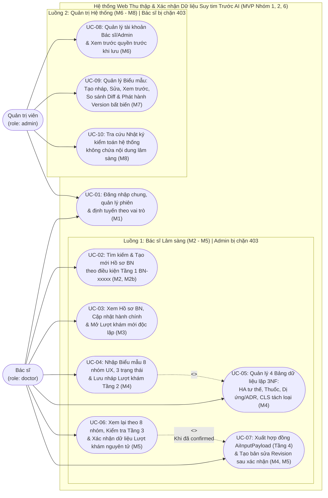

# User Stories và Use Cases · HFCARE MVP

- **Dự án:** Hệ thống Thu thập, Kiểm tra, Lưu trữ và Xác nhận Dữ liệu Lâm sàng Bệnh nhân Suy tim có Cấu trúc (Trước AI)
- **Nhóm thực hiện:** Nhóm 27 (`suy_tim_nhom27`) — Chặng C (`W4 docs-rtm-architect`)
- **Ngày lập:** `2026-11-21`
- **Căn cứ đồng bộ:**
  - Hợp đồng đặt tên & Endpoint cốt lõi: `CONTRACT.md` (Mục 1, 4.1, 4.2, 4.3).
  - Siêu dữ liệu CSDL chuẩn 3NF (19 bảng, 10 enum): [`stage-c/database/schema_metadata.json`](../database/schema_metadata.json) & `CR-W1-01.md`.
  - Đặc tả SRS cập nhật cho MVP: [`SRS.md`](SRS.md).
  - Đặc tả UX/UI hai luồng Bác sĩ (`M1–M5`) và Admin (`M1 → M6–M8`): `stage-b/01-dac-ta-hai-luong-ux-ui.md` & `stage-b/02-ma-tran-man-hinh-thao-tac-du-lieu.md`.

---

## 1. Product Backlog MVP (`US-01` .. `US-12`) theo Tiêu chuẩn INVEST

Toàn bộ 12 User Stories của phạm vi MVP (Nhóm chức năng 1, 2, 6) dưới đây tuân thủ tiêu chuẩn **INVEST** (Independent, Negotiable, Valuable, Estimable, Small, Testable) và ánh xạ trực tiếp tới 8 màn hình (`M1–M8`), 19 bảng CSDL và 32 `operationId` trong OpenAPI:

| Mã US | Vai trò (Actor) | Màn hình | Nội dung User Story (`Là ... tôi muốn ... để ...`) | Mã FR / NFR liên kết | API `operationId` (`CONTRACT.md`) | Bảng CSDL chính |
|---|---|---|---|---|---|---|
| **`US-01`** | Bác sĩ (`doctor`) & Quản trị viên (`admin`) | `M1` | **Là** Bác sĩ hoặc Quản trị viên, **tôi muốn** đăng nhập qua một cổng xác thực duy nhất bằng tên đăng nhập và mật khẩu **để** máy chủ tự động xác định vai trò thực của tôi và định tuyến vào đúng không gian làm việc mà không có cổng tự chọn vai trò giả lập. | `FR-G6-01`, `FR-G6-02`, `NFR-06`, `NFR-07` | `login`, `refreshToken`, `logout`, `getCurrentUser` | `app_user`, `user_session`, `audit_log` |
| **`US-02`** | Bác sĩ (`doctor`) | `M2`, `M2b` | **Là** Bác sĩ, **tôi muốn** tìm kiếm hồ sơ bệnh nhân theo mã `BN-xxxxx` hoặc tên giả lập và tạo hồ sơ mới với thông tin hành chính tối thiểu Tầng 1 (`patient_created`) giữ đúng độ chính xác ngày sinh/năm sinh/tuổi **để** quản lý định danh duy nhất cho từng người bệnh mà không bịa ngày sinh giả `01/01` hay lưu PII thật. | `FR-G1-01`, `NFR-01`, `NFR-04`, `NFR-08` | `listPatients`, `createPatient` | `patient`, `audit_log` |
| **`US-03`** | Bác sĩ (`doctor`) | `M3`, `M2b` | **Là** Bác sĩ, **tôi muốn** xem trang hồ sơ bệnh nhân kèm tóm tắt lâm sàng có gắn nguồn lượt khám, cập nhật hành chính có kiểm soát đồng thời và tạo lượt khám mới gắn cứng phiên bản biểu mẫu `published` hiện hành **để** mỗi đợt khám có dữ liệu độc lập, không bị sao chép số đo cũ sang lượt mới. | `FR-G1-02`, `FR-G1-03`, `NFR-03`, `NFR-05` | `getPatient`, `updatePatient`, `listPatientVisits`, `createVisit`, `getVisit` | `patient`, `visit`, `form_version` |
| **`US-04`** | Bác sĩ (`doctor`) | `M4` | **Là** Bác sĩ, **tôi muốn** nhập dữ liệu lâm sàng trên biểu mẫu lượt khám 8 nhóm UX với cụm chọn 3 trạng thái (`Chưa rõ / Có / Không` tách biệt khỏi `Chưa điền`), bảo toàn số `0` hợp lệ, tự động tính `Tuổi` và `BMI`, và lưu nháp bất kỳ lúc nào ở Tầng 2 (`draft_saved`) **để** ghi nhận đúng thực tế thăm khám mà không bị chặn khi chưa có đủ kết quả xét nghiệm. | `FR-G2-01`, `FR-G2-02`, `FR-G2-06`, `NFR-01`, `NFR-04`, `NFR-10`, `NFR-12` | `getVisitForm`, `getVisit`, `saveVisitDraft` | `visit`, `visit_value`, `visit_value_option`, `form_section`, `form_field`, `field_definition`, `field_option` |
| **`US-05`** | Bác sĩ (`doctor`) | `M4` *(Nhóm 3 & 5)* | **Là** Bác sĩ, **tôi muốn** ghi nhận nhiều lần đo Huyết áp theo tư thế (`supine / sitting / standing`), danh sách nhiều Thuốc đang sử dụng (kê đơn và OTC/TPCN/YHCT, tự đếm số thuốc đồng thời) và danh sách Dị ứng / ADR / Dị ứng thuốc cản quang **để** lưu trữ đầy đủ dữ liệu lặp chuẩn 3NF có thời điểm và đơn vị. | `FR-G2-03`, `FR-G2-04`, `FR-G2-06`, `NFR-04` | `saveVisitDraft`, `getVisit` | `visit_orthostatic_bp`, `visit_medication`, `visit_allergy`, `visit_value` |
| **`US-06`** | Bác sĩ (`doctor`) | `M4` *(Nhóm 6)* | **Là** Bác sĩ, **tôi muốn** ghi nhận nhiều kết quả xét nghiệm cận lâm sàng và thăm dò hình ảnh có gắn thời điểm và đơn vị chuẩn — tách riêng mã `BNP` với `NT-proBNP`, `Creatinin` với `eGFR`, và chỉ số `LVEF (%)` với kết luận siêu âm tim/ECG/X-quang — **để** theo dõi chính xác diễn biến cận lâm sàng mà không làm mất đơn vị hay mốc thời gian. | `FR-G2-05`, `NFR-04` | `saveVisitDraft`, `getVisit` | `visit_lab_result`, `visit_value`, `field_definition` |
| **`US-07`** | Bác sĩ (`doctor`) | `M5`, `M4` | **Là** Bác sĩ, **tôi muốn** xem lại bảng tổng hợp dữ liệu lượt khám theo 8 nhóm (`Đã nhập`, `Chưa điền`, `Chọn Chưa rõ`, lỗi Tầng 3 `Cần kiểm tra` và độ sẵn sàng Tầng 4 của 4 module AI), nhảy thẳng về trường lỗi để sửa, và xác nhận dữ liệu lượt khám (`confirmed`) **để** chốt bản dữ liệu đáng tin cậy kèm chữ ký tài khoản, thời điểm và phiên bản biểu mẫu. | `FR-G1-04`, `FR-G1-05`, `NFR-02`, `NFR-03`, `NFR-05`, `NFR-09` | `getVisitReview`, `confirmVisit` | `visit`, `visit_value`, `visit_revision`, `field_ai_module`, `audit_log` |
| **`US-08`** | Bác sĩ (`doctor`) | `M5`, `M4` | **Là** Bác sĩ, **tôi muốn** xuất gói dữ liệu đầu vào chuẩn hóa `AiInputPayload` từ lượt khám đã xác nhận và khi cần đính chính sau xác nhận thì tạo bản sửa mới (`visit_revision`) có ghi lý do bắt buộc **để** cung cấp hợp đồng dữ liệu sạch cho 4 module AI sau này mà không bao giờ xóa mất bản xác nhận lịch sử. | `FR-G1-06`, `FR-G2-07`, `NFR-02`, `NFR-03`, `NFR-08`, `NFR-09` | `getVisitAiInput`, `createVisitRevision`, `getVisit` | `visit`, `visit_revision`, `field_ai_module`, `audit_log` |
| **`US-09`** | Quản trị viên (`admin`) | `M6` | **Là** Quản trị viên, **tôi muốn** quản lý danh sách tài khoản, xem trước ma trận quyền (`previewUserPermissions`) trước khi lưu, tạo tài khoản bác sĩ mới, khóa/mở khóa hoặc đặt lại mật khẩu có ghi lý do, đồng thời bị chặn tuyệt đối khỏi mọi dữ liệu bệnh án lâm sàng **để** vận hành hệ thống an toàn và đúng ranh giới phân quyền y tế. | `FR-G6-02`, `FR-G6-03`, `NFR-06`, `NFR-07`, `NFR-09` | `listUsers`, `getUser`, `previewUserPermissions`, `createUser`, `updateUser` | `app_user`, `user_session`, `audit_log` |
| **`US-10`** | Quản trị viên (`admin`) | `M7` *(Tab 1)* | **Là** Quản trị viên, **tôi muốn** tra cứu danh mục định nghĩa trường dùng chung (`95 mvp` + `26 can_xac_nhan`), tạo bản nháp phiên bản biểu mẫu mới từ bản `published` hiện hành và chỉnh sửa cấu trúc nhóm/trường/lựa chọn trên trình soạn thảo 3 vùng cuộn hỗ trợ bàn phím **để** cập nhật biểu mẫu mà không làm biến đổi phiên bản đã phát hành. | `FR-G6-04`, `FR-G6-05`, `NFR-03`, `NFR-10`, `NFR-11` | `listFieldDefinitions`, `listForms`, `listFormVersions`, `getFormVersion`, `createFormVersionDraft`, `updateFormVersion` | `field_definition`, `field_option`, `field_ai_module`, `form_template`, `form_version`, `form_section`, `form_field`, `audit_log` |
| **`US-11`** | Quản trị viên (`admin`) | `M7` *(Tab 2 & 3)* | **Là** Quản trị viên, **tôi muốn** xem trước bản nháp biểu mẫu dưới góc nhìn Bác sĩ, so sánh chi tiết thay đổi (`Diff`) với bản gốc và phát hành phiên bản mới (`publishFormVersion`) **để** các lượt khám mới sử dụng biểu mẫu cập nhật trong khi các lượt khám cũ vẫn đọc đúng theo phiên bản cũ. | `FR-G6-05`, `NFR-03`, `NFR-05`, `NFR-09` | `previewFormVersion`, `diffFormVersion`, `publishFormVersion` | `form_version`, `form_section`, `form_field`, `audit_log` |
| **`US-12`** | Quản trị viên (`admin`) | `M8` | **Là** Quản trị viên, **tôi muốn** tra cứu và lọc Nhật ký kiểm toán hệ thống (`audit_log`) theo người thực hiện, khoảng thời gian, loại thực thể và hành động mà chỉ hiển thị siêu dữ liệu kiểm toán **để** giám sát tuân thủ hệ thống mà không xâm phạm quyền riêng tư bệnh án lâm sàng. | `FR-G6-06`, `NFR-07`, `NFR-08`, `NFR-09` | `listAuditLogs` | `audit_log`, `app_user` |

> [!NOTE]
> **Bảo toàn các User Story thuộc Tầm nhìn Dài hạn (`SRS v1.0` `US-03..US-10, US-12` cũ):**
> Các User Story liên quan đến việc chạy suy luận 4 module AI (`Diagnosis`, `Lab/Test`, `Treatment`, `MedSafety`), hiển thị giải thích quy tắc AI, bác sĩ/dược sĩ chấp nhận hoặc từ chối khuyến nghị AI và xuất báo cáo tổng hợp cho bệnh nhân ngoại trú được giữ nguyên trong **Backlog Tầm nhìn Dài hạn (Nhóm chức năng 3, 4, 5)** với trạng thái `future / ngoai_mvp` (xem chi tiết trong [`RTM.md`](RTM.md)).

---

## 2. Tiêu chí Nghiệm thu BDD (`Given / When / Then`) cho 12 User Stories MVP

Mỗi User Story dưới đây bao gồm đầy đủ kịch bản luồng chính (Happy Path) và các kịch bản ngoại lệ/biên (Edge & Exception Cases) khớp với mã lỗi HTTP (`401`, `403`, `404`, `409`, `422` theo `application/problem+json`):

```gherkin
# =====================================================================
# US-01: Đăng nhập chung, quản lý phiên và định tuyến theo vai trò (M1)
# Endpoints: login, refreshToken, logout, getCurrentUser
# =====================================================================

Scenario: US-01.1 - Bác sĩ đăng nhập thành công và được định tuyến vào Danh sách hồ sơ bệnh nhân (M2)
  Given tài khoản "bs.nguyen" có role "doctor" và trạng thái is_active = true trong bảng "app_user"
  When người dùng gửi POST "/api/v1/auth/login" (operationId: "login") với username "bs.nguyen" và mật khẩu hợp lệ
  Then hệ thống trả về HTTP 200 kèm accessToken, refreshToken (lưu hash vào "user_session") và thông tin user có role = "doctor"
  And hệ thống ghi bản ghi vào "audit_log" với action = "login"
  And giao diện tự động chuyển hướng tới Màn 2 ("#patients" - Danh sách hồ sơ bệnh nhân) mà không hiển thị hộp thoại chọn vai trò

Scenario: US-01.2 - Admin đăng nhập thành công và được định tuyến vào Quản lý tài khoản (M6)
  Given tài khoản "admin.ht" có role = "admin" và is_active = true
  When người dùng gửi POST "/api/v1/auth/login" (operationId: "login") với thông tin xác thực hợp lệ
  Then hệ thống trả về HTTP 200 với role = "admin" và ghi "audit_log" với action = "login"
  And giao diện tự động chuyển hướng tới Màn 6 ("#admin-users") và ẩn hoàn toàn các mục menu bệnh nhân/lượt khám lâm sàng

Scenario: US-01.3 - Đăng nhập thất bại do sai mật khẩu hoặc tài khoản bị khóa
  Given tài khoản "bs.nguyen" tồn tại trên hệ thống
  When người dùng gửi POST "/api/v1/auth/login" với mật khẩu sai
  Then hệ thống trả về HTTP 401 ProblemDetails với thông báo chung "Tên đăng nhập hoặc mật khẩu không đúng"
  And hệ thống ghi bản ghi vào "audit_log" với action = "login_failed" (không ghi mật khẩu vào detail)
  When tài khoản "bs.khoa" có is_active = false gửi POST "/api/v1/auth/login" đúng mật khẩu
  Then hệ thống trả về HTTP 403 ProblemDetails thông báo tài khoản đã bị khóa và không tạo phiên trong "user_session"

# =====================================================================
# US-02: Tìm kiếm và tạo mới Hồ sơ bệnh nhân theo điều kiện Tầng 1 (M2, M2b)
# Endpoints: listPatients, createPatient
# =====================================================================

Scenario: US-02.1 - Tạo hồ sơ bệnh nhân mới khi chỉ biết năm sinh (không bịa ngày 01/01)
  Given Bác sĩ đã đăng nhập với role "doctor" tại Màn 2
  When Bác sĩ mở modal M2b và gửi POST "/api/v1/patients" (operationId: "createPatient") với displayName = "BN Giả lập Nguyễn Văn A", sex = "nam", birthYear = 1948, dateOfBirth = null
  Then hệ thống tự động sinh mã patientCode theo đúng mẫu "^BN-[0-9]{5}$" (ví dụ "BN-00001")
  And hệ thống lưu vào bảng "patient" với birth_year = 1948 và date_of_birth = NULL (tuyệt đối không lưu "1948-01-01")
  And hệ thống ghi bản ghi vào "audit_log" với action = "patient_create" và trả về HTTP 201

Scenario: US-02.2 - Chặn tạo hồ sơ khi thiếu cả ngày sinh, năm sinh lẫn tuổi khai báo hoặc ngày sinh ở tương lai (Lỗi Tầng 1)
  Given Bác sĩ đã đăng nhập với role "doctor"
  When Bác sĩ gửi POST "/api/v1/patients" với dateOfBirth = null, birthYear = null, declaredAge = null (hoặc dateOfBirth lớn hơn ngày hiện tại)
  Then hệ thống trả về HTTP 422 ProblemDetails chỉ rõ lỗi ràng buộc Tầng 1 tại trường ngày/năm sinh/tuổi và không tạo bản ghi trong "patient"

# =====================================================================
# US-03: Xem hồ sơ, cập nhật hành chính và tạo lượt khám mới độc lập (M3)
# Endpoints: getPatient, updatePatient, listPatientVisits, createVisit, getVisit
# =====================================================================

Scenario: US-03.1 - Tạo hai lượt khám khác nhau cho cùng một bệnh nhân không làm lẫn dữ liệu
  Given hồ sơ bệnh nhân "BN-00001" đã có Lượt khám 1 ở trạng thái "confirmed" với cân nặng 62.5 kg và LVEF 35%
  And biểu mẫu suy tim hiện có phiên bản v1 đang ở trạng thái "published"
  When Bác sĩ gửi POST "/api/v1/patients/{patientId}/visits" (operationId: "createVisit") để mở Lượt khám 2
  Then hệ thống tạo bản ghi mới trong bảng "visit" với status = "draft", row_version = 1, gắn cứng form_version_id của v1
  And Lượt khám 2 có tập "visit_value", "visit_orthostatic_bp", "visit_medication", "visit_allergy", "visit_lab_result" hoàn toàn trống (không tự sao chép 62.5 kg hay LVEF 35% từ Lượt khám 1)

Scenario: US-03.2 - Chặn cập nhật hành chính hồ sơ khi có xung đột sửa đồng thời (ETag / row_version)
  Given hồ sơ bệnh nhân "BN-00001" trên máy chủ đang có row_version = 3
  When Bác sĩ gửi PATCH "/api/v1/patients/{patientId}" (operationId: "updatePatient") với If-Match tương ứng row_version = 2
  Then hệ thống trả về HTTP 409 Conflict ProblemDetails và không ghi đè dữ liệu hành chính đã được phiên khác cập nhật

# =====================================================================
# US-04: Nhập biểu mẫu 8 nhóm, phân biệt 3 trạng thái + số 0 và Lưu nháp Tầng 2 (M4)
# Endpoints: getVisitForm, getVisit, saveVisitDraft
# =====================================================================

Scenario: US-04.1 - Lưu nháp thành công khi còn thiếu trường lâm sàng và bảo toàn 3 trạng thái + số 0
  Given Bác sĩ đang mở lượt khám "draft" (row_version = 1) trên Màn 4
  When Bác sĩ gửi PUT "/api/v1/visits/{visitId}/draft" (operationId: "saveVisitDraft") kèm If-Match = "1" với:
    | field_code                   | state    | value | Ghi chú nghiệp vụ                                |
    | kho_tho_khi_gang_suc         | answered | true  | Chọn "Có"                                        |
    | kho_tho_khi_nam              | answered | false | Chọn "Không"                                     |
    | lu_lan_sang                  | unknown  | null  | Chủ động chọn "Chưa rõ"                          |
    | dau_nguc                     | (bỏ qua) | -     | Để trống "Chưa điền" (không gửi dòng giá trị)    |
    | so_lan_cap_cuu_nhap_vien     | answered | 0     | Nhập số 0 hợp lệ                                 |
    | chieu_cao_cm                 | answered | 165   | Đủ chiều cao                                     |
    | can_nang_kg                  | (bỏ qua) | -     | Chưa nhập cân nặng -> BMI phải giữ NULL, không=0 |
  Then hệ thống trả về HTTP 200 và lưu vào "visit_value":
    - "kho_tho_khi_gang_suc" có value_state = "answered", value_bool = true
    - "kho_tho_khi_nam" có value_state = "answered", value_bool = false
    - "lu_lan_sang" có value_state = "unknown", toàn bộ cột value_* = NULL
    - "dau_nguc" không có dòng trong "visit_value"
    - "so_lan_cap_cuu_nhap_vien" có value_state = "answered", value_num = 0 (không bị đổi thành NULL)
    - "bmi" không bị gán bằng 0 khi thiếu cân nặng

Scenario: US-04.2 - Báo lỗi tại trường khi giá trị sai kiểu hoặc vượt miền kỹ thuật ở Tầng 2
  Given Bác sĩ đang nhập dữ liệu lượt khám "draft" trên Màn 4
  When Bác sĩ gửi PUT "/api/v1/visits/{visitId}/draft" với "spo2" = 120 (vượt miền 30..100%) hoặc "chieu_cao_cm" = 0
  Then hệ thống trả về HTTP 422 ProblemDetails chỉ đích danh trường lỗi "spo2" / "chieu_cao_cm"
  And trên giao diện Màn 4 chỉ đánh dấu đỏ trường sai, giữ nguyên toàn bộ các trường hợp lệ Bác sĩ đã gõ trên màn hình

# =====================================================================
# US-05: Ghi nhận 3 bảng lặp: Huyết áp tư thế, Thuốc đang dùng và Dị ứng/ADR (M4)
# Endpoints: saveVisitDraft, getVisit
# =====================================================================

Scenario: US-05.1 - Lưu và đọc lại đúng thứ tự nhiều lần đo HA tư thế, nhiều thuốc và dị ứng
  Given Bác sĩ đang mở lượt khám "draft" trên Màn 4
  When Bác sĩ gửi PUT "/api/v1/visits/{visitId}/draft" (operationId: "saveVisitDraft") gồm:
    - 2 bản ghi "orthostaticBp": (1) position = "supine", systolic = 138, diastolic = 82, heartRate = 76; (2) position = "standing", minuteAfter = 3, systolic = 114, diastolic = 70, heartRate = 88
    - 2 bản ghi "medications": (1) Sacubitril/Valsartan 50mg uống 2 lần/ngày (kê đơn); (2) Ibuprofen 400mg uống khi đau (OTC/TPCN/YHCT)
    - Cờ "co_tien_su_di_ung_adr" = true kèm 1 bản ghi "allergies": allergen = "Enalapril", reaction = "Ho khan kéo dài", kind = "adr", severity = "vua"
  Then hệ thống lưu đầy đủ vào 3 bảng "visit_orthostatic_bp", "visit_medication", "visit_allergy" gắn đúng visit_id
  And tự động tính "so_luong_thuoc_dong_thoi" = 2
  And khi gọi GET "/api/v1/visits/{visitId}" (operationId: "getVisit"), hệ thống trả lại đúng thứ tự, đơn vị và thời điểm của từng bản ghi

# =====================================================================
# US-06: Ghi nhận bảng lặp Cận lâm sàng tách loại, đơn vị và thời điểm (M4)
# Endpoints: saveVisitDraft, getVisit
# =====================================================================

Scenario: US-06.1 - Lưu nhiều kết quả cận lâm sàng tách biệt BNP vs NT-proBNP và Creatinin vs eGFR
  Given Bác sĩ đang mở lượt khám "draft" trên Màn 4 (Nhóm 6: Cận lâm sàng)
  When Bác sĩ thêm vào danh sách kết quả xét nghiệm ("visit_lab_result") và trường siêu âm:
    - Bản ghi 1: labCode = "cls_nt_probnp", valueNum = 1850, unit = "pg/mL", measuredAt = "2026-11-18T08:30:00+07:00"
    - Bản ghi 2: labCode = "cls_creatinin", valueNum = 132, unit = "umol/L", measuredAt = "2026-11-18T08:30:00+07:00"
    - Bản ghi 3: labCode = "cls_egfr", valueNum = 44.5, unit = "mL/phut/1.73m2", measuredAt = "2026-11-18T08:30:00+07:00"
    - Siêu âm tim: "cls_lvef" = 36 (%), "cls_sieu_am_tim_ket_luan" = "Giãn thất trái, giảm động toàn bộ"
  And gửi PUT "/api/v1/visits/{visitId}/draft"
  Then hệ thống lưu riêng từng mã xét nghiệm kèm đúng đơn vị và thời điểm mà không gộp chung BNP với NT-proBNP hay Creatinin với eGFR

Scenario: US-06.2 - Chặn bản ghi xét nghiệm đã nhập số nhưng bỏ trống đơn vị hoặc thời điểm
  Given Bác sĩ thêm một dòng xét nghiệm "cls_creatinin" với valueNum = 132 nhưng để trống "unit" hoặc "measuredAt"
  When Bác sĩ gửi PUT "/api/v1/visits/{visitId}/draft" hoặc POST "/api/v1/visits/{visitId}/confirm"
  Then hệ thống trả về HTTP 422 ProblemDetails báo lỗi thiếu đơn vị/thời điểm tại bản ghi xét nghiệm đó

# =====================================================================
# US-07: Xem lại theo 8 nhóm, kiểm tra Tầng 3 và Xác nhận dữ liệu lượt khám (M5)
# Endpoints: getVisitReview, confirmVisit
# =====================================================================

Scenario: US-07.1 - Xem lại tổng hợp 8 nhóm và Xác nhận dữ liệu lượt khám thành công ngay cả khi thiếu trường Tầng 4 (AI)
  Given lượt khám "draft" đã điền hợp lệ toàn bộ các trường có required_for_confirm = true (Tầng 3 = 0 lỗi)
  And lượt khám chưa có kết quả siêu âm tim "cls_lvef" (nên module "ai_treatment" ở Tầng 4 có ready = false)
  When Bác sĩ gọi GET "/api/v1/visits/{visitId}/review" (operationId: "getVisitReview")
  Then hệ thống trả về thống kê 8 nhóm với confirmEligible = true, tier3Errors = [] và modules[ai_treatment].ready = false kèm missingFieldCodes = ["cls_lvef", ...]
  When Bác sĩ gửi POST "/api/v1/visits/{visitId}/confirm" (operationId: "confirmVisit") kèm If-Match hợp lệ
  Then hệ thống thực thi giao dịch nguyên tử: chuyển visit.status = "confirmed", lưu confirmed_by, confirmed_at, form_version_id, tăng row_version, tạo snapshot trong "visit_revision" (revision_no = 1) và ghi "audit_log" (action = "visit_confirm")
  And trả về HTTP 200 (không chặn xác nhận vì thiếu trường của Tầng 4)

Scenario: US-07.2 - Chặn xác nhận khi còn lỗi Tầng 3 hoặc xung đột ETag 409
  Given lượt khám còn thiếu trường có required_for_confirm = true hoặc chọn "co_tien_su_di_ung_adr" = true nhưng bảng "visit_allergy" đang rỗng
  When Bác sĩ gửi POST "/api/v1/visits/{visitId}/confirm"
  Then hệ thống trả về HTTP 422 ProblemDetails liệt kê các mục Tầng 3 cần bổ sung và giữ visit.status = "draft"

# =====================================================================
# US-08: Xuất hợp đồng AiInputPayload và đính chính sau xác nhận có Revision (M5, M4)
# Endpoints: getVisitAiInput, createVisitRevision
# =====================================================================

Scenario: US-08.1 - Xuất hợp đồng dữ liệu đầu vào chuẩn AiInputPayload từ lượt khám đã xác nhận
  Given lượt khám đã ở trạng thái "confirmed" (revision_no = 1)
  When Bác sĩ gọi GET "/api/v1/visits/{visitId}/ai-input" (operationId: "getVisitAiInput")
  Then hệ thống trả về HTTP 200 với cấu trúc "AiInputPayload" gồm:
    - visitId, patientCode ("BN-xxxxx", không lộ họ tên), formVersionId, confirmedAt
    - map "values" chứa các trường answered và unknown (các trường chưa điền không xuất hiện trong "values")
    - các mảng "orthostaticBp[]", "medications[]", "allergies[]" (và kết quả CLS)
    - mảng "modules[]" cho 4 mã "ai_diagnosis", "ai_lab_test", "ai_treatment", "ai_medsafety"

Scenario: US-08.2 - Chặn xuất AiInputPayload khi lượt khám còn ở trạng thái draft
  Given lượt khám đang ở trạng thái "draft"
  When Bác sĩ gọi GET "/api/v1/visits/{visitId}/ai-input"
  Then hệ thống trả về HTTP 409 Conflict ProblemDetails yêu cầu xác nhận lượt khám trước khi xuất đầu vào AI

Scenario: US-08.3 - Đính chính dữ liệu sau xác nhận tạo revision mới và giữ nguyên lịch sử bản cũ
  Given lượt khám đã ở trạng thái "confirmed" với revision_no = 1 trong bảng "visit_revision"
  When Bác sĩ gửi PUT "/api/v1/visits/{visitId}/draft" trực tiếp lên lượt khám đang "confirmed"
  Then hệ thống trả về HTTP 409 Conflict (và Trigger CSDL chặn sửa trực tiếp bản đã confirmed)
  When Bác sĩ gửi POST "/api/v1/visits/{visitId}/revisions" (operationId: "createVisitRevision") kèm changeReason = "Bổ sung kết quả NT-proBNP vừa trả từ phòng xét nghiệm" và dữ liệu cập nhật
  Then hệ thống giữ nguyên bản ghi revision_no = 1 trong "visit_revision", tạo thêm bản ghi revision_no = 2 kèm người sửa, thời điểm, lý do và ghi "audit_log"

# =====================================================================
# US-09: Admin quản lý tài khoản Bác sĩ, Xem trước quyền và tách quyền lâm sàng (M6)
# Endpoints: listUsers, getUser, previewUserPermissions, createUser, updateUser
# =====================================================================

Scenario: US-09.1 - Admin xem trước quyền và tạo tài khoản Bác sĩ mới
  Given Quản trị viên đã đăng nhập với role "admin" tại Màn 6
  When Quản trị viên gửi POST "/api/v1/admin/users/permission-preview" (operationId: "previewUserPermissions") cho role = "doctor"
  Then hệ thống trả về HTTP 200 liệt kê rõ danh sách quyền lâm sàng được cấp và danh sách quyền quản trị không được cấp
  When Quản trị viên gửi POST "/api/v1/admin/users" (operationId: "createUser") với username = "bs.tran", fullName = "BS. Trần Minh", role = "doctor"
  Then hệ thống băm mật khẩu khởi tạo vào "password_hash", lưu vào "app_user", ghi "audit_log" (action = "user_create") và trả về HTTP 201 (response tuyệt đối không chứa password hay password_hash)

Scenario: US-09.2 - Ranh giới RBAC hai chiều: Bác sĩ bị chặn vào API Admin và Admin bị chặn đọc bệnh án lâm sàng
  Given Bác sĩ có token với role = "doctor" và Quản trị viên có token với role = "admin"
  When Bác sĩ gửi GET "/api/v1/admin/users" hoặc POST "/api/v1/admin/forms/{formId}/versions"
  Then hệ thống trả về HTTP 403 Forbidden và ghi sự kiện từ chối vào "audit_log"
  When Quản trị viên gửi GET "/api/v1/patients", GET "/api/v1/patients/{patientId}", GET "/api/v1/visits/{visitId}" hoặc GET "/api/v1/visits/{visitId}/ai-input"
  Then hệ thống trả về HTTP 403 Forbidden cho toàn bộ yêu cầu đọc dữ liệu lâm sàng của Admin (tuân thủ Chốt K8)

# =====================================================================
# US-10 & US-11: Admin tạo bản nháp biểu mẫu, sửa, xem trước, diff và phát hành (M7)
# Endpoints: listFieldDefinitions, listForms, listFormVersions, getFormVersion,
#            createFormVersionDraft, updateFormVersion, previewFormVersion,
#            diffFormVersion, publishFormVersion
# =====================================================================

Scenario: US-10.1 - Chặn sửa trực tiếp phiên bản biểu mẫu đã published ở cả API và CSDL (Chốt K4)
  Given phiên bản biểu mẫu v1 đang có status = "published"
  When Quản trị viên gửi PATCH "/api/v1/admin/form-versions/{v1_id}" (operationId: "updateFormVersion")
  Then hệ thống trả về HTTP 409 Conflict ProblemDetails báo phiên bản đã phát hành là bất biến
  And mọi câu lệnh SQL UPDATE/DELETE trực tiếp lên cấu trúc v1 trong PostgreSQL đều bị Trigger chặn

Scenario: US-11.1 - Tạo bản nháp v2 từ v1, xem trước, so sánh Diff và phát hành v2 mà không ảnh hưởng lượt khám cũ
  Given Lượt khám 1 đã được tạo và gắn với form_version v1 (status = "published")
  When Quản trị viên gửi POST "/api/v1/admin/forms/{formId}/versions" (operationId: "createFormVersionDraft") với basedOnVersionId = v1_id
  Then hệ thống tạo form_version v2 với status = "draft" và sao chép cấu trúc 8 nhóm từ v1, ghi "audit_log" (action = "form_version_create")
  When Quản trị viên gửi PATCH "/api/v1/admin/form-versions/{v2_id}" (operationId: "updateFormVersion") để cập nhật thứ tự hiển thị và thêm 1 trường từ catalog
  And gọi GET "/api/v1/admin/form-versions/{v2_id}/preview" (operationId: "previewFormVersion") và GET "/api/v1/admin/form-versions/{v2_id}/diff?baseVersionId={v1_id}" (operationId: "diffFormVersion")
  Then hệ thống trả về cấu trúc xem trước góc nhìn Bác sĩ và bảng Diff chỉ rõ trường thêm/sửa
  When Quản trị viên gửi POST "/api/v1/admin/form-versions/{v2_id}/publish" (operationId: "publishFormVersion")
  Then v2 chuyển sang status = "published", ghi published_at, published_by và "audit_log" (action = "form_version_publish")
  And Lượt khám 1 cũ khi gọi "getVisitForm" vẫn trả về đúng cấu trúc v1, còn Lượt khám mới tạo sau thời điểm phát hành sẽ tự động gắn với v2

# =====================================================================
# US-12: Admin tra cứu Nhật ký kiểm toán hệ thống không lộ dữ liệu lâm sàng (M8)
# Endpoints: listAuditLogs
# =====================================================================

Scenario: US-12.1 - Admin lọc nhật ký kiểm toán theo hành động và khoảng thời gian
  Given Quản trị viên đã đăng nhập với role "admin" tại Màn 8
  When Quản trị viên gọi GET "/api/v1/admin/audit-logs?action=visit_confirm" (operationId: "listAuditLogs")
  Then hệ thống trả về HTTP 200 gồm danh sách bản ghi "audit_log" có actor_user_id, action, entity_type = "visit", entity_id, occurred_at, ip và detail
  And trường "detail" chỉ chứa siêu dữ liệu kiểm toán (formVersionId, revisionNo), tuyệt đối không chứa triệu chứng, kết quả xét nghiệm hay đơn thuốc của bệnh nhân
```

---

## 3. Sơ đồ và Danh mục Use Cases MVP (`UC-01` .. `UC-10`)

### 3.1. Sơ đồ Use Case Tổng thể MVP (Hai Luồng Bác sĩ & Admin)



---

## 4. Đặc tả Chi tiết 10 Use Cases MVP (`UC-01` .. `UC-10`)

### 4.1. `UC-01`: Đăng nhập chung, quản lý phiên và định tuyến theo vai trò (`M1`)
- **Actor chính:** Bác sĩ (`doctor`), Quản trị viên (`admin`).
- **Màn hình:** `M1 — Đăng nhập chung`.
- **Mã yêu cầu & User Story:** `FR-G6-01`, `FR-G6-02`, `NFR-06`, `NFR-07` ↔ `US-01`.
- **API Endpoints (`operationId`):**
  - `POST /api/v1/auth/login` (`login`)
  - `POST /api/v1/auth/refresh` (`refreshToken`)
  - `POST /api/v1/auth/logout` (`logout`)
  - `GET /api/v1/auth/me` (`getCurrentUser`)
- **Bảng CSDL tham gia:** `app_user`, `user_session`, `audit_log`.
- **Tiền điều kiện:** Người dùng mở ứng dụng web; tài khoản đã được khởi tạo trong `app_user`.
- **Luồng sự kiện chính (Basic Flow):**
  1. Người dùng nhập `username` và `password` trên Màn 1 (có thể bật/tắt nút Hiện/Ẩn mật khẩu) và bấm **Đăng nhập**.
  2. Giao diện khóa nút gửi (`Đang xác thực...`) và gọi `POST /api/v1/auth/login` (`login`).
  3. Backend tra cứu `app_user` theo `username`, đối chiếu băm mật khẩu (`password_hash`) và kiểm tra `is_active = true`.
  4. Backend sinh Access Token và Refresh Token, lưu băm Refresh Token vào bảng `user_session` (`expires_at`), đồng thời ghi `audit_log` với `action = 'login'`.
  5. Frontend gọi/nhận thông tin từ `getCurrentUser` (`role`: `doctor` hoặc `admin`) và tự động chuyển hướng:
     - Nếu `role = 'doctor'` → mở Màn 2 (`Danh sách hồ sơ bệnh nhân`).
     - Nếu `role = 'admin'` → mở Màn 6 (`Quản lý tài khoản & Quyền`).
  6. Khi sắp hết hạn Access Token, client gọi `POST /api/v1/auth/refresh` (`refreshToken`) để gia hạn phiên; khi người dùng bấm **Đăng xuất**, client gọi `POST /api/v1/auth/logout` (`logout`) để cập nhật `user_session.revoked_at = now()`, ghi `audit_log` (`action = 'logout'`) và xóa sạch phiên cục bộ.
- **Luồng ngoại lệ (Alternative / Exception Flows):**
  - *E1 — Trống trường (`422 Unprocessable Entity`):* Thiếu `username` hoặc `password` → báo lỗi trực tiếp dưới ô trống.
  - *E2 — Sai thông tin đăng nhập (`401 Unauthorized`):* Không tìm thấy `username` hoặc sai mật khẩu → ghi `audit_log` (`action = 'login_failed'`), trả thông báo chung *"Tên đăng nhập hoặc mật khẩu không đúng"*.
  - *E3 — Tài khoản bị khóa (`403 Forbidden`):* `app_user.is_active = false` → trả `403` thông báo tài khoản đang bị khóa, hướng dẫn liên hệ Admin.
  - *E4 — Lỗi mạng khi đăng xuất:* Frontend sử dụng khối `try / finally` để luôn xóa sạch token cục bộ ngay cả khi mạng gián đoạn.
- **Hậu điều kiện:** Phiên làm việc được thiết lập đúng vai trò thực từ máy chủ và mọi sự kiện xác thực được lưu vết trong `audit_log`.

---

### 4.2. `UC-02`: Tìm kiếm và tạo mới Hồ sơ bệnh nhân theo điều kiện Tầng 1 (`M2`, `M2b`)
- **Actor chính:** Bác sĩ (`doctor`) *(Role `admin` bị chặn `403`)*.
- **Màn hình:** `M2 — Danh sách hồ sơ bệnh nhân`, `M2b — Modal Tạo hồ sơ bệnh nhân`.
- **Mã yêu cầu & User Story:** `FR-G1-01`, `FR-G6-02`, `NFR-01`, `NFR-04`, `NFR-08` ↔ `US-02`.
- **API Endpoints (`operationId`):**
  - `GET /api/v1/patients` (`listPatients`)
  - `POST /api/v1/patients` (`createPatient`)
- **Bảng CSDL tham gia:** `patient`, `visit` (đọc ngày/trạng thái lượt khám gần nhất), `audit_log`.
- **Tiền điều kiện:** Bác sĩ đã đăng nhập thành công (`role = 'doctor'`).
- **Luồng sự kiện chính:**
  1. Tại Màn 2, hệ thống gọi `GET /api/v1/patients` (`listPatients`) hiển thị bảng danh sách hồ sơ bệnh nhân gồm: `patient_code` (`BN-xxxxx`), tên hiển thị/giả lập, giới tính, ngày sinh/năm sinh/tuổi kèm nhãn độ chính xác, số lượt khám, ngày và trạng thái lượt khám gần nhất.
  2. Bác sĩ có thể gõ từ khóa tìm kiếm (`BN-xxxxx`, tên hiển thị, mã tham chiếu ngoài) hoặc lọc theo trạng thái lượt khám gần nhất.
  3. Để thêm bệnh nhân mới, Bác sĩ bấm **`+ Tạo hồ sơ bệnh nhân`** mở Modal `M2b`.
  4. Bác sĩ nhập tên hiển thị/giả lập (`full_name` / `display_name`), chọn giới tính (`sex`), chọn đúng mức độ chính xác tuổi/ngày sinh có thật (nhập `date_of_birth` `YYYY-MM-DD`, hoặc chỉ nhập `birth_year` `YYYY`, hoặc chỉ nhập `declared_age` `0..120`), tùy chọn nhập mã tham chiếu ngoài (`external_patient_code`), rồi bấm **Lưu hồ sơ**.
  5. Backend gọi `createPatient`: kiểm tra quyền `doctor` và điều kiện Tầng 1 (`patient_created`), tự động sinh mã `patient_code` theo định dạng `BN-\d{5}` duy nhất, lưu bản ghi vào bảng `patient` và ghi `audit_log` (`action = 'patient_create'`).
  6. Hệ thống trả về `201 Created` và chuyển Bác sĩ sang Màn 3 (`Trang hồ sơ bệnh nhân`).
- **Luồng ngoại lệ:**
  - *E1 — Vi phạm điều kiện Tầng 1 (`422`):* Bỏ trống tên hiển thị, bỏ trống cả 3 trường ngày sinh/năm sinh/tuổi, hoặc nhập ngày sinh ở tương lai / năm sinh `< 1900` / tuổi `> 120` → trả `422` gắn lỗi vào đúng ô nhập, giữ nguyên dữ liệu đã gõ trong modal.
  - *E2 — Admin gọi trực tiếp (`403`):* Token `admin` gọi `listPatients` hoặc `createPatient` → bị chặn `403 Forbidden` (`Chốt K8`).
- **Hậu điều kiện:** Bản ghi `patient` mới được tạo với `patient_code` chuẩn `BN-\d{5}` và không chứa ngày sinh giả `01/01`.

---

### 4.3. `UC-03`: Xem hồ sơ bệnh nhân, cập nhật hành chính và mở lượt khám mới độc lập (`M3`, `M2b`)
- **Actor chính:** Bác sĩ (`doctor`) *(Role `admin` bị chặn `403`)*.
- **Màn hình:** `M3 — Trang hồ sơ bệnh nhân & Dòng thời gian lượt khám`, `M2b — Modal Sửa hành chính`, `Modal Tạo lượt khám mới`.
- **Mã yêu cầu & User Story:** `FR-G1-02`, `FR-G1-03`, `NFR-03`, `NFR-05` ↔ `US-03`.
- **API Endpoints (`operationId`):**
  - `GET /api/v1/patients/{patientId}` (`getPatient`)
  - `PATCH /api/v1/patients/{patientId}` (`updatePatient`)
  - `GET /api/v1/patients/{patientId}/visits` (`listPatientVisits`)
  - `POST /api/v1/patients/{patientId}/visits` (`createVisit`)
  - `GET /api/v1/visits/{visitId}` (`getVisit`)
- **Bảng CSDL tham gia:** `patient`, `visit`, `form_version`, `visit_value`, `visit_orthostatic_bp`, `visit_medication`, `visit_allergy`, `visit_lab_result`.
- **Tiền điều kiện:** Bác sĩ đã đăng nhập và chọn một hồ sơ bệnh nhân tồn tại.
- **Luồng sự kiện chính:**
  1. Hệ thống gọi `getPatient` và `listPatientVisits` để hiển thị Màn 3:
     - Thẻ hành chính (`patient_code`, tên, giới tính, ngày/năm sinh/tuổi, mã ngoài, `row_version`).
     - Khung **Thông tin theo dõi / Tóm tắt lâm sàng gần nhất**: chỉ hiển thị các chỉ số, thuốc đang dùng, tiền sử dị ứng khi đã có ghi nhận từ lượt khám trước và luôn gắn kèm nhãn nguồn (`visitId`, `visitDate`, `status`). Nếu bệnh nhân mới chưa có lượt khám nào, hiển thị trạng thái rỗng trung tính.
     - Dòng thời gian (Timeline) liệt kê các lượt khám theo thời gian giảm dần.
  2. Nếu cần cập nhật hành chính, Bác sĩ mở modal Sửa hành chính và gửi `PATCH /api/v1/patients/{patientId}` (`updatePatient`) kèm `If-Match` (`row_version`).
  3. Để bắt đầu đợt khám mới, Bác sĩ bấm **`+ Tạo lượt khám mới`**, chọn thời điểm khám (`visitDate`) và gửi `POST /api/v1/patients/{patientId}/visits` (`createVisit`).
  4. Backend tìm phiên bản biểu mẫu suy tim đang có `status = 'published'`, tạo bản ghi `visit` mới với `form_version_id` gắn cứng vào phiên bản đó, `status = 'draft'`, `row_version = 1`, `created_by = doctor_id` (hoàn toàn không sao chép dữ liệu lâm sàng từ lượt cũ sang lượt mới).
  5. Giao diện chuyển Bác sĩ sang Màn 4 (`Biểu mẫu lượt khám`) của lượt khám vừa tạo.
- **Luồng ngoại lệ:**
  - *E1 — Ngày khám trước ngày/năm sinh (`422`):* `createVisit` có `visitDate` nhỏ hơn `date_of_birth` hoặc `birth_year` của bệnh nhân → trả `422`.
  - *E2 — Xung đột sửa hành chính đồng thời (`409`):* `If-Match` không khớp `patient.row_version` hiện tại → trả `409 Conflict`.
  - *E3 — Không tìm thấy hồ sơ (`404`):* `patientId` không tồn tại → trả `404 Not Found`.
- **Hậu điều kiện:** Lượt khám mới được tạo ở trạng thái `draft`, gắn cứng `form_version_id` đang phát hành và cô lập hoàn toàn dữ liệu với các lượt khám trước.

---

### 4.4. `UC-04`: Nhập dữ liệu lâm sàng 8 nhóm UX, xử lý 3 trạng thái & lưu nháp lượt khám Tầng 2 (`M4`)
- **Actor chính:** Bác sĩ (`doctor`) *(Role `admin` bị chặn `403`)*.
- **Màn hình:** `M4 — Biểu mẫu lượt khám nhiều nhóm (8 nhóm UX)`.
- **Mã yêu cầu & User Story:** `FR-G2-01`, `FR-G2-02`, `FR-G2-06`, `NFR-01`, `NFR-04`, `NFR-10`, `NFR-12` ↔ `US-04`.
- **API Endpoints (`operationId`):**
  - `GET /api/v1/visits/{visitId}` (`getVisit`)
  - `GET /api/v1/visits/{visitId}/form` (`getVisitForm`)
  - `PUT /api/v1/visits/{visitId}/draft` (`saveVisitDraft`)
- **Bảng CSDL tham gia:** `visit`, `form_version`, `form_section`, `form_field`, `field_definition`, `field_option`, `visit_value`, `visit_value_option`.
- **Tiền điều kiện:** Lượt khám đang ở trạng thái `visit.status = 'draft'`.
- **Luồng sự kiện chính:**
  1. Khi mở Màn 4, frontend gọi `getVisitForm` và `getVisit` để dựng giao diện 8 nhóm biểu mẫu (`hanh_chinh`, `trieu_chung_dien_bien`, `sinh_ton_kham`, `benh_su_dong_mac`, `thuoc_di_ung`, `can_lam_sang`, `lao_khoa`, `ghi_chu`) đúng theo `visit.form_version_id`. Header luôn ghim cố định `patient_code`, mã lượt, thời điểm khám, trạng thái `Bản nháp`, `form_version` và `row_version`.
  2. Bác sĩ điều hướng qua 8 nhóm, dùng phím `/` để tìm trường hoặc lọc *Chưa điền / Cần kiểm tra*, và nhập dữ liệu:
     - Với trường Có/Không (`boolean`): chọn 1 trong 3 nút **`Chưa rõ`** (`value_state = 'unknown'`), **`Có`** (`value_state = 'answered', value_bool = true`), **`Không`** (`value_state = 'answered', value_bool = false`), hoặc bấm bỏ chọn để đưa về trạng thái **`Chưa điền`** (xóa dòng trong `visit_value`).
     - Với trường số (`number`/`integer`): nhập giá trị số kèm đơn vị chuẩn; nếu nhập `0` hợp lệ (ví dụ số lần nhập viện = `0`), hệ thống hiển thị nhãn xác nhận số `0` chủ ý; nếu để trống, hệ thống giữ `Chưa điền` (không tự điền `0`).
     - Hệ thống tự động tính `Tuổi tại lượt khám` và `BMI` (khi có đủ cả `chieu_cao_cm > 0` và `can_nang_kg > 0`).
  3. Bác sĩ bấm **`Lưu nháp`** (hoặc `Ctrl+S`), gửi `PUT /api/v1/visits/{visitId}/draft` (`saveVisitDraft`) kèm header `If-Match` (`row_version`).
  4. Backend kiểm tra điều kiện Tầng 2 (`draft_saved`): xác nhận lượt khám đang là `draft`, kiểm tra `If-Match`, kiểm tra kiểu dữ liệu và miền giới hạn kỹ thuật của các trường đã nhập (không chặn các trường lâm sàng đang để trống), cập nhật `visit_value` / `visit_value_option`, tăng `visit.row_version` và trả về `200 OK` kèm ETag mới.
- **Luồng ngoại lệ:**
  - *E1 — Lỗi kiểu hoặc vượt miền kỹ thuật tại trường (`422`):* Ví dụ `spo2 > 100`, `chieu_cao_cm <= 0`, hoặc `field_option_id` không thuộc `field_definition_id` → trả `422 ProblemDetails` liệt kê từng trường lỗi; UI cuộn và hiển thị viền đỏ tại trường sai, bảo toàn toàn bộ dữ liệu hợp lệ trên màn hình.
  - *E2 — Xung đột sửa đồng thời hoặc lượt đã xác nhận (`409`):* `If-Match` cũ hơn `visit.row_version` trên server, hoặc lượt khám đã `confirmed` → trả `409 Conflict`, hiển thị banner cảnh báo xung đột để bác sĩ so sánh/tải lại, không ghi đè âm thầm.
  - *E3 — Mất mạng hoặc hết phiên (`401`):* Giữ nguyên toàn bộ dữ liệu nháp đang nhập trên trình duyệt và hiển thị modal đăng nhập lại / nút Thử lại.
- **Hậu điều kiện:** Dữ liệu nháp hợp lệ được lưu bền vững vào PostgreSQL với đúng 3 trạng thái câu trả lời (`Chưa điền` / `unknown` / `answered`).

---

### 4.5. `UC-05`: Quản lý dữ liệu lặp chuẩn 3NF: Huyết áp tư thế, Thuốc đang dùng, Dị ứng/ADR và Cận lâm sàng tách loại (`M4`)
- **Actor chính:** Bác sĩ (`doctor`).
- **Màn hình:** `M4 — Biểu mẫu lượt khám` (Nhóm 3 `sinh_ton_kham`, Nhóm 5 `thuoc_di_ung`, Nhóm 6 `can_lam_sang`).
- **Mã yêu cầu & User Story:** `FR-G2-03`, `FR-G2-04`, `FR-G2-05`, `FR-G2-06`, `NFR-04` ↔ `US-05`, `US-06`.
- **API Endpoints (`operationId`):** `PUT /api/v1/visits/{visitId}/draft` (`saveVisitDraft`), `GET /api/v1/visits/{visitId}` (`getVisit`).
- **Bảng CSDL tham gia:** `visit_orthostatic_bp`, `visit_medication`, `visit_allergy`, `visit_lab_result`, `visit_value`.
- **Tiền điều kiện:** Bác sĩ đang chỉnh sửa lượt khám `draft` trên Màn 4.
- **Luồng sự kiện chính:**
  1. **Tại Nhóm 3 (Đo huyết áp theo tư thế):** Bác sĩ bấm `+ Thêm lần đo huyết áp`, chọn tư thế (`supine` Nằm, `sitting` Ngồi, `standing` Đứng), nhập số phút sau đứng (`minute_after` khi chọn Đứng), huyết áp tâm thu (`systolic`), tâm trương (`diastolic`), nhịp tim (`heart_rate`).
  2. **Tại Nhóm 5 (Thuốc & Dị ứng/ADR):**
     - Bác sĩ bấm `+ Thêm thuốc đang dùng`, chọn phân nhóm (thuốc kê đơn hoặc `OTC/TPCN/YHCT`), nhập `drug_name` / hoạt chất, liều (`dose`), đơn vị (`unit`), tần suất (`frequency`), đường dùng (`route`) và trạng thái (`status`). Hệ thống tự động cập nhật chỉ số `so_luong_thuoc_dong_thoi`.
     - Bác sĩ chọn cờ tiền sử dị ứng/ADR (`Chưa rõ / Có / Không`); khi chọn `Có` (hoặc bấm `+ Thêm dị ứng/ADR`), Bác sĩ nhập tác nhân (`allergen`, gồm cả thuốc điều trị và thuốc cản quang), biểu hiện (`reaction`), mức độ (`severity`) và phân loại `kind` (`allergy` hoặc `adr`).
  3. **Tại Nhóm 6 (Kết quả Cận lâm sàng đã có):**
     - Bác sĩ bấm `+ Thêm kết quả xét nghiệm`, chọn mã loại xét nghiệm đã tách nguyên tử (`cls_bnp`, `cls_nt_probnp`, `cls_troponin`, `cls_creatinin`, `cls_egfr`, `cls_natri`, `cls_kali`, `cls_clo`), nhập giá trị (`value_num`), chọn đơn vị chuẩn (`unit`) và thời điểm lấy mẫu (`measured_at`).
     - Với Siêu âm tim, ECG, X-quang: Bác sĩ nhập chỉ số định lượng `LVEF (%)` tách riêng khỏi văn bản kết luận siêu âm kèm thời điểm thực hiện.
  4. Khi Bác sĩ bấm **`Lưu nháp`** (`saveVisitDraft`), backend kiểm tra ràng buộc từng dòng lặp và ghi nguyên tử vào 4 bảng con `visit_orthostatic_bp`, `visit_medication`, `visit_allergy`, `visit_lab_result`.
- **Luồng ngoại lệ:**
  - *E1 — Vi phạm ràng buộc huyết áp hoặc thiếu đơn vị CLS (`422`):* Huyết áp `systolic <= diastolic`, dòng thuốc thiếu `drug_name`, hoặc dòng xét nghiệm đã nhập số nhưng bỏ trống `unit` / `measured_at` → trả `422 ProblemDetails` chỉ rõ vị trí dòng lỗi trong bảng lặp.
- **Hậu điều kiện:** Toàn bộ các bản ghi lặp được lưu chuẩn hóa 3NF trong 4 bảng con có gắn thời điểm và đơn vị chuẩn.

---

### 4.6. `UC-06`: Xem lại dữ liệu theo 8 nhóm, kiểm tra điều kiện Tầng 3 và Xác nhận dữ liệu lượt khám nguyên tử (`M5`)
- **Actor chính:** Bác sĩ (`doctor`) *(Role `admin` bị chặn `403`)*.
- **Màn hình:** `M5 — Xem lại & Xác nhận dữ liệu lượt khám`.
- **Mã yêu cầu & User Story:** `FR-G1-04`, `FR-G1-05`, `NFR-02`, `NFR-03`, `NFR-05`, `NFR-09` ↔ `US-07`.
- **API Endpoints (`operationId`):**
  - `GET /api/v1/visits/{visitId}/review` (`getVisitReview`)
  - `POST /api/v1/visits/{visitId}/confirm` (`confirmVisit`)
- **Bảng CSDL tham gia:** `visit`, `visit_value`, `visit_value_option`, `visit_orthostatic_bp`, `visit_medication`, `visit_allergy`, `visit_lab_result`, `form_field`, `field_ai_module`, `visit_revision`, `audit_log`.
- **Tiền điều kiện:** Bác sĩ đã lưu nháp lượt khám trên Màn 4 và chuyển sang Màn 5 (`Xem lại & Xác nhận`).
- **Luồng sự kiện chính:**
  1. Hệ thống gọi `GET /api/v1/visits/{visitId}/review` (`getVisitReview`).
  2. Backend tổng hợp và trả về:
     - Thống kê toàn lượt khám và theo từng nhóm trong 8 nhóm UX: số trường *Đã nhập (`answered`)*, *Chưa điền (`unfilled`)*, *Chọn Chưa rõ (`unknown`)*.
     - Danh sách lỗi kiểm tra Tầng 3 (`tier3Errors`: các trường `form_field.required_for_confirm = true` còn trống, hoặc các bản ghi lặp dở dang) và cờ `confirmEligible` (`true` khi `tier3Errors` rỗng).
     - Danh sách trạng thái sẵn sàng Tầng 4 (`modules[]`) cho 4 module AI (`ai_diagnosis`, `ai_lab_test`, `ai_treatment`, `ai_medsafety`) dựa trên bảng `field_ai_module` (chỉ để thông tin, không làm `confirmEligible = false`).
  3. Bác sĩ rà soát bảng tổng hợp trên Màn 5; nếu muốn sửa một trường, Bác sĩ bấm vào tên trường đó để nhảy thẳng về đúng ô nhập trên Màn 4.
  4. Khi `confirmEligible = true`, Bác sĩ kiểm tra thông báo pháp lý (*"Xác nhận dữ liệu thực tế của lượt khám, không phải xác nhận chẩn đoán hay phác đồ điều trị"*) và bấm **`Xác nhận dữ liệu lượt khám`**.
  5. Frontend gửi `POST /api/v1/visits/{visitId}/confirm` (`confirmVisit`) kèm `If-Match` (`row_version`).
  6. Backend mở giao dịch PostgreSQL nguyên tử: kiểm tra lại điều kiện Tầng 3 và `If-Match`, cập nhật `visit.status = 'confirmed'`, `confirmed_at = now()`, `confirmed_by = doctor_id`, tăng `row_version`, ghi snapshot bản xác nhận đầu tiên vào bảng `visit_revision` (`revision_no = 1`, `revision_type = 'initial_confirm'`) và ghi `audit_log` (`action = 'visit_confirm'`).
- **Luồng ngoại lệ:**
  - *E1 — Chưa đạt điều kiện Tầng 3 (`422`):* Còn lỗi trong `tier3Errors` → nút Xác nhận trên UI bị khóa và nếu gọi trực tiếp API sẽ trả `422 ProblemDetails`.
  - *E2 — Xung đột đồng thời hoặc đã xác nhận trước đó (`409`):* `If-Match` lệch `row_version` hoặc `visit.status` đã là `'confirmed'` → trả `409 Conflict`.
- **Hậu điều kiện:** Lượt khám chuyển sang trạng thái `confirmed` (chỉ đọc), lưu đầy đủ chữ ký bác sĩ xác nhận, thời điểm, `form_version_id`, bản ghi `visit_revision` và `audit_log`.

---

### 4.7. `UC-07`: Xuất hợp đồng dữ liệu đầu vào AI (`AiInputPayload` — Tầng 4) và tạo bản sửa Revision sau xác nhận (`M4`, `M5`)
- **Actor chính:** Bác sĩ (`doctor`) *(Role `admin` bị chặn `403`)*.
- **Màn hình:** `M5 — Xem lại & Xác nhận`, `M4 — Chế độ Đã xác nhận (Chỉ đọc) & Modal Tạo bản sửa mới`.
- **Mã yêu cầu & User Story:** `FR-G1-06`, `FR-G2-07`, `NFR-02`, `NFR-03`, `NFR-08`, `NFR-09` ↔ `US-08`.
- **API Endpoints (`operationId`):**
  - `GET /api/v1/visits/{visitId}/ai-input` (`getVisitAiInput`)
  - `POST /api/v1/visits/{visitId}/revisions` (`createVisitRevision`)
- **Bảng CSDL tham gia:** `visit`, `patient`, `visit_value`, `visit_value_option`, `visit_orthostatic_bp`, `visit_medication`, `visit_allergy`, `visit_lab_result`, `field_definition`, `field_ai_module`, `visit_revision`, `audit_log`.
- **Tiền điều kiện:** Lượt khám đã ở trạng thái `visit.status = 'confirmed'`.
- **Luồng sự kiện chính:**
  1. **Xuất hợp đồng dữ liệu đầu vào chuẩn cho AI (`getVisitAiInput`):**
     - Bác sĩ (hoặc dịch vụ tích hợp được ủy quyền dưới quyền bác sĩ) gọi `GET /api/v1/visits/{visitId}/ai-input`.
     - Backend kiểm tra `visit.status = 'confirmed'`, kết xuất gói JSON theo đúng schema `AiInputPayload` tại Mục 4.3 `CONTRACT.md`:
       - Định danh ẩn danh hóa: `visitId`, `patientCode` (`BN-xxxxx`), `formVersionId`, `confirmedAt`.
       - `values`: map từ `field_definition.code` sang `{ state: "answered" | "unknown", value, unit }` (trường chưa điền không xuất hiện trong `values`; trường chọn "Chưa rõ" xuất hiện với `state: "unknown"`, `value: null`).
       - Các mảng dữ liệu lặp: `orthostaticBp[]`, `medications[]`, `allergies[]` (và kết quả CLS).
       - `modules[]`: mỗi phần tử cho `ai_diagnosis`, `ai_lab_test`, `ai_treatment`, `ai_medsafety` gồm `{ aiModuleCode, ready, missingFieldCodes[] }`.
  2. **Tạo bản sửa đính chính sau xác nhận (`createVisitRevision`):**
     - Khi cần bổ sung/đính chính dữ liệu trên lượt khám đã `confirmed`, Bác sĩ bấm **`Tạo bản sửa mới (revision)`**, nhập lý do đính chính bắt buộc (`changeReason`) và dữ liệu cập nhật, gửi `POST /api/v1/visits/{visitId}/revisions` (`createVisitRevision`) kèm `If-Match`.
     - Backend giữ nguyên các dòng `visit_revision` cũ, kiểm tra điều kiện Tầng 3 trên dữ liệu mới, tạo dòng `visit_revision` mới với `revision_no = max + 1`, cập nhật `visit.row_version` và ghi `audit_log`.
- **Luồng ngoại lệ:**
  - *E1 — Gọi `getVisitAiInput` trên lượt khám `draft` (`409`):* Lượt khám chưa được xác nhận → trả `409 Conflict` theo đúng Mục 4.3 `CONTRACT.md`.
  - *E2 — Thiếu lý do khi tạo Revision (`422`):* `changeReason` trống hoặc quá ngắn → trả `422 ProblemDetails`.
- **Hậu điều kiện:** Hợp đồng dữ liệu `AiInputPayload` được xuất nhất quán với bản xác nhận mới nhất và toàn bộ lịch sử các bản xác nhận trước đó được bảo toàn bất biến trong `visit_revision`.

---

### 4.8. `UC-08`: Quản trị tài khoản Bác sĩ/Admin, Xem trước quyền và thực thi ranh giới tách quyền lâm sàng (`M6`)
- **Actor chính:** Quản trị viên (`admin`) *(Role `doctor` bị chặn `403`)*.
- **Màn hình:** `M6 — Admin: Quản lý tài khoản & Quyền` (kèm Modal 2 bước có Xem lại quyền trước khi lưu).
- **Mã yêu cầu & User Story:** `FR-G6-02`, `FR-G6-03`, `NFR-06`, `NFR-07`, `NFR-09` ↔ `US-09`.
- **API Endpoints (`operationId`):**
  - `GET /api/v1/admin/users` (`listUsers`)
  - `GET /api/v1/admin/users/{userId}` (`getUser`)
  - `POST /api/v1/admin/users/permission-preview` (`previewUserPermissions`)
  - `POST /api/v1/admin/users` (`createUser`)
  - `PATCH /api/v1/admin/users/{userId}` (`updateUser`)
- **Bảng CSDL tham gia:** `app_user`, `user_session`, `audit_log`.
- **Tiền điều kiện:** Quản trị viên đã đăng nhập (`role = 'admin'`).
- **Luồng sự kiện chính:**
  1. Tại Màn 6, hệ thống gọi `GET /api/v1/admin/users` (`listUsers`) hiển thị danh sách tài khoản (`username`, `full_name`, `role`, `is_active`, thời điểm tạo/cập nhật — tuyệt đối không trả về hay hiển thị mật khẩu).
  2. Để tạo tài khoản mới (ví dụ cho Bác sĩ mới), Admin bấm **`+ Tạo tài khoản mới`** (Bước 1: Nhập `username`, `full_name`, chọn `role` [`doctor` | `admin`], thiết lập mật khẩu khởi tạo).
  3. Admin bấm **`Tiếp tục: Xem lại quyền →`** (Bước 2): Frontend gọi `POST /api/v1/admin/users/permission-preview` (`previewUserPermissions`). Hệ thống hiển thị bảng đối chiếu 2 cột rõ ràng: **Quyền được cấp** vs **Quyền bị chặn** (khẳng định `admin` không có quyền đọc/sửa hồ sơ và lượt khám lâm sàng; `doctor` không có quyền truy cập quản trị).
  4. Sau khi kiểm tra bảng xem trước quyền, Admin bấm **`Xác nhận & Tạo tài khoản`**, gửi `POST /api/v1/admin/users` (`createUser`).
  5. Backend kiểm tra trùng `username`, băm mật khẩu an toàn lưu vào `app_user.password_hash`, ghi `audit_log` (`action = 'user_create'`) trong cùng giao dịch và trả về `201 Created`.
  6. Khi cần khóa/mở khóa tài khoản, đổi thông tin hoặc đặt lại mật khẩu, Admin chọn tài khoản (`getUser`), nhập lý do và gửi `PATCH /api/v1/admin/users/{userId}` (`updateUser`). Nếu khóa tài khoản (`is_active = false`), backend thu hồi toàn bộ phiên đang hoạt động của tài khoản đó trong `user_session` (`revoked_at = now()`) và ghi `audit_log` (`action = 'user_update'`).
- **Luồng ngoại lệ:**
  - *E1 — Trùng tên đăng nhập hoặc tự khóa Admin cuối cùng (`409`):* `username` đã tồn tại trong `app_user` hoặc Admin cố tự khóa tài khoản `admin` đang hoạt động cuối cùng → trả `409 Conflict`.
  - *E2 — Sai định dạng `username` hoặc mật khẩu yếu (`422`):* Vi phạm biểu thức chính quy `^[a-zA-Z0-9_.-]+$` hoặc thiếu `full_name` → trả `422 ProblemDetails`.
  - *E3 — Bác sĩ truy cập trái quyền (`403`):* Token `doctor` gọi bất kỳ endpoint nào thuộc `/api/v1/admin/users*` → trả `403 Forbidden`.
- **Hậu điều kiện:** Tài khoản được tạo/cập nhật an toàn, phiên của tài khoản bị khóa được thu hồi tức thì, và sự kiện được lưu vào `audit_log`.

---

### 4.9. `UC-09`: Quản trị biểu mẫu: Tạo bản nháp, chỉnh sửa, Xem trước góc bác sĩ, So sánh Diff và Phát hành phiên bản bất biến (`M7`)
- **Actor chính:** Quản trị viên (`admin`) *(Role `doctor` bị chặn `403`)*.
- **Màn hình:** `M7 — Admin: Quản lý biểu mẫu & Phiên bản` (3 Tab: *Trình sửa bản nháp 3 vùng cuộn* / *Xem trước góc nhìn Bác sĩ* / *So sánh thay đổi Diff & Phát hành*).
- **Mã yêu cầu & User Story:** `FR-G6-04`, `FR-G6-05`, `NFR-03`, `NFR-05`, `NFR-09`, `NFR-10`, `NFR-11` ↔ `US-10`, `US-11`.
- **API Endpoints (`operationId`):**
  - `GET /api/v1/admin/field-definitions` (`listFieldDefinitions`)
  - `GET /api/v1/admin/forms` (`listForms`)
  - `GET /api/v1/admin/forms/{formId}/versions` (`listFormVersions`)
  - `POST /api/v1/admin/forms/{formId}/versions` (`createFormVersionDraft`)
  - `GET /api/v1/admin/form-versions/{versionId}` (`getFormVersion`)
  - `PATCH /api/v1/admin/form-versions/{versionId}` (`updateFormVersion`)
  - `GET /api/v1/admin/form-versions/{versionId}/preview` (`previewFormVersion`)
  - `GET /api/v1/admin/form-versions/{versionId}/diff?baseVersionId=` (`diffFormVersion`)
  - `POST /api/v1/admin/form-versions/{versionId}/publish` (`publishFormVersion`)
- **Bảng CSDL tham gia:** `field_definition`, `field_option`, `field_ai_module`, `form_template`, `form_version`, `form_section`, `form_field`, `audit_log`.
- **Tiền điều kiện:** Quản trị viên đã đăng nhập (`role = 'admin'`); hệ thống đã có biểu mẫu khám suy tim (`form_template`) và phiên bản `v1` đang `published`.
- **Luồng sự kiện chính:**
  1. Tại Màn 7, hệ thống gọi `listForms`, `listFormVersions` và `listFieldDefinitions` để hiển thị danh sách phiên bản biểu mẫu và danh mục 121 trường chuẩn (`95 mvp` + `26 can_xac_nhan`). Khi Admin chọn xem phiên bản `published` (`getFormVersion`), giao diện hiển thị banner khóa bất biến (chỉ đọc).
  2. Để cập nhật biểu mẫu, Admin bấm **`+ Tạo bản nháp mới từ phiên bản này`**, gửi `POST /api/v1/admin/forms/{formId}/versions` (`createFormVersionDraft`) với `basedOnVersionId`. Backend tạo bản ghi `form_version` mới với `status = 'draft'`, sao chép cấu trúc `form_section` và `form_field` từ bản gốc, ghi `audit_log` (`action = 'form_version_create'`).
  3. **Tại Tab 1 (Trình sửa bản nháp):** Admin thêm/bớt trường từ `field_definition`, sắp xếp thứ tự hiển thị (`display_order`) bằng chuột hoặc phím tắt `Alt+↑/↓`, cấu hình cờ `required_for_confirm` (Tầng 3) và bấm Lưu bản nháp (`Ctrl+S`), gửi `PATCH /api/v1/admin/form-versions/{versionId}` (`updateFormVersion`) kèm `If-Match`. Backend cập nhật cấu trúc bản nháp và ghi `audit_log` (`action = 'form_version_update'`).
  4. **Tại Tab 2 (Xem trước góc nhìn Bác sĩ):** Admin chuyển tab, hệ thống gọi `GET /api/v1/admin/form-versions/{versionId}/preview` (`previewFormVersion`) và kết xuất biểu mẫu bằng đúng bộ giao diện Màn 4 của Bác sĩ (kèm dải thông báo chế độ xem trước không lưu bệnh án).
  5. **Tại Tab 3 (So sánh thay đổi Diff & Phát hành):** Hệ thống gọi `GET /api/v1/admin/form-versions/{versionId}/diff?baseVersionId=` (`diffFormVersion`), tính toán trực tiếp danh sách trường `+ Thêm mới`, `~ Cập nhật thứ tự / cờ bắt buộc`, `- Ngừng dùng cho lượt mới`.
  6. Admin kiểm tra bảng Diff và bấm **`Phát hành phiên bản mới`**, gửi `POST /api/v1/admin/form-versions/{versionId}/publish` (`publishFormVersion`) kèm `If-Match`.
  7. Backend thực thi giao dịch nguyên tử: chuyển phiên bản `published` cũ sang `retired` (hoặc giữ lịch sử bất biến cho các lượt khám cũ đang gắn), chuyển bản nháp hiện tại sang `status = 'published'`, ghi `published_at = now()`, `published_by = admin_id`, và ghi `audit_log` (`action = 'form_version_publish'`).
- **Luồng ngoại lệ:**
  - *E1 — Cố sửa phiên bản không phải `draft` (`409`):* Gọi `updateFormVersion` hoặc `publishFormVersion` trên một `versionId` đã có `status = 'published'` hoặc `'retired'` → trả `409 Conflict` (và bị chặn bởi Trigger PostgreSQL ở tầng CSDL theo `Chốt K4`).
  - *E2 — Cấu trúc bản nháp không hợp lệ (`422`):* Gắn `field_definition_id` trùng lặp trong cùng phiên bản hoặc thứ tự `display_order` không hợp lệ → trả `422 ProblemDetails`.
- **Hậu điều kiện:** Phiên bản biểu mẫu mới được phát hành và khóa bất biến; mọi lượt khám tạo mới sau thời điểm này sẽ gắn với phiên bản mới, trong khi mọi lượt khám cũ vẫn giữ nguyên `form_version_id` cũ.

---

### 4.10. `UC-10`: Tra cứu Nhật ký kiểm toán hệ thống (`Audit Log`) bảo vệ quyền riêng tư lâm sàng (`M8`)
- **Actor chính:** Quản trị viên (`admin`) *(Role `doctor` bị chặn `403`)*.
- **Màn hình:** `M8 — Admin: Tra cứu nhật ký hệ thống`.
- **Mã yêu cầu & User Story:** `FR-G6-06`, `NFR-07`, `NFR-08`, `NFR-09` ↔ `US-12`.
- **API Endpoints (`operationId`):** `GET /api/v1/admin/audit-logs` (`listAuditLogs`).
- **Bảng CSDL tham gia:** `audit_log`, `app_user`.
- **Tiền điều kiện:** Quản trị viên đã đăng nhập (`role = 'admin'`).
- **Luồng sự kiện chính:**
  1. Tại Màn 8, hệ thống gọi `GET /api/v1/admin/audit-logs` (`listAuditLogs`) với các tham số lọc tùy chọn (`actorUserId`, `action`, `entityType`, `entityId`, `from`, `to`, phân trang).
  2. Hệ thống hiển thị bảng nhật ký theo thứ tự thời gian mới nhất (`occurred_at`), gồm: Thời điểm (tới giây), Người thực hiện (`username` / `full_name`), Hành động (`audit_action`), Loại đối tượng (`entity_type`), Mã đối tượng (`entity_id`), Địa chỉ IP (`ip`) và khung xem chi tiết siêu dữ liệu (`detail` JSONB).
  3. Admin bấm vào một dòng nhật ký để xem chi tiết siêu dữ liệu kiểm toán (ví dụ: diff thay đổi trạng thái tài khoản, số hiệu `form_version` vừa phát hành, hoặc mã lượt khám vừa xác nhận kèm dải thông báo đã ẩn nội dung bệnh án lâm sàng).
- **Luồng ngoại lệ:**
  - *E1 — Khoảng thời gian lọc không hợp lệ (`422`):* Tham số `from > to` → trả `422 ProblemDetails`.
  - *E2 — Bác sĩ gọi trực tiếp (`403`):* Token `doctor` gọi `listAuditLogs` → trả `403 Forbidden`.
- **Hậu điều kiện:** Admin tra cứu được toàn bộ lịch sử vận hành và bảo mật của hệ thống mà không đọc được mật khẩu hay dữ liệu lâm sàng của bệnh nhân (`Chốt K8`).
