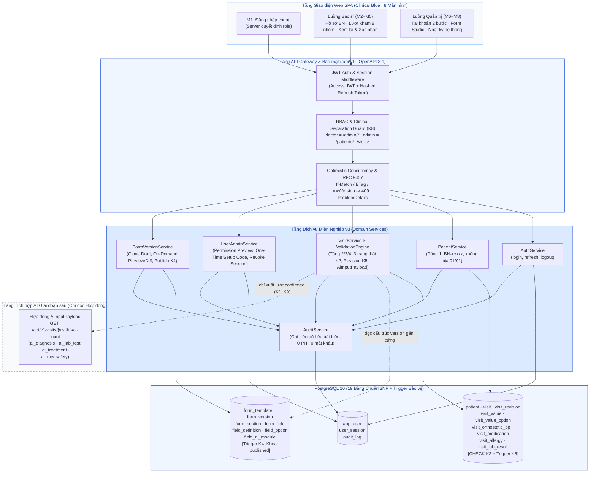
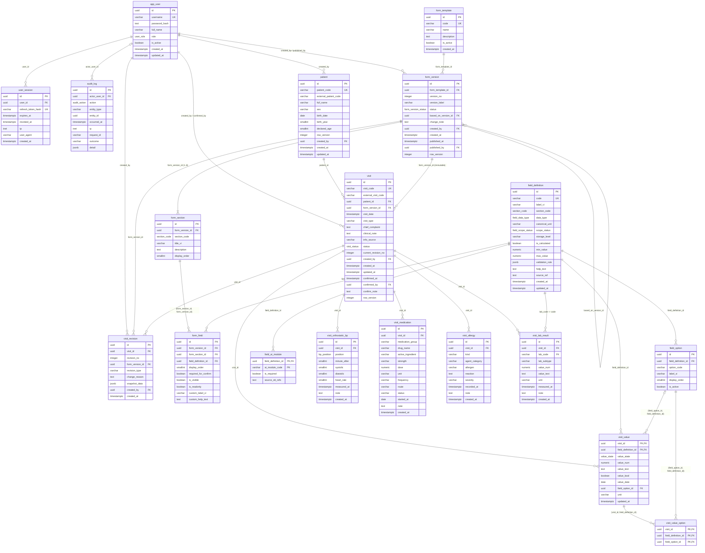

# Thiết kế Kiến trúc & Mô hình UML Chặng C — Hệ thống Thu thập & Xác nhận Dữ liệu Suy tim Trước AI (MVP)

**Phiên bản tài liệu:** `1.0.0` (Chặng C — Thiết kế kỹ thuật đồng bộ S1/S2)  
**Ngày lập:** `2026-11-21`  
**Phụ trách:** UML & Architecture Lead (`@uml-architect`)  
**Bảng màu sơ đồ chuẩn hóa:** **Tone Xanh Dương Y Tế (Clinical Blue)** (`fillColor=#DBEAFE`, `strokeColor=#1D4ED8`, `fontColor=#1E3A8A`) đồng bộ 100% với giao diện Chặng B và yêu cầu `#43`.

**Tài liệu căn cứ đồng bộ 100%:**
- Hợp đồng kiến trúc & đặt tên: `CONTRACT.md` (Chốt `K1`–`K10`, Mục 4)
- Đề xuất chuẩn hóa 3NF `multi_choice`: `CR-W1-01.md` (`visit_value_option` / `VisitValueOption`)
- Nguồn sự thật CSDL (Mốc S1): [`schema_metadata.json`](../../database/schema_metadata.json) (`19` bảng, `10` enum, `121` trường catalog = `95 mvp + 26 can_xac_nhan`)
- Nguồn sự thật API (Mốc S2): [`openapi.yaml`](../../api/openapi.yaml) (`OpenAPI 3.1.0`, `33 operationId`, `74` schemas)
- Bản bàn giao gốc: `BAN-GIAO-DEV-web-suy-tim-hai-luong-2026-11-19.md` (Mục 6.1, 6.3)

---

## 1. Danh mục Tệp Nguồn Sơ đồ trong `stage-c/architecture/`

Toàn bộ sơ đồ được xuất song song 3 định dạng đồng bộ (nguồn biên tập chuẩn `mxGraphModel` `.drawio`, mã nguồn PlantUML `.puml`, và sơ đồ Mermaid nhúng đọc trực tiếp trong tài liệu này). Tên tệp dễ hiểu, không gắn số mục báo cáo:

| Sơ đồ | Tệp nguồn Draw.io (`.drawio`) | Mã nguồn PlantUML (`.puml`) | Phạm vi mô tả |
|---|---|---|---|
| **ERD CSDL MVP** | [`erd-heart-failure-mvp.drawio`](./erd-heart-failure-mvp.drawio) | [`erd-heart-failure-mvp.puml`](./erd-heart-failure-mvp.puml) | Đủ **19 bảng** 3NF, PK/FK/UQ/NN, Crow's Foot multiplicity, 10 enum & ghi chú ràng buộc `K1–K10` |
| **UML Class Diagram** | [`class-heart-failure-mvp.drawio`](./class-heart-failure-mvp.drawio) | [`class-heart-failure-mvp.puml`](./class-heart-failure-mvp.puml) | Đủ **19 lớp thực thể** (có thuộc tính, phương thức nghiệp vụ, multiplicity) + **3 Value Object tính động** (`AiInputPayload`, `VisitReviewResponse`, `FormVersionDiffResponse`) |
| **Sequence 1 — Luồng Bác sĩ** | [`sequence-doctor-visit-confirm.drawio`](./sequence-doctor-visit-confirm.drawio) | [`sequence-doctor-visit-confirm.puml`](./sequence-doctor-visit-confirm.puml) | `createVisit` → `getVisitForm` → `saveVisitDraft` → `getVisitReview` → `confirmVisit` (+ `createVisitRevision`) → `getVisitAiInput` |
| **Sequence 2 — Luồng Admin Tài khoản** | [`sequence-admin-user-permission.drawio`](./sequence-admin-user-permission.drawio) | [`sequence-admin-user-permission.puml`](./sequence-admin-user-permission.puml) | `previewUserPermissions` → `createUser` → `updateUser` (kiểm quyền `admin`, thu hồi `user_session`, ghi `audit_log`) |
| **Sequence 3 — Luồng Admin Form Version** | [`sequence-admin-form-version-publish.drawio`](./sequence-admin-form-version-publish.drawio) | [`sequence-admin-form-version-publish.puml`](./sequence-admin-form-version-publish.puml) | `createFormVersionDraft` → `updateFormVersion` (chặn `409` trên bản `published` + Trigger K4) → `previewFormVersion` → `diffFormVersion` → `publishFormVersion` |

> [!NOTE]
> Theo Mục 6.3 bản bàn giao, khi hợp nhất tài liệu vào nhánh nộp GitHub (`submissions/suy_tim_nhom27/docs/architecture/`), các tệp `.drawio` sẽ được xuất kèm tệp ảnh `.png` cùng tên để nhúng trực tiếp bằng cú pháp ảnh Markdown; không dùng liên kết `.drawio` thay cho ảnh trong báo cáo đọc cuối.

---

## 2. Kiến trúc Phân lớp Tổng thể & Các Chốt Khóa cứng (`K1`–`K10`)

Hệ thống MVP sử dụng mô hình **Modular Monolith phân lớp sạch** (*Web SPA → REST API Gateway & RBAC → Domain Services → PostgreSQL 16*), bao phủ đúng 3 nhóm chức năng MVP (**Nhóm 1:** Hồ sơ bệnh án & lượt khám, **Nhóm 2:** Tiếp nhận & tiền xử lý dữ liệu nhập tay, **Nhóm 6:** Quản trị hệ thống & dữ liệu dùng chung). Tuyệt đối **không có** luồng nhập Excel/HIS, cổng bệnh nhân, hay mô-đun chạy AI giả (`K9`).



### Ma trận Đảm bảo Toàn vẹn theo Tầng Kiến trúc

| Chốt | Yêu cầu nghiệp vụ | Bảo đảm tại DDL / CHECK | Bảo đảm tại DB Trigger | Bảo đảm tại Giao dịch / Service / API |
|---|---|---|---|---|
| **K1** | Tách 4 tầng (`patient_created`, `draft_saved`, `confirmed`, `ai_ready`) | `patient` NOT NULL hành chính + CHECK nhóm tuổi; `form_field.required_for_confirm`; `field_ai_module` | — | `saveVisitDraft` cho phép thiếu trường lâm sàng; `getVisitReview` tách `tier3ConfirmErrors[]` khỏi `tier4AiModules[]`; Tầng 4 không chặn `confirmVisit`. |
| **K2** | 3 trạng thái câu trả lời (Chưa điền / Chưa rõ / Đã trả lời, giữ `0` & `false`) | `CHECK` trên `visit_value`: `unknown` buộc 5 cột giá trị & `unit` đều `NULL`; `answered` đơn trị có đúng 1 cột khác `NULL`; `multi_choice` dùng `visit_value_option` (`CR-W1-01`) | Trigger kiểm khớp `data_type` với cột giá trị, chặn gắn option khi `value_state='unknown'`, và deferred constraint kiểm `>=1` option cho `multi_choice` | `AiInputPayload` bỏ qua trường chưa điền, xuất `state: "unknown"` cho "Chưa rõ", giữ nguyên số `0` và `false`. |
| **K3** | Biểu mẫu điều khiển bằng metadata & gắn cứng version | Tách `field_definition` khỏi `form_field`; `visit.form_version_id NOT NULL FK` | Chặn đổi `visit.form_version_id` sau khi tạo lượt khám | `createVisit` luôn khóa vào phiên bản `published` hiện hành; `getVisitForm` luôn đọc theo đúng `visit.form_version_id`. |
| **K4** | Phiên bản `published` / đã có lượt dùng là bất biến | Partial unique index (tối đa 1 bản `published` / template); `based_on_version_id` self-FK | Trigger `trg_form_version_immutable`, `trg_form_section_immutable`, `trg_form_field_immutable` chặn mọi `UPDATE`/`DELETE` khi `status != 'draft'` hoặc đã có `visit` tham chiếu | `updateFormVersion` kiểm `status == 'draft'` & `If-Match`, trả `409 FORM_VERSION_IMMUTABLE` nếu đã phát hành. |
| **K5** | Lượt khám `confirmed` bất biến, sửa sau xác nhận giữ lịch sử `visit_revision` | `visit.status` (`draft`/`confirmed`), `UQ(visit_id, revision_no)` trên `visit_revision` | Trigger `trg_visit_lifecycle_guard`, `trg_visit_*_confirmed_guard`, `trg_visit_revision_append_only` chặn sửa/xóa trực tiếp bản đã xác nhận | `confirmVisit` chạy giao dịch nguyên tử (`UPDATE visit` + `INSERT visit_revision` + `INSERT audit_log`); `createVisitRevision` đòi `changeReason` bắt buộc. |
| **K6** | Bảng lặp là bảng con thực, không nén JSON | 4 bảng độc lập `visit_orthostatic_bp`, `visit_medication`, `visit_allergy`, `visit_lab_result` có FK về `visit(id)` | `trg_visit_bp_confirmed_guard`, `trg_visit_med_confirmed_guard`, `trg_visit_allergy_confirmed_guard`, `trg_visit_lab_guard` | `saveVisitDraft` đồng bộ nguyên tử cả `visit_value` + 4 bảng lặp trong cùng transaction và tăng `row_version`. |
| **K7** | Tách chỉ số cận lâm sàng & đơn vị chuẩn | `field_definition.code` tách `cls_bnp` ≠ `cls_nt_probnp`, `cls_creatinin` ≠ `cls_egfr`; `visit_lab_result.lab_code FK -> field_definition(code)` | `trg_visit_lab_guard` | Validation engine đối chiếu `canonical_unit` và kiểm miền sinh học (`systolic > diastolic`, `SpO2 30..100`, `LVEF >= 0`). |
| **K8** | Admin không đọc bệnh án; `audit_log` không chứa PHI / mật khẩu | `app_user.role` (`doctor` \| `admin`), `audit_log.detail` JSONB object | `trg_audit_log_append_only`, `trg_audit_log_no_clinical_data` | RBAC Middleware chặn `admin` gọi `/patients*`, `/visits*` (`403`) và chặn `doctor` gọi `/admin/*` (`403`); `AuditService` lọc sạch mọi trường lâm sàng & mật khẩu trước khi ghi. |
| **K10** | Mã bệnh nhân `BN-\d{5}` duy nhất, bất biến | `CHECK (patient_code ~ '^BN-[0-9]{5}$')`, `UNIQUE(patient_code)`, khóa nội bộ `UUID` | `trg_patient_immutable_code` chặn cập nhật `patient_code` sau `INSERT` | `createPatient` sinh `BN-xxxxx` trên server; `updatePatient` đánh dấu `patientCode` chỉ đọc (`readOnly: true`). |

---

## 3. Sơ đồ Thực thể Liên kết (ERD — 19 Bảng Chuẩn 3NF)

**Tệp nguồn biên tập:** [`erd-heart-failure-mvp.drawio`](./erd-heart-failure-mvp.drawio) · [`erd-heart-failure-mvp.puml`](./erd-heart-failure-mvp.puml)

Sơ đồ dưới đây đồng bộ **100% cả 19 bảng và tên cột** với [`schema_metadata.json`](../../database/schema_metadata.json), bao gồm bảng `visit_value_option` (`CR-W1-01`) để bảo toàn chuẩn 3NF và toàn vẹn khóa ngoại tổng hợp cho kiểu `multi_choice`, cùng `visit_lab_result` (nhiều xét nghiệm có thời điểm & đơn vị) và `visit_revision` (ảnh chụp bất biến bản xác nhận):



---

## 4. Biểu đồ Lớp Miền Nghiệp vụ (UML Class Diagram)

**Tệp nguồn biên tập:** [`class-heart-failure-mvp.drawio`](./class-heart-failure-mvp.drawio) · [`class-heart-failure-mvp.puml`](./class-heart-failure-mvp.puml)

Khác với việc sao chép bảng DB thành lớp dữ liệu rỗng, mô hình lớp dưới đây phân tách ranh giới **Aggregate Root** (`AppUser`, `FormVersion`, `Patient`, `Visit` / `Encounter`), đóng gói **quy tắc nghiệp vụ vào phương thức miền** (`saveDraft`, `computeBmi`, `buildReviewSummary`, `confirm`, `createRevision`, `exportAiInput`, `assertDraftEditable`, `diffAgainst`, `publish`, `previewPermissions`, `assertNoClinicalOrSecretPayload`), đồng thời biểu diễn rõ 3 **Value Object tính động** không lưu bảng (`AiInputPayload`, `VisitReviewResponse`, `FormVersionDiffResponse`):

```mermaid
classDiagram
    class AppUser {
        <<Aggregate Root>>
        -UUID id
        -String username
        -String passwordHash
        -String fullName
        -UserRole role
        -Boolean isActive
        +authenticate(rawPassword) Boolean
        +hasRole(role) Boolean
        +canAccessClinicalData() Boolean
        +deactivate(reason, actor) void
        +previewPermissions(role) PermissionPreviewResponse
    }

    class UserSession {
        <<Entity>>
        -UUID id
        -UUID userId
        -String refreshTokenHash
        -Instant expiresAt
        -Instant revokedAt
        +isActive(now) Boolean
        +verifyRefreshToken(rawToken) Boolean
        +rotate(newTokenHash, ttl) UserSession
        +revoke(now) void
    }

    class AuditLog {
        <<Immutable Audit>>
        -UUID id
        -UUID actorUserId
        -AuditAction action
        -String entityType
        -UUID entityId
        -Instant occurredAt
        -String outcome
        -Map detail
        +record(actor, action, entity, outcome, detail)$ AuditLog
        +assertNoClinicalOrSecretPayload() void
    }

    class FormTemplate {
        <<Entity>>
        -UUID id
        -String code
        -String name
        -Boolean isActive
        +getActivePublishedVersion() FormVersion
        +createDraftFrom(base, admin) FormVersion
    }

    class FormVersion {
        <<Aggregate Root>>
        -UUID id
        -UUID formTemplateId
        -Integer versionNo
        -String versionLabel
        -FormVersionStatus status
        -UUID basedOnVersionId
        -Instant publishedAt
        -UUID publishedBy
        -Integer rowVersion
        +assertDraftEditable() void
        +upsertSection(spec) FormSection
        +upsertField(sectionId, spec) FormField
        +renderPreview() FormVersionPreviewResponse
        +diffAgainst(base) FormVersionDiffResponse
        +publish(admin, expectedRowVersion) void
        +retire() void
    }

    class FormSection {
        <<Entity>>
        -UUID id
        -UUID formVersionId
        -SectionCode sectionCode
        -String titleVi
        -SmallInt displayOrder
        +getOrderedFields() List~FormField~
        +addField(def, order, reqT3) FormField
    }

    class FormField {
        <<Entity>>
        -UUID id
        -UUID formVersionId
        -UUID formSectionId
        -UUID fieldDefinitionId
        -SmallInt displayOrder
        -Boolean requiredForConfirm
        -Boolean isVisible
        -Boolean isReadonly
        +isRequiredAtTier3() Boolean
        +validateValue(v) List~FieldValidationError~
    }

    class FieldDefinition {
        <<Catalog Entity>>
        -UUID id
        -String code
        -String labelVi
        -SectionCode sectionCode
        -FieldDataType dataType
        -String canonicalUnit
        -FieldScopeStatus scopeStatus
        -String storageLevel
        -Boolean isCalculated
        -Decimal minValue
        -Decimal maxValue
        -String sourceRef
        +isTriState() Boolean
        +validateBounds(rawValue) List~FieldValidationError~
        +getActiveOptions() List~FieldOption~
        +getLinkedAiModules() List~FieldAiModule~
    }

    class FieldOption {
        <<Entity>>
        -UUID id
        -UUID fieldDefinitionId
        -String optionCode
        -String labelVi
        -SmallInt displayOrder
        -Boolean isActive
        +belongsTo(def) Boolean
        +deactivate() void
    }

    class FieldAiModule {
        <<Entity>>
        -UUID fieldDefinitionId
        -String aiModuleCode
        -Boolean isRequired
        -String sourceSttRefs
        +isSatisfiedBy(values) Boolean
    }

    class Patient {
        <<Aggregate Root>>
        -UUID id
        -String patientCode
        -String externalPatientCode
        -String fullName
        -String sex
        -Date birthDate
        -SmallInt birthYear
        -SmallInt declaredAge
        -Integer rowVersion
        +hasValidBirthInfo() Boolean
        +calculateAgeAt(visitDate) Integer
        +updateDemographics(patch, expectedRowVersion) void
        +openVisit(publishedVer, doctor) Visit
    }

    class Visit {
        <<Aggregate Root / Encounter>>
        -UUID id
        -String visitCode
        -UUID patientId
        -UUID formVersionId
        -Instant visitDate
        -String visitType
        -VisitStatus status
        -Integer currentRevisionNo
        -Instant confirmedAt
        -UUID confirmedBy
        -Integer rowVersion
        +assertDraftEditable(expectedRowVersion) void
        +saveDraft(payload, expectedRowVersion) void
        +computeBmi() Decimal
        +buildReviewSummary() VisitReviewResponse
        +confirm(doctor, expectedRowVersion) VisitRevision
        +createRevision(doctor, changeReason) VisitRevision
        +exportAiInput() AiInputPayload
    }

    class VisitRevision {
        <<Immutable Snapshot>>
        -UUID id
        -UUID visitId
        -Integer revisionNo
        -UUID formVersionId
        -String revisionType
        -String changeReason
        -JSONB snapshotData
        -UUID createdBy
        -Instant createdAt
        +captureSnapshot(visit, actor, reason)$ VisitRevision
        +verifyIntegrity() Boolean
    }

    class VisitValue {
        <<Entity>>
        -UUID visitId
        -UUID fieldDefinitionId
        -ValueState valueState
        -Decimal valueNum
        -String valueText
        -Boolean valueBool
        -Date valueDate
        -UUID fieldOptionId
        -String unit
        +setAnswered(typedVal, unit) void
        +markUnknown() void
        +validateAgainst(def) List~FieldValidationError~
    }

    class VisitValueOption {
        <<Entity CR-W1-01>>
        -UUID visitId
        -UUID fieldDefinitionId
        -UUID fieldOptionId
        +assertOptionMatchesField(opt) void
        +assertParentAnswered(parent) void
    }

    class OrthostaticBpMeasurement {
        <<Entity>>
        -UUID id
        -UUID visitId
        -BpPosition position
        -SmallInt minuteAfter
        -SmallInt systolic
        -SmallInt diastolic
        -SmallInt heartRate
        -Instant measuredAt
        +validatePressures() Boolean
        +hasOrthostaticDrop(baseline) Boolean
    }

    class VisitMedication {
        <<Entity>>
        -UUID id
        -UUID visitId
        -String medicationGroup
        -String drugName
        -String activeIngredient
        -Decimal dose
        -String unit
        -String frequency
        -String route
        -String status
        +isCompleteForConfirm() Boolean
        +isCurrentlyActive() Boolean
    }

    class VisitAllergy {
        <<Entity>>
        -UUID id
        -UUID visitId
        -String kind
        -String agentCategory
        -String allergen
        -String reaction
        -String severity
        +isContrastAgentAllergy() Boolean
        +isCompleteForConfirm() Boolean
    }

    class VisitLabResult {
        <<Entity>>
        -UUID id
        -UUID visitId
        -String labCode
        -String labSubtype
        -Decimal valueNum
        -String valueText
        -String unit
        -Instant measuredAt
        +matchesCanonicalUnit(def) Boolean
        +isCompleteForConfirm() Boolean
    }

    class AiInputPayload {
        <<Value Object>>
        +UUID visitId
        +String patientCode
        +UUID formVersionId
        +Instant confirmedAt
        +Map values
        +List~OrthostaticBpMeasurement~ orthostaticBp
        +List~VisitMedication~ medications
        +List~VisitAllergy~ allergies
        +List~VisitLabResult~ labResults
        +List~AiModuleReadiness~ modules
        +omitUnfilledFields() void
        +isModuleReady(code) Boolean
    }

    class VisitReviewResponse {
        <<Value Object>>
        +UUID visitId
        +ReadinessTier readinessTier
        +Boolean canConfirm
        +List~FieldValidationError~ tier3ConfirmErrors
        +List~AiModuleReadiness~ tier4AiModules
    }

    class FormVersionDiffResponse {
        <<Value Object>>
        +UUID targetVersionId
        +UUID baseVersionId
        +Boolean hasChanges
        +List~FormFieldDiffItem~ addedFields
        +List~FormFieldDiffItem~ modifiedFields
        +List~FormFieldDiffItem~ removedFields
    }

    AppUser "1" *-- "0..*" UserSession : owns
    AppUser "0..1" -- "0..*" AuditLog : actor
    AppUser "1" -- "0..*" Patient : createdBy
    AppUser "1" -- "0..*" Visit : createdBy/confirmedBy
    AppUser "1" -- "0..*" FormVersion : publishedBy

    FormTemplate "1" *-- "0..*" FormVersion : versions
    FormVersion "0..*" --> "0..1" FormVersion : basedOnVersion
    FormVersion "1" *-- "1..8" FormSection : sections
    FormSection "1" *-- "0..*" FormField : fields
    FormField "0..*" --> "1" FieldDefinition : definition
    FieldDefinition "1" *-- "0..*" FieldOption : options
    FieldDefinition "1" *-- "0..*" FieldAiModule : aiModules

    Patient "1" -- "0..*" Visit : encounters
    Visit "0..*" --> "1" FormVersion : boundFormVersion
    Visit "1" *-- "0..*" VisitRevision : revisions
    Visit "1" *-- "0..*" VisitValue : values
    VisitValue "1" *-- "0..*" VisitValueOption : selectedOptions
    VisitValue "0..*" --> "1" FieldDefinition : field
    VisitValueOption "0..*" --> "1" FieldOption : option
    Visit "1" *-- "0..*" OrthostaticBpMeasurement : orthostaticBp
    Visit "1" *-- "0..*" VisitMedication : medications
    Visit "1" *-- "0..*" VisitAllergy : allergies
    Visit "1" *-- "0..*" VisitLabResult : labResults
    VisitLabResult "0..*" --> "1" FieldDefinition : labCode

    Visit ..> AiInputPayload : exports
    Visit ..> VisitReviewResponse : produces
    FormVersion ..> FormVersionDiffResponse : computes
```



---

## 5. Ba Biểu đồ Tuần tự Ưu tiên (Sequence Diagrams — Mục 6.3 Bàn giao)

Mọi thông điệp API trong cả 3 biểu đồ đều khớp chính xác đường dẫn `/api/v1/...`, `operationId`, header `If-Match` / `ETag`, mã lỗi RFC 9457 (`401`/`403`/`404`/`409`/`422`), ranh giới quyền `doctor`/`admin` (`K8`), giao dịch nguyên tử PostgreSQL và ghi nhật ký kiểm toán `audit_log`.

### 5.1. Sequence 1 — Luồng Bác sĩ: Tạo lượt → Lưu nháp → Xem lại → Xác nhận → Xuất `AiInputPayload`

**Tệp nguồn biên tập:** [`sequence-doctor-visit-confirm.drawio`](./sequence-doctor-visit-confirm.drawio) · [`sequence-doctor-visit-confirm.puml`](./sequence-doctor-visit-confirm.puml)

```mermaid
sequenceDiagram
    autonumber
    actor Doc as Bác sĩ (Doctor)
    participant UI as Web UI (M3–M5)
    participant API as API Gateway & RBAC (/api/v1)
    participant Svc as VisitService & Validator
    participant DB as PostgreSQL 16 (Clinical & Audit)

    rect rgb(239, 246, 255)
        Note over Doc,DB: Giai đoạn 1 — Tạo lượt khám & Tải cấu trúc biểu mẫu gắn cứng form_version_id (K3)
        Doc->>UI: Bấm [+ Tạo lượt khám mới] (visitDate, visitType)
        UI->>API: POST /api/v1/patients/{patientId}/visits [createVisit] (Bearer JWT)
        alt RBAC Guard: role != 'doctor' (vd. admin cố truy cập bệnh án — K8)
            API->>DB: INSERT audit_log(outcome='denied', detail={path}) — không lộ PHI
            API-->>UI: 403 Forbidden (CLINICAL_DATA_SEPARATION_ENFORCED)
        else role == 'doctor'
            API->>Svc: createVisit(patientId, doctor, CreateVisitRequest)
            Svc->>DB: SELECT published form_version; INSERT visit(status='draft', form_version_id, row_version=1)
            DB-->>Svc: visit (không sao chép số đo cũ)
            Svc-->>API: Visit
            API-->>UI: 201 Created (Visit) + ETag: "1"
            UI->>API: GET /api/v1/visits/{visitId}/form [getVisitForm]
            API-->>UI: 200 OK (VisitFormStructureResponse — 8 nhóm đúng form_version_id)
        end
    end

    rect rgb(239, 246, 255)
        Note over Doc,DB: Giai đoạn 2 — Nhập tay & Lưu nháp Tầng 2 (saveVisitDraft)
        Doc->>UI: Nhập 8 nhóm (3 trạng thái K2 + 4 bảng lặp K6) -> [Lưu nháp]
        UI->>API: PUT /api/v1/visits/{visitId}/draft [saveVisitDraft] (If-Match: "1")
        API->>Svc: saveVisitDraft(visitId, expectedRowVersion=1, SaveVisitDraftRequest)
        Svc->>Svc: Validate Tầng 2 (kiểu, miền sinh học, CHECK 3 trạng thái; giữ 0/false; cho phép thiếu trường)
        alt Lỗi kiểu dữ liệu / miền kỹ thuật (SpO2 > 100, diastolic >= systolic...)
            Svc-->>API: ValidationError(fieldErrors[])
            API-->>UI: 422 Unprocessable Entity (ProblemDetails + errors[]) — giữ nguyên ô hợp lệ
        else row_version != If-Match HOẶC visit.status == 'confirmed' (K5)
            Svc-->>API: ConflictError(currentRowVersion)
            API-->>UI: 409 Conflict (CONCURRENCY_ROW_VERSION_MISMATCH / VISIT_ALREADY_CONFIRMED)
        else Hợp lệ — Giao dịch nguyên tử (BEGIN ... COMMIT)
            Svc->>DB: BEGIN; UPSERT visit_value & visit_value_option; SYNC 4 bảng lặp (BP/Med/Allergy/Lab)
            Svc->>DB: UPDATE visit SET row_version=row_version+1, updated_at=NOW() WHERE id=? AND row_version=1
            DB-->>Svc: COMMIT OK (row_version=2)
            Svc-->>API: VisitDetailResponse(rowVersion=2)
            API-->>UI: 200 OK (VisitDetailResponse) + ETag: "2"
        end
    end

    rect rgb(239, 246, 255)
        Note over Doc,DB: Giai đoạn 3 — Xem lại theo 8 nhóm: Tách Tầng 3 & Tầng 4 (getVisitReview)
        Doc->>UI: Mở Màn 5 [Xem lại & Xác nhận]
        UI->>API: GET /api/v1/visits/{visitId}/review [getVisitReview]
        API->>Svc: buildReviewSummary(visitId)
        Svc->>DB: SELECT visit, form_field(required_for_confirm), visit_value, 4 bảng lặp, field_ai_module
        DB-->>Svc: Dữ liệu lượt + quy tắc Tầng 3 + ánh xạ 4 module AI
        Svc->>Svc: Tách tier3ConfirmErrors[] khỏi tier4AiModules[] (Tầng 4 không chặn xác nhận — K1)
        Svc-->>API: VisitReviewResponse
        API-->>UI: 200 OK (VisitReviewResponse)
    end

    rect rgb(239, 246, 255)
        Note over Doc,DB: Giai đoạn 4 — Xác nhận dữ liệu lượt khám (confirmVisit)
        Doc->>UI: Bấm [Xác nhận dữ liệu lượt khám]
        UI->>API: POST /api/v1/visits/{visitId}/confirm [confirmVisit] (If-Match: "2", ConfirmVisitRequest)
        API->>Svc: confirmVisit(visitId, doctor, expectedRowVersion=2)
        alt Còn lỗi Tầng 3 (required_for_confirm hoặc bản ghi lặp dở dang)
            Svc-->>API: Tier3ValidationFailed(errors[])
            API-->>UI: 422 Unprocessable Entity (TIER3_CONFIRM_REQUIREMENTS_UNMET)
        else Lệch ETag HOẶC đã confirmed
            Svc-->>API: ConflictError
            API-->>UI: 409 Conflict (ProblemDetails)
        else Đạt Tầng 3 — Giao dịch nguyên tử (BEGIN ... COMMIT)
            Svc->>DB: BEGIN; SELECT visit FOR UPDATE; UPDATE visit SET status='confirmed', confirmed_at=NOW(), confirmed_by=doctor, current_revision_no=1, row_version=3
            Svc->>DB: INSERT visit_revision(revision_no=1, revision_type='confirmed_snapshot', snapshot_data)
            Svc->>DB: INSERT audit_log(action='visit_confirm', entity_type='visit', entity_id=visitId, detail={formVersionId, rev:1})
            DB-->>Svc: COMMIT OK
            Svc-->>API: Visit(confirmed, rowVersion=3)
            API-->>UI: 200 OK (Visit) + ETag: "3" (Khóa M4 chỉ đọc; sửa sau dùng createVisitRevision)
        end
    end

    rect rgb(239, 246, 255)
        Note over Doc,DB: Giai đoạn 5 — Xuất hợp đồng dữ liệu đầu vào chuẩn AI (getVisitAiInput)
        Doc->>UI: Yêu cầu xem / xuất gói dữ liệu chuẩn đầu vào AI
        UI->>API: GET /api/v1/visits/{visitId}/ai-input [getVisitAiInput]
        API->>Svc: exportAiInput(visitId)
        alt visit.status != 'confirmed'
            Svc-->>API: VisitNotConfirmedError
            API-->>UI: 409 Conflict (VISIT_NOT_CONFIRMED_FOR_AI_INPUT)
        else visit.status == 'confirmed'
            Svc->>DB: SELECT visit, patient.patient_code, visit_value, visit_value_option, 4 bảng lặp, field_ai_module
            DB-->>Svc: Dữ liệu đã xác nhận + cấu hình 4 module AI
            Svc-->>API: AiInputPayload (bỏ trường chưa điền, giữ unknown/0/false, kèm modules[])
            API-->>UI: 200 OK (AiInputPayload — chỉ hợp đồng dữ liệu, không chạy AI giả)
        end
    end
```

---

### 5.2. Sequence 2 — Luồng Admin: Xem trước quyền → Tạo & Cập nhật tài khoản Bác sĩ

**Tệp nguồn biên tập:** [`sequence-admin-user-permission.drawio`](./sequence-admin-user-permission.drawio) · [`sequence-admin-user-permission.puml`](./sequence-admin-user-permission.puml)

```mermaid
sequenceDiagram
    autonumber
    actor Adm as Quản trị viên (Admin)
    participant UI as Web UI (M6 Admin)
    participant API as API Gateway & RBAC (/api/v1/admin)
    participant Svc as UserAdminService
    participant DB as PostgreSQL 16 (app_user, session, audit)

    rect rgb(239, 246, 255)
        Note over Adm,DB: Giai đoạn 1 — Xem trước ma trận quyền 2 cột trước khi lưu (previewUserPermissions)
        Adm->>UI: Chọn vai trò (doctor | admin) -> bấm [Xem lại quyền]
        UI->>API: POST /api/v1/admin/users/permission-preview [previewUserPermissions] (Bearer JWT)
        alt RBAC Guard: role != 'admin' (vd. doctor gọi trực tiếp /admin/*)
            API->>DB: INSERT audit_log(outcome='denied', entity_type='app_user', detail={path})
            API-->>UI: 403 Forbidden (RBAC_ROLE_FORBIDDEN)
        else role == 'admin'
            API->>Svc: computePermissionPreview(PermissionPreviewRequest)
            Svc->>Svc: Đối chiếu chính sách K8 (admin cấm đọc bệnh án lâm sàng)
            Svc-->>API: PermissionPreviewResponse(clinicalDataAccessAllowed, granted[], denied[])
            API-->>UI: 200 OK (Không ghi DB — hiển thị bảng 2 cột quyền)
        end
    end

    rect rgb(239, 246, 255)
        Note over Adm,DB: Giai đoạn 2 — Tạo tài khoản bác sĩ mới (createUser)
        Adm->>UI: Rà soát xong -> bấm [Xác nhận & Lưu tài khoản]
        UI->>API: POST /api/v1/admin/users [createUser] (CreateUserRequest: username, fullName, role, isActive, reason)
        API->>Svc: createUser(actor=admin, CreateUserRequest)
        Svc->>Svc: Validate định dạng username, fullName, role & reason
        alt Dữ liệu đầu vào không hợp lệ
            Svc-->>API: ValidationError(fieldErrors[])
            API-->>UI: 422 Unprocessable Entity (ProblemDetails + errors[])
        else Kiểm tra trùng username
            Svc->>DB: SELECT 1 FROM app_user WHERE username = ?
            alt username đã tồn tại
                DB-->>Svc: EXISTS (uq_app_user_username)
                Svc-->>API: DuplicateUsernameError
                API-->>UI: 409 Conflict (DUPLICATE_USERNAME)
            else Hợp lệ — Sinh mã kích hoạt 1 lần & Giao dịch nguyên tử
                Svc->>Svc: Sinh oneTimeSetupCode (hết hạn 24h) & băm Argon2id/bcrypt (0 log mật khẩu rõ)
                Svc->>DB: BEGIN; INSERT app_user(id, username, password_hash, full_name, role, is_active)
                Svc->>DB: INSERT audit_log(actor_user_id=admin, action='user_create', entity_type='app_user', detail={username, role, reason})
                DB-->>Svc: COMMIT OK
                Svc-->>API: CreateUserResponse(user, oneTimeSetupCode, setupExpiresAt)
                API-->>UI: 201 Created + ETag (CreateUserResponse — 0 password_hash)
            end
        end
    end

    rect rgb(239, 246, 255)
        Note over Adm,DB: Giai đoạn 3 — Cập nhật, Khóa/Mở, Đặt lại MK hoặc Đổi vai trò (updateUser)
        Adm->>UI: Sửa thông tin / Đặt lại MK / Khóa tài khoản kèm lý do
        UI->>API: PATCH /api/v1/admin/users/{userId} [updateUser] (If-Match, UpdateUserRequest)
        API->>Svc: updateUser(actor=admin, userId, expectedRowVersion, UpdateUserRequest)
        Svc->>DB: SELECT app_user WHERE id=? ; COUNT(*) active admins
        alt Không tìm thấy userId
            DB-->>Svc: NULL
            API-->>UI: 404 Not Found (RESOURCE_NOT_FOUND)
        else Tự khóa Admin cuối cùng HOẶC lệch If-Match
            DB-->>Svc: Conflict
            API-->>UI: 409 Conflict (LAST_ACTIVE_ADMIN / CONCURRENCY_ROW_VERSION_MISMATCH)
        else Hợp lệ — Giao dịch nguyên tử (BEGIN ... COMMIT)
            Svc->>DB: BEGIN; UPDATE app_user SET full_name=?, role=?, is_active=?, updated_at=NOW() WHERE id=?
            opt is_active == false HOẶC đổi role HOẶC resetPassword == true
                Svc->>DB: UPDATE user_session SET revoked_at=NOW() WHERE user_id=? AND revoked_at IS NULL
            end
            Svc->>DB: INSERT audit_log(action='user_update', entity_type='app_user', entity_id=userId, detail={diff, reason})
            DB-->>Svc: COMMIT OK
            Svc-->>API: UpdateUserResponse(user, oneTimeSetupCode?)
            API-->>UI: 200 OK + ETag mới (UpdateUserResponse)
        end
    end
```

---

### 5.3. Sequence 3 — Luồng Admin: Tạo bản nháp Form → Sửa → Xem trước → Diff → Phát hành

**Tệp nguồn biên tập:** [`sequence-admin-form-version-publish.drawio`](./sequence-admin-form-version-publish.drawio) · [`sequence-admin-form-version-publish.puml`](./sequence-admin-form-version-publish.puml)

```mermaid
sequenceDiagram
    autonumber
    actor Adm as Quản trị viên (Admin)
    participant UI as Web UI (M7 Form Studio)
    participant API as API Gateway & RBAC (/api/v1/admin)
    participant Svc as FormVersionService
    participant DB as PostgreSQL 16 (form_* + Trigger K4)

    rect rgb(239, 246, 255)
        Note over Adm,DB: Giai đoạn 1 — Tạo bản nháp mới từ phiên bản hiện hành (createFormVersionDraft)
        Adm->>UI: Chọn bản Đang dùng (v1) -> [+ Tạo bản nháp mới]
        UI->>API: POST /api/v1/admin/forms/{formId}/versions [createFormVersionDraft] (basedOnVersionId, changeNote)
        alt RBAC Guard: role != 'admin' (403) | Đã có bản draft đang mở (409)
            API-->>UI: 403 Forbidden / 409 Conflict (ProblemDetails)
        else Hợp lệ — Giao dịch nguyên tử (BEGIN ... COMMIT)
            API->>Svc: createDraftFrom(formId, basedOnVersionId, admin)
            Svc->>DB: BEGIN; INSERT form_version(version_no=base+1, status='draft', based_on_version_id, row_version=1)
            Svc->>DB: Deep clone form_section (8 nhóm) & form_field; INSERT audit_log(action='form_version_create')
            DB-->>Svc: COMMIT OK (draftVersionId, row_version=1)
            Svc-->>API: FormVersion(draft)
            API-->>UI: 201 Created (FormVersion) + ETag: "1"
        end
    end

    rect rgb(239, 246, 255)
        Note over Adm,DB: Giai đoạn 2 — Chỉnh sửa bản nháp & Chặn sửa trực tiếp bản published (updateFormVersion — K4)
        Adm->>UI: Sắp xếp nhóm/trường, chỉnh thuộc tính -> [Lưu nháp]
        UI->>API: PATCH /api/v1/admin/form-versions/{versionId} [updateFormVersion] (If-Match: "1")
        API->>Svc: updateFormVersion(versionId, expectedRowVersion=1, UpdateFormVersionRequest)
        alt version.status != 'draft' (đã published/retired) HOẶC DB Trigger K4 chặn
            Svc->>DB: Kiểm status='published' (trigger trg_form_version_immutable / trg_form_field_immutable)
            API-->>UI: 409 Conflict (FORM_VERSION_IMMUTABLE — bắt buộc tạo bản nháp mới)
        else Lệch If-Match (409) HOẶC lỗi cấu trúc/field_definition_id (422)
            API-->>UI: 409 Conflict / 422 Unprocessable Entity (ProblemDetails)
        else Hợp lệ — Giao dịch nguyên tử (BEGIN ... COMMIT)
            Svc->>DB: BEGIN; UPDATE/UPSERT form_section & form_field cho draftVersionId
            Svc->>DB: UPDATE form_version SET row_version=2 WHERE id=? AND status='draft'; INSERT audit_log('form_version_update')
            DB-->>Svc: COMMIT OK (row_version=2)
            Svc-->>API: FormVersionDetailResponse(rowVersion=2)
            API-->>UI: 200 OK (FormVersionDetailResponse) + ETag: "2"
        end
    end

    rect rgb(239, 246, 255)
        Note over Adm,DB: Giai đoạn 3 — Xem trước góc nhìn Bác sĩ (previewFormVersion — Tính động)
        Adm->>UI: Mở Tab [Xem trước góc nhìn Bác sĩ]
        UI->>API: GET /api/v1/admin/form-versions/{versionId}/preview [previewFormVersion]
        API->>Svc: buildPreview(versionId)
        Svc->>DB: SELECT form_section JOIN form_field JOIN field_definition LEFT JOIN field_option
        DB-->>Svc: Cấu trúc 8 nhóm + catalog + lựa chọn
        Svc-->>API: FormVersionPreviewResponse (isPreviewOnly=true, không lưu DB)
        API-->>UI: 200 OK (FormVersionPreviewResponse — render thử M4)
    end

    rect rgb(239, 246, 255)
        Note over Adm,DB: Giai đoạn 4 — So sánh thay đổi (diffFormVersion — Tính động)
        Adm->>UI: Mở Tab [So sánh thay đổi (Diff)]
        UI->>API: GET /api/v1/admin/form-versions/{versionId}/diff?baseVersionId={baseId} [diffFormVersion]
        API->>Svc: computeDiff(versionId, baseVersionId)
        Svc->>DB: SELECT form_section & form_field của baseVersion và draftVersion
        DB-->>Svc: Cấu trúc 2 phiên bản
        Svc->>Svc: Tính FormVersionDiffResponse (hasChanges, +added, ~modified, -removed)
        Svc-->>API: FormVersionDiffResponse (không lưu bảng DB)
        API-->>UI: 200 OK (FormVersionDiffResponse)
    end

    rect rgb(239, 246, 255)
        Note over Adm,DB: Giai đoạn 5 — Phát hành phiên bản mới (publishFormVersion)
        Adm->>UI: Nhập ghi chú phát hành & bấm [Phát hành phiên bản mới]
        UI->>API: POST /api/v1/admin/form-versions/{versionId}/publish [publishFormVersion] (If-Match: "2")
        API->>Svc: publishFormVersion(versionId, expectedRowVersion=2, admin)
        alt status != 'draft' HOẶC lệch ETag (409) | Bản nháp rỗng (422)
            API-->>UI: 409 Conflict / 422 Unprocessable Entity (ProblemDetails)
        else Hợp lệ — Giao dịch nguyên tử (BEGIN ... COMMIT)
            Svc->>DB: BEGIN; UPDATE form_version SET status='retired' WHERE form_template_id=? AND status='published'
            Svc->>DB: UPDATE form_version SET status='published', published_at=NOW(), published_by=admin, row_version=3
            Svc->>DB: INSERT audit_log(action='form_version_publish', entity_type='form_version', detail={retiredVersionId, versionNo})
            Note over DB: Trigger K4 khóa bất biến bản v2 vĩnh viễn; lượt cũ vẫn giữ form_version_id=v1
            DB-->>Svc: COMMIT OK (v2=published, v1=retired)
            Svc-->>API: FormVersion(published, rowVersion=3)
            API-->>UI: 200 OK (FormVersion) + ETag: "3"
        end
    end
```

---

## 6. Bảng Đối chiếu 3 Chiều: `UML Class ↔ Bảng DB ↔ OpenAPI Schema`

### 6.1. Đối chiếu 19 Thực thể Lưu trữ + 3 Value Object Tính động

Mọi tên lớp `PascalCase`, tên bảng `snake_case`, và OpenAPI schema đều được kiểm chứng khớp **100%** với `CONTRACT.md`, `database/schema_metadata.json` (`#45`) và `api/openapi.yaml` (`#46`):

| # | UML Class (`PascalCase`) | Bảng DB (`snake_case`) | OpenAPI 3.1 Schema (`components.schemas`) | Màn hình | Các `operationId` liên quan chính | Ghi chú thiết kế & Ràng buộc |
|---:|---|---|---|---|---|---|
| 1 | `AppUser` | `app_user` | `AppUser` (`CreateUserRequest/Response`, `UpdateUserRequest/Response`) | M1, M6 | `login`, `getCurrentUser`, `listUsers`, `createUser`, `getUser`, `updateUser`, `previewUserPermissions` | 1 role duy nhất (`doctor`/`admin`), `password_hash` không xuất qua API; tạo/đặt lại MK trả `oneTimeSetupCode` 1 lần |
| 2 | `UserSession` | `user_session` | `UserSession` (`AuthTokenResponse`, `RefreshTokenRequest`, `LogoutRequest`) | M1, M6 | `login`, `refreshToken`, `logout`, `updateUser` | Lưu `refresh_token_hash` (SHA-256), `revoked_at`; thu hồi tức thì khi khóa/đổi quyền |
| 3 | `AuditLog` | `audit_log` | `AuditLog` (`AuditLogListResponse`) | M1–M8 | `listAuditLogs` *(và ghi tự động từ mọi thao tác ghi/403)* | Chỉ lưu siêu dữ liệu kiểm toán (`detail` JSONB), **tuyệt đối 0 PHI và 0 mật khẩu** (`K8`) |
| 4 | `FormTemplate` | `form_template` | `FormTemplate` (`FormTemplateListResponse`) | M7 | `listForms` | Biểu mẫu logic (`suy_tim_kham_lam_sang`) quản lý chuỗi phiên bản |
| 5 | `FormVersion` | `form_version` | `FormVersion` (`FormVersionDetailResponse`, `FormVersionListResponse`) | M4, M7 | `listFormVersions`, `createFormVersionDraft`, `getFormVersion`, `updateFormVersion`, `publishFormVersion` | Bất biến ở trạng thái `published`/`retired` bởi API (`409`) và Trigger DB (`K4`); có `rowVersion` |
| 6 | `FormSection` | `form_section` | `FormSection` | M4, M7 | `getVisitForm`, `getFormVersion`, `updateFormVersion`, `previewFormVersion` | 8 mã nhóm UX tiếng Việt cố định (`section_code`), có `displayOrder` |
| 7 | `FormField` | `form_field` | `FormField` | M4, M5, M7 | `getVisitForm`, `getVisitReview`, `updateFormVersion`, `diffFormVersion` | Tách cấu hình theo version khỏi `FieldDefinition` (`K3`); mang cờ `requiredForConfirm` (Tầng 3) |
| 8 | `FieldDefinition` | `field_definition` | `FieldDefinition` (`FieldDefinitionListResponse`) | M4, M7 | `listFieldDefinitions`, `getVisitForm`, `previewFormVersion` | 121 trường (`95 mvp + 26 can_xac_nhan`), `0` đầu ra AI; tách BNP/NT-proBNP, Creatinin/eGFR (`K7`) |
| 9 | `FieldOption` | `field_option` | `FieldOption` | M4, M7 | `listFieldDefinitions`, `getVisitForm`, `previewFormVersion` | Khóa tổng hợp `(id, field_definition_id)` chặn gắn option sai trường |
| 10 | `FieldAiModule` | `field_ai_module` | `FieldAiModule` (`AiModuleReadiness`) | M5, M7 | `getVisitReview`, `getVisitAiInput`, `listFieldDefinitions` | Ánh xạ trường sang 4 mã module AI (`ai_diagnosis`, `ai_lab_test`, `ai_treatment`, `ai_medsafety`) cho Tầng 4 |
| 11 | `Patient` | `patient` | `Patient` (`PatientListItem`, `PatientDetailResponse`, `Create/UpdatePatientRequest`) | M2, M3 | `listPatients`, `createPatient`, `getPatient`, `updatePatient` | Mã `BN-\d{5}` duy nhất, bất biến do server sinh (`K10`); hành chính Tầng 1, không bịa ngày `01/01` |
| 12 | `Visit` *(Encounter)* | `visit` | `Visit` (`VisitDetailResponse`, `CreateVisitRequest`, `ConfirmVisitRequest`) | M3, M4, M5 | `listPatientVisits`, `createVisit`, `getVisit`, `saveVisitDraft`, `confirmVisit` | Gắn cứng `formVersionId` (`K3`), khóa sửa khi `confirmed` (`K5`), kiểm soát đồng thời `rowVersion` (`If-Match`) |
| 13 | `VisitRevision` | `visit_revision` | `VisitRevision` (`CreateVisitRevisionRequest`) | M4, M5 | `confirmVisit`, `createVisitRevision`, `getVisit` | Ảnh chụp bất biến bản xác nhận & bản sửa bổ sung sau xác nhận có `changeReason` (`K5`) |
| 14 | `VisitValue` | `visit_value` | `VisitValue` (`SaveVisitDraftRequest`) | M4, M5 | `getVisit`, `saveVisitDraft`, `getVisitReview`, `getVisitAiInput` | PK `(visit_id, field_definition_id)`; 3 trạng thái `K2` (vắng mặt = chưa điền, `unknown`, `answered`) |
| 15 | `VisitValueOption` | `visit_value_option` | `VisitValueOption` | M4, M5 | `getVisit`, `saveVisitDraft`, `getVisitAiInput` | **Bổ sung theo `CR-W1-01`**: chuẩn hóa 3NF cho `multi_choice`, composite FK tới `visit_value` & `field_option` |
| 16 | `OrthostaticBpMeasurement` | `visit_orthostatic_bp` | `OrthostaticBpMeasurement` | M3, M4, M5 | `getVisit`, `saveVisitDraft`, `getVisitAiInput` | Bảng lặp thực (`K6`): nhiều lần đo HA theo tư thế (`supine`/`sitting`/`standing`) & `minuteAfter`, `systolic > diastolic` |
| 17 | `VisitMedication` | `visit_medication` | `VisitMedication` | M3, M4, M5 | `getVisit`, `saveVisitDraft`, `getVisitAiInput` | Bảng lặp thực (`K6`): thuốc kê đơn + OTC/TPCN/YHCT kèm liều, đơn vị, đường dùng, tần suất |
| 18 | `VisitAllergy` | `visit_allergy` | `VisitAllergy` | M3, M4, M5 | `getVisit`, `saveVisitDraft`, `getVisitAiInput` | Bảng lặp thực (`K6`): dị ứng & ADR (`allergy`/`adr`), bao gồm dị ứng thuốc cản quang |
| 19 | `VisitLabResult` | `visit_lab_result` | `VisitLabResult` | M4, M5 | `getVisit`, `saveVisitDraft`, `getVisitAiInput` | Bảng lặp thực (`K6`, `K7`): nhiều kết quả CLS có `labCode -> field_definition.code`, giá trị, đơn vị, `measuredAt` |
| VO-1 | `AiInputPayload` | *(Tính động — không lưu bảng)* | `AiInputPayload` (`AiInputFieldValue`, `AiModuleReadiness`) | M5 | `getVisitAiInput` | Hợp đồng đầu ra chuẩn cho AI; trả `409` nếu lượt còn `draft`; bỏ trường chưa điền, giữ `unknown`/`0`/`false` |
| VO-2 | `VisitReviewResponse` | *(Tính động — không lưu bảng)* | `VisitReviewResponse` (`SectionReviewSummary`, `FieldValidationError`) | M5 | `getVisitReview` | Tách biệt lỗi chặn xác nhận Tầng 3 (`tier3ConfirmErrors[]`) với trạng thái Tầng 4 (`tier4AiModules[]`) |
| VO-3 | `FormVersionDiffResponse` | *(Tính động — không lưu bảng)* | `FormVersionDiffResponse` (`FormFieldDiffItem`) | M7 | `diffFormVersion` | So sánh `addedFields` / `modifiedFields` / `removedFields` giữa 2 phiên bản biểu mẫu khi gọi (`CONTRACT §4.1`) |

### 6.2. Đối chiếu 10 Enum Chuẩn (`CONTRACT.md` §4.2)

| Enum CSDL (`snake_case`) | OpenAPI / UML Enum (`PascalCase`) | Tập giá trị khóa cứng |
|---|---|---|
| `user_role` | `UserRole` | `doctor`, `admin` |
| `visit_status` | `VisitStatus` | `draft`, `confirmed` |
| `value_state` | `ValueState` | `answered`, `unknown` |
| `form_version_status` | `FormVersionStatus` | `draft`, `published`, `retired` |
| `field_scope_status` | `FieldScopeStatus` | `mvp`, `can_xac_nhan` |
| `field_data_type` | `FieldDataType` | `number`, `integer`, `text`, `boolean`, `date`, `single_choice`, `multi_choice` |
| `section_code` | `SectionCode` | `hanh_chinh`, `trieu_chung_dien_bien`, `sinh_ton_kham`, `benh_su_dong_mac`, `thuoc_di_ung`, `can_lam_sang`, `lao_khoa`, `ghi_chu` |
| `readiness_tier` | `ReadinessTier` | `patient_created`, `draft_saved`, `confirmed`, `ai_ready` |
| `bp_position` | `BpPosition` | `supine`, `sitting`, `standing` |
| `audit_action` | `AuditAction` | `login`, `logout`, `login_failed`, `user_create`, `user_update`, `form_version_create`, `form_version_update`, `form_version_publish`, `patient_create`, `visit_confirm` |

---

## 7. Kết quả Kiểm chứng Tự động (Chặng C — W3)

Toàn bộ tệp trong thư mục `docs/architecture/` đã được kiểm định tự động bằng Python (`xml.etree.ElementTree.parse`, `json`, `yaml.safe_load`):
1. **Tính hợp lệ XML mxGraphModel:** 5/5 tệp `.drawio` parse thành công qua `xml.etree.ElementTree.parse`, mở trực tiếp trên `app.diagrams.net` / VS Code Draw.io.
2. **Kiểm định hình học & bố cục:** `0` khối vượt lề trang (`oob = 0`), `0` khối chồng lấn (`overlaps = 0`) trên toàn bộ 5 sơ đồ.
3. **Đồng bộ bảng màu Clinical Blue (`#43`):** 5/5 tệp `.drawio` và 5/5 tệp `.puml` sử dụng thống nhất hệ màu xanh dương y tế (`#DBEAFE`, `#1D4ED8`, `#1E3A8A`, `#EFF6FF`).
4. **Đối chiếu 3 chiều S1 ↔ S2 ↔ W3:** 19/19 bảng & lớp thực thể, 10/10 enum, 3 Value Object tính động và toàn bộ `operationId` trong 3 Sequence Diagram khớp 100% với `database/schema_metadata.json` và `api/openapi.yaml`; `0` khái niệm thuộc phạm vi đã loại (`Excel/HIS import`, `patient portal`, `AI stub/predict`).
