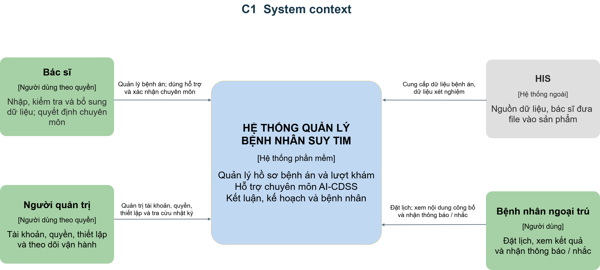
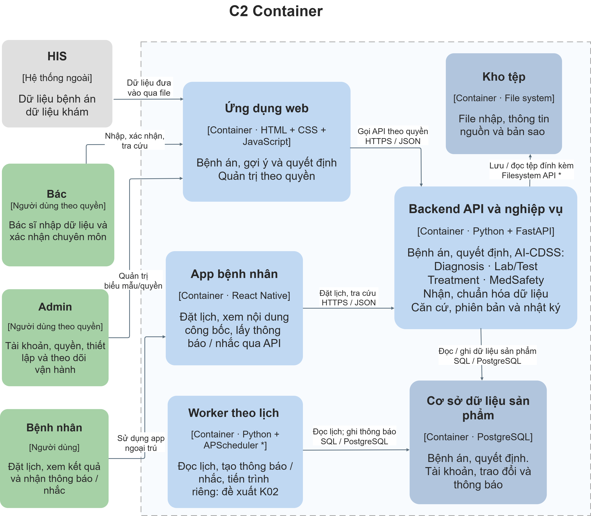
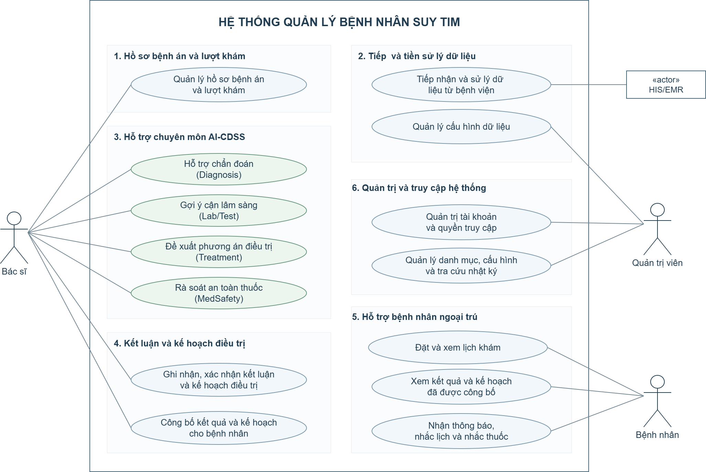
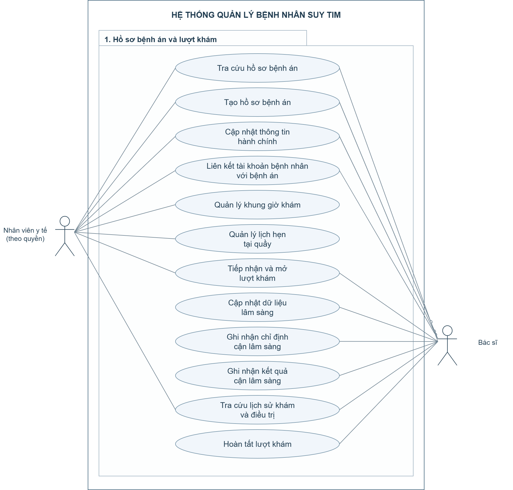
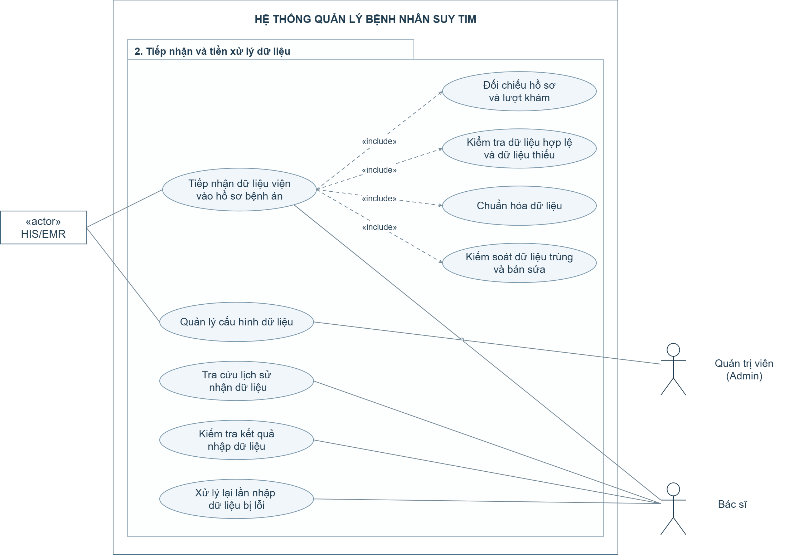
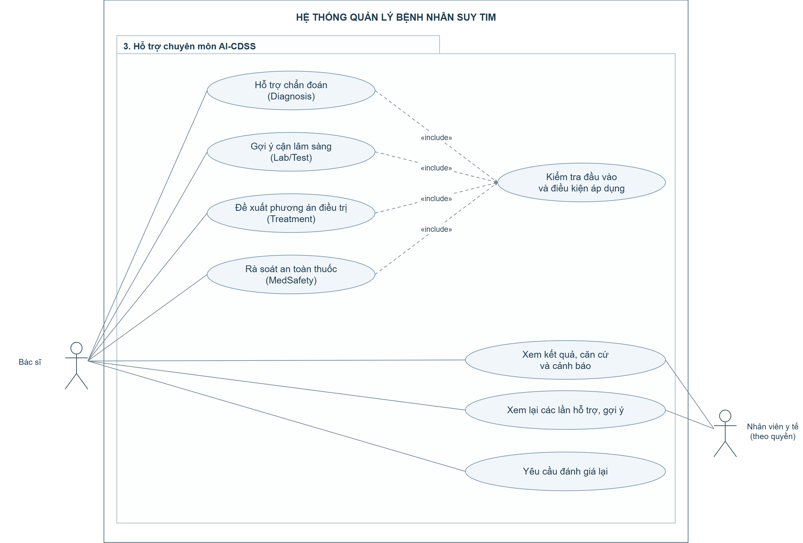
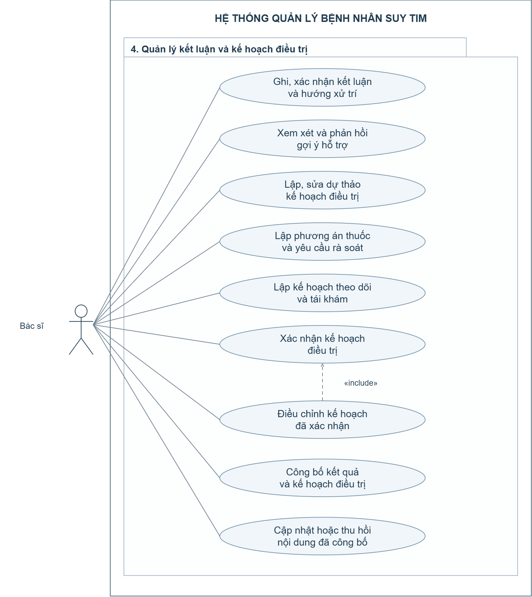
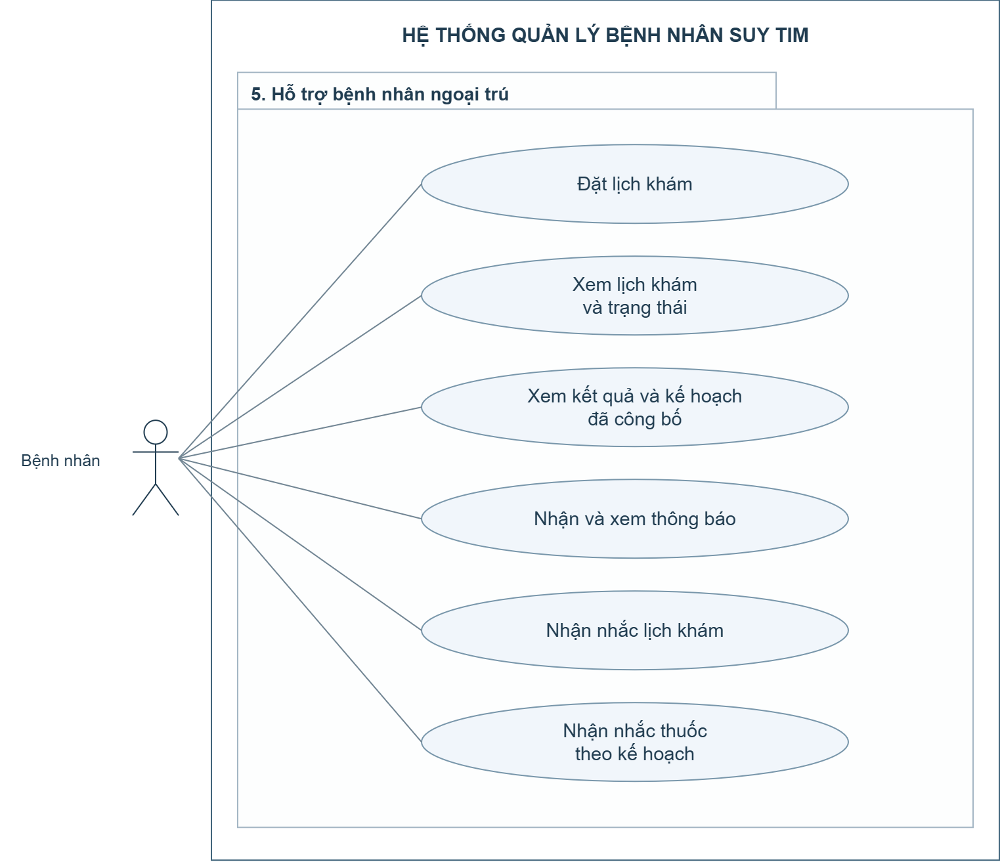
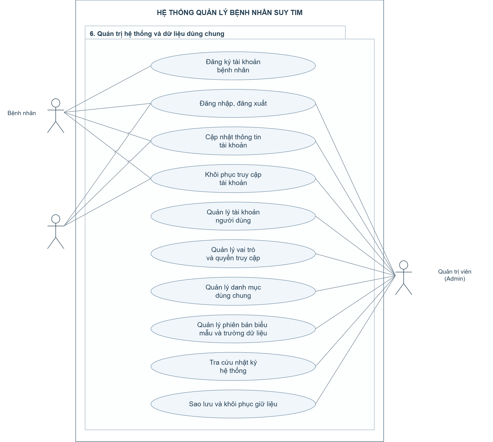

# Kiến trúc và các sơ đồ của hệ thống quản lý bệnh nhân suy tim

Cập nhật ngày 31/10/2026. Nội dung theo phạm vi hiện hành của [SRS v1.0](../SRS-v1.0.md), [đặc tả Use Case](<../Đặc tả usecase đầy đủ.md>) và [User Story INVEST BDD](../User-Stories-INVEST-BDD.md). Tài liệu này thay nội dung kiến trúc tuần 3 cũ tại cùng đường dẫn.

Thư mục lưu nguyên bảy ảnh Use Case trưởng nhóm cung cấp và hai ảnh C1/C2 đã thống nhất. Những ảnh `.drawio.png` giữ metadata nguồn trong ảnh nếu bản cung cấp có chứa; không mặc định các PNG khác có file draw.io chỉnh sửa riêng. Tên ảnh được dùng nhất quán trong SRS.

## 1 Phạm vi và trình tự xây dựng

Hệ thống là web chuyên suy tim, dùng hồ sơ bệnh nhân và các lượt khám làm trung tâm. Nhập tay rồi nhập file vào cùng bệnh án sản phẩm; phần thiếu được bổ sung theo quyền. Nền tảng nhóm 1, 2, 6 được xây trước; AI và quyết định/kế hoạch sau khi dữ liệu ổn định; bệnh nhân ngoại trú sau luồng chính.

Bản demo dùng một trang đăng nhập theo vai trò Bác sĩ/Admin. Nhân viên y tế là tác nhân nghiệp vụ theo quyền trên các sơ đồ chi tiết; chưa tạo loại đăng nhập riêng. Chỉ Bác sĩ xác nhận kết luận và kế hoạch. Quyền Admin không tự là quyền nhập/xác nhận lâm sàng. Không mặc định có vai trò dược sĩ riêng hoặc phạm vi truy cập toàn bộ người bệnh.

HIS/EMR là nguồn file do Bác sĩ đưa vào sản phẩm và cung cấp quy ước cấu trúc để đối chiếu. Demo không dựng nguồn HIS/LIS/PACS mô phỏng, không gọi API viện hoặc ghi trả HIS. Việc kết nối/nhúng thật cần thỏa thuận riêng.

## 2 C1 Ngữ cảnh hệ thống

C1 biểu diễn toàn hệ thống trong quan hệ với Bác sĩ, Người quản trị, Bệnh nhân ngoại trú và HIS. Hệ thống lưu dữ liệu khám và quyết định ở sản phẩm; Bác sĩ nhập, kiểm tra và xác nhận chuyên môn. Bệnh nhân chỉ xem phần được công bố sau liên kết tài khoản đã xác minh.

## 3 C2 Các container

| Thành phần | Công nghệ hoặc định hướng | Trách nhiệm |
| --- | --- | --- |
| Ứng dụng web | HTML, CSS, JavaScript | Giao diện hồ sơ/lượt, biểu mẫu, nhập file và quản trị theo quyền. |
| Backend API và nghiệp vụ | Python, FastAPI | Quyền, nghiệp vụ, kiểm tra/chuẩn hóa dữ liệu, bốn module hỗ trợ, quyết định và truy vết. |
| Cơ sở dữ liệu sản phẩm | PostgreSQL | Hồ sơ/lượt, giá trị, mẫu/phiên bản, tài khoản/quyền, kết quả và các dữ liệu nghiệp vụ liên quan. |
| Kho tệp | File system do ứng dụng quản lý | File nhập, tham chiếu nguồn, tệp cần lưu và bản sao theo phạm vi đã xác định. Volume hoạt động không tự là bản sao lưu. |
| App bệnh nhân | React Native, giai đoạn sau | Đặt/xem lịch, xem thông tin công bố, lấy thông báo và nhắc qua API. |
| Worker theo lịch | Python, APScheduler được đề xuất, giai đoạn sau | Đọc lịch, tạo thông báo/nhắc; cách chạy tiến trình riêng và kênh khi app đóng được cụ thể hóa khi triển khai. |

Diagnosis, Lab/Test, Treatment và MedSafety là các module bên trong Backend; không mặc định bốn dịch vụ hay bốn máy chủ AI riêng. Web/app dùng API theo quyền, Backend truy cập PostgreSQL và kho tệp. HTTPS/JSON trên hình là giao tiếp mục tiêu; không phải bằng chứng demo local đã chạy HTTPS hoặc app đã có push khi đóng.

Container C4 là ứng dụng hoặc kho dữ liệu; không đồng nhất với container Docker. Docker Compose là cách đóng gói khi cấu hình được hoàn thiện. Không tự thêm Redis/RabbitMQ hay một Gateway triển khai riêng khi chưa có nhu cầu được xác định.

## 4 Bộ sơ đồ Use Case

Các hình được giữ nguyên theo lựa chọn của trưởng nhóm. Danh mục và nội dung đặc tả hiện hành có 54 ca theo nhóm 12/9/8/9/6/10; các mã ca đã gộp có liên kết lịch sử ở file đặc tả.

### Tổng quan

### Nhóm 1 Hồ sơ bệnh án và lượt khám

### Nhóm 2 Tiếp nhận và tiền xử lý dữ liệu

### Nhóm 3 Hỗ trợ chuyên môn AI CDSS

### Nhóm 4 Kết luận và kế hoạch điều trị

### Nhóm 5 Hỗ trợ bệnh nhân ngoại trú

### Nhóm 6 Quản trị hệ thống và dữ liệu dùng chung

UC2.01 bao gồm các kiểm tra nhập và bước Bác sĩ xác nhận; UC2.12 kiểm tra kết quả từng lần nhập. Bốn ca AI include kiểm tra đầu vào UC3.05. UC4.07 include xác nhận lại UC4.06 trên luồng thành công; lưu nháp chưa hoàn tất điều chỉnh hoặc thay hiệu lực. UC6.08 quản lý chung mẫu/trường/phiên bản; UC6.12 có hai nhánh sao lưu và khôi phục.

Tác nhân nội bộ chưa ghi nhãn ở ảnh nhóm 6 được diễn giải trong SRS là người dùng nội bộ thực hiện các chức năng tài khoản cá nhân. Quan hệ HIS/EMR với cấu hình nguồn không cấp quyền quản trị sản phẩm cho hệ thống bên ngoài.

## 5 Trạng thái thiết kế và tài liệu liên quan

Các sơ đồ mô tả phạm vi thiết kế theo giai đoạn, không chứng minh mọi thành phần đã triển khai hoặc được bệnh viện nghiệm thu. Thiết kế dữ liệu mục 5.3 đang được rà soát riêng; chưa đưa ERD đề xuất chưa duyệt thành kiến trúc đã chốt. DFD/UML cũ ở tài liệu khác phải đối chiếu trước dùng lại, không tự coi khớp với bộ hiện hành này.

Nguồn phương pháp: [C4 System Context](https://c4model.com/diagrams/system-context) và [C4 Container](https://c4model.com/diagrams/container). Phạm vi sản phẩm và công nghệ áp dụng được giải thích trong SRS.
