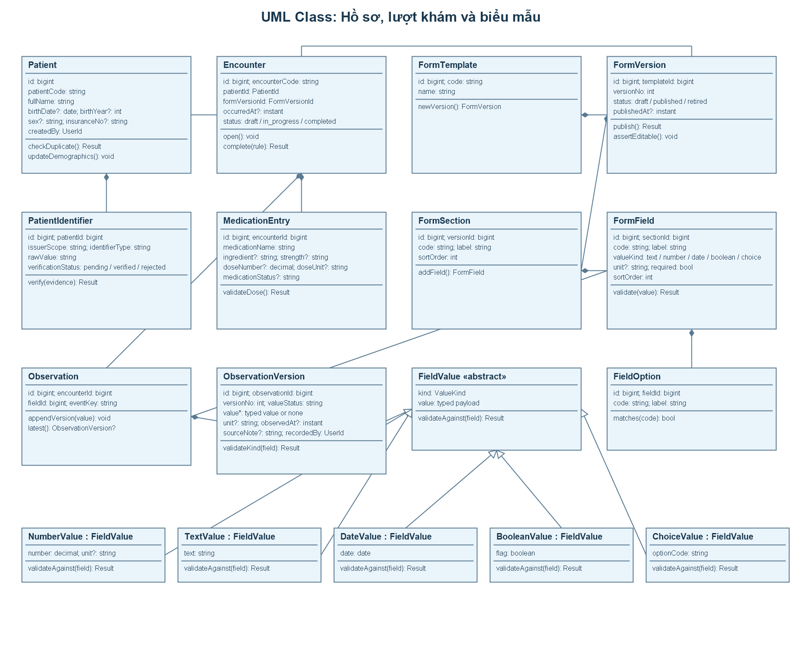
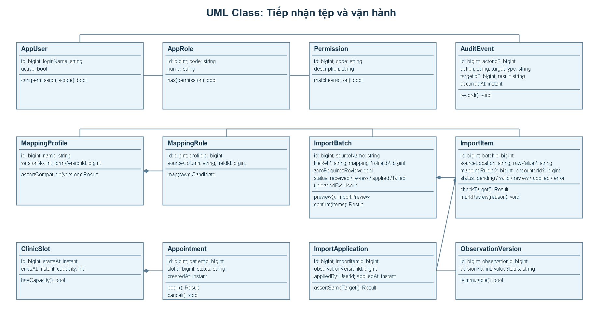
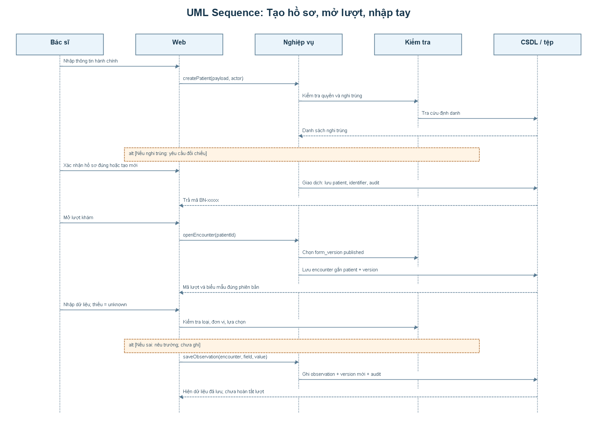
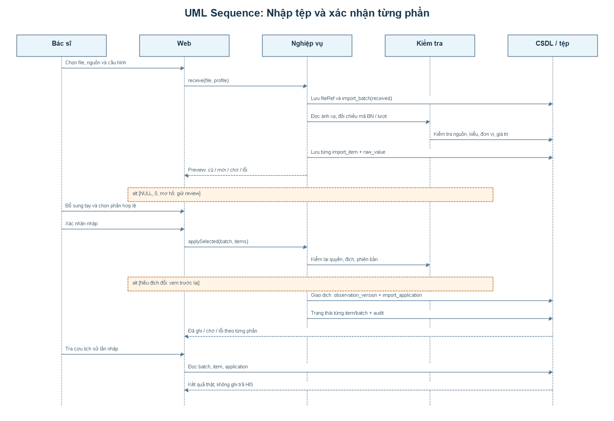
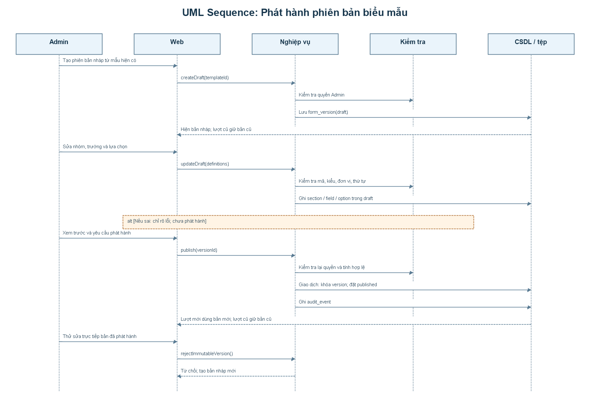

# Thiết kế hướng đối tượng UML — MVP suy tim

**Phạm vi duyệt:** Công việc 3.3, nhóm chức năng **1, 2, 6**. Tài liệu này là thiết kế để triển khai, chưa phải bằng chứng web demo đã hiện thực các phương thức. Bốn module AI, kết luận/kế hoạch và cổng bệnh nhân thuộc giai đoạn sau.

## Mục lục

1. [Căn cứ và ranh giới](#1-căn-cứ-và-ranh-giới)
2. [Class Diagram](#2-class-diagram)
3. [Sequence Diagram](#3-sequence-diagram)
4. [Đối chiếu yêu cầu và dữ liệu](#4-đối-chiếu-yêu-cầu-và-dữ-liệu)
5. [Bất biến, giới hạn và điểm cần chốt khi lập trình](#5-bất-biến-giới-hạn-và-điểm-cần-chốt-khi-lập-trình)

## 1 Căn cứ và ranh giới

Ưu tiên đối chiếu theo thứ tự: yêu cầu Công việc 3.3 của môn học; [SRS v1.0](SRS-v1.0.md) và [54 đặc tả Use Case](<Đặc tả usecase đầy đủ.md>) hiện hành; [thiết kế dữ liệu MVP](thiet-ke-du-lieu.md) cùng `database/mvp/schema.sql`; [User Story và BDD](User-Stories.md); [C1/C2](architecture/architecture.md) và [bài giảng OOP](https://fossbk-spec.github.io/ktpmud-book/ch03_oop_clean_code). Các trường biểu mẫu lâm sàng chi tiết thuộc cấu hình đã truy vết ở [tài liệu thiết kế dữ liệu](thiet-ke-du-lieu.md), không viết cứng thành 66 thuộc tính của `Encounter`.

MVP là web quản lý hồ sơ suy tim. Bác sĩ tạo hồ sơ, mở lượt, nhập tay trước rồi tiếp nhận file từ HIS và bổ sung phần thiếu. Admin quản trị tài khoản, quyền, phiên bản biểu mẫu, cấu hình ánh xạ và nhật ký. Hai vai trò dùng chung trang đăng nhập; quyền được kiểm tra ở nghiệp vụ và nơi lưu. HIS chỉ là **nguồn file do bác sĩ đưa vào**, không phải thành phần gọi trực tiếp API sản phẩm; không có luồng ghi trả HIS. Sản phẩm lưu bệnh án của chính nó.

Sơ đồ lớp dùng tên `CamelCase` cho đối tượng, tên bảng SQL dùng `snake_case`. Thuộc tính có `?` là có thể chưa biết hoặc chưa có; kiểu `Result` là kết quả nghiệp vụ, không phải cột SQL. Các phương thức thể hiện trách nhiệm dự kiến và **chưa tồn tại trong Gateway tuần 3**. Nguồn chỉnh sửa `.drawio` đặt cạnh từng ảnh trong `docs/architecture/`.

## 2 Class Diagram

### 2.1 Hồ sơ, lượt khám và biểu mẫu

`Patient` định danh một người bằng mã `BN-xxxxx`, có nhiều `Encounter`. Một lượt gắn một `FormVersion` đã phát hành; cấu trúc mẫu đi theo chuỗi `FormTemplate → FormVersion → FormSection → FormField → FieldOption`. Nhờ vậy, lượt cũ vẫn đọc theo phiên bản đã gắn khi Admin phát hành mẫu mới. `Observation` nhận diện một trường của một lượt và `eventKey` cho phép nhiều lần đo; `ObservationVersion` giữ các bản giá trị theo thời gian. Thuốc được lưu thành nhiều `MedicationEntry`, không nhét danh sách thuốc vào một trường văn bản.

**Kết tập và kế thừa.** Hình thoi đặc tại đầu quan hệ trong tệp `.drawio` biểu thị sở hữu vòng đời: người bệnh–định danh, lượt–giá trị/thuốc, mẫu–nhóm–trường–lựa chọn, quan sát–các bản giá trị. `FieldValue` là **value object trừu tượng trong thiết kế**, với năm loại con theo `value_kind`: số, chữ, ngày, boolean và lựa chọn. Đây không phải sáu bảng SQL mới: giá trị đã biết được ánh xạ vào đúng một trong `value_number`, `value_text`, `value_date`, `value_boolean`, `value_code` của `observation_version`; `unknown` và `not_applicable` không chứa giá trị. `NumberValue` còn giữ đơn vị ở bản giá trị. Cấu trúc này thể hiện đa hình khi kiểm tra giá trị theo định nghĩa trường mà không sửa dữ liệu cũ.

| Đối tượng | Bảng/khóa liên quan | Trách nhiệm nghiệp vụ và ràng buộc cần giữ |
| --- | --- | --- |
| `Patient`, `PatientIdentifier` | `patient`, `patient_identifier` | Mã BN duy nhất; định danh nguồn có phạm vi/cơ quan cấp và trạng thái xác minh. Ngày sinh hoặc năm sinh, không tự suy diễn cả hai. |
| `Encounter` | `encounter`, `encounter_identifier` | Luôn thuộc đúng người và đúng phiên bản mẫu; xem hồ sơ không tự tạo lượt. Lịch hẹn không đồng nghĩa lượt khám. |
| `FormTemplate`, `FormVersion`, `FormSection`, `FormField`, `FieldOption` | Năm bảng biểu mẫu cùng tên | Định nghĩa trường, kiểu, đơn vị, lựa chọn, thứ tự; bản đã phát hành/đã dùng không sửa trực tiếp. |
| `Observation`, `ObservationVersion` | `observation`, `observation_version` | `event_key` phân biệt các lần đo; mỗi lần thay đổi tạo bản giá trị mới. Một giá trị đã biết chỉ có một kiểu; thiếu khác 0 và `false`. |
| `MedicationEntry` | `medication_entry` | Nhiều thuốc trên cùng lượt; tên, hoạt chất/liều/đơn vị, trạng thái, nguồn và thời điểm thuộc dòng thuốc. Chưa là đơn thuốc xác nhận. |
| `FieldValue` và năm lớp con | Không có bảng riêng; ánh xạ vào cột typed của `observation_version` | Mô hình đối tượng để kiểm tra kiểu; không thay thế quy tắc lâm sàng hay chuẩn hóa đơn vị chưa được chốt. |

### 2.2 Nhập tệp, quyền và vận hành

`AppUser` có nhiều `AppRole` qua `user_role`; vai trò có nhiều `Permission` qua `role_permission`. Bác sĩ và Admin **không là hai lớp con cố định của `AppUser`**: quyền có thể thay đổi, nên dùng quan hệ vai trò thay vì kế thừa theo chức danh. Kiểm tra quyền còn phải xét phạm vi hồ sơ ở tầng ứng dụng; lược đồ hiện có chưa biểu diễn đầy đủ chính sách phạm vi.

`MappingProfile` phiên bản hóa tập `MappingRule`, mỗi quy tắc nối một cột nguồn với một `FormField` của đúng phiên bản mẫu. `ImportBatch` lưu một lần tiếp nhận và tham chiếu tệp; nhiều `ImportItem` giữ vị trí/giá trị gốc, lượt đích và trạng thái riêng. Chỉ mục đã xác nhận mới sinh `ImportApplication` nối tới `ObservationVersion`. `ClinicSlot` có nhiều `Appointment`, sức chứa phải được kiểm tra trong giao dịch. `AuditEvent` ghi thao tác quan trọng. Quan hệ với `Patient`, `Encounter`, `FormVersion` và `FormField` ở hình thứ nhất được giữ bằng các khóa SQL; hình này tách ra để dễ đọc.

| Đối tượng | Bảng/khóa liên quan | Quy tắc quan trọng |
| --- | --- | --- |
| `AppUser`, `AppRole`, `Permission` | `app_user`, `app_role`, `user_role`, `permission`, `role_permission` | Admin không mặc nhiên được nhập hoặc xác nhận lâm sàng; tài khoản bị khóa không thực hiện thao tác bảo vệ. |
| `MappingProfile`, `MappingRule` | `mapping_profile`, `mapping_rule` | Quy tắc ánh xạ phải trỏ tới trường của đúng phiên bản mẫu; profile đã sử dụng không được đổi nghĩa ngầm. |
| `ImportBatch`, `ImportItem`, `ImportApplication` | `import_batch`, `import_item`, `import_application` | Tải và xem trước chưa ghi bệnh án. Mỗi mục có nguồn, vị trí, lượt đích và kết quả; mục đã áp dụng không được sửa/xóa âm thầm. |
| `ClinicSlot`, `Appointment` | `clinic_slot`, `appointment` | Chặn đặt vượt sức chứa kể cả khi thao tác đồng thời; lịch hẹn và lượt là hai thực thể khác nhau. |
| `AuditEvent` | `audit_event` | Gắn người, thời điểm, đối tượng và kết quả thao tác; không dùng log để chứa bí mật/tệp nguồn. |

## 3 Sequence Diagram

Các lifeline `Web`, `Nghiệp vụ`, `Kiểm tra`, `CSDL/tệp` là **trách nhiệm logic trong container web/backend hiện hành**, không tuyên bố bốn microservice hoặc API đã triển khai. Mũi tên liền là yêu cầu, nét đứt là phản hồi; khung `alt` mô tả đường ngoại lệ. Các thao tác nhiều bảng cần một giao dịch và chỉ báo thành công sau khi giao dịch hoàn tất.

### 3.1 Tạo hồ sơ, mở lượt, nhập tay

Luồng bao gồm tra cứu nghi trùng trước khi cấp mã BN, chọn người bệnh rõ ràng, gắn lượt mới với mẫu đã phát hành, kiểm tra giá trị theo trường và lưu bản giá trị có nguồn/người/thời điểm. Dữ liệu thiếu ở trạng thái `unknown`; số 0 do người dùng nhập và xác nhận có thể hợp lệ nếu quy tắc trường cho phép. Lưu dữ liệu **chưa** hoàn tất lượt, xác nhận chuyên môn hoặc chạy AI. `Encounter.complete()` chỉ được gọi ở luồng hoàn tất riêng khi điều kiện đã chốt; sơ đồ không suy diễn điều kiện đó từ DDL.

### 3.2 Tiếp nhận tệp và xác nhận từng phần

Bác sĩ đưa file từ HIS vào web. Hệ thống lưu lần nhập, đọc theo cấu hình, đối chiếu **định danh nguồn đã xác minh** với hồ sơ và lượt, kiểm tra kiểu/đơn vị/giá trị, rồi hiển thị xem trước. NULL giữ là thiếu; số 0 **từ file nguồn** được đánh dấu chờ bác sĩ kiểm tra/nhập lại theo quyết định nhóm, không tự áp dụng. Sau khi bác sĩ chọn mục hợp lệ và xác nhận, hệ thống kiểm tra lại quyền, đích, cấu hình và dữ liệu hiện có; thay đổi sau xem trước buộc đối chiếu lại. Một giao dịch ghi bản giá trị và liên kết nguồn cho từng phần được nhận; trả về kết quả đã ghi/chờ/lỗi thật. Không ghi trả HIS.

### 3.3 Phát hành phiên bản biểu mẫu

Admin tạo **bản nháp mới**, sửa nhóm/trường/lựa chọn, kiểm tra mã, kiểu, đơn vị và thứ tự rồi phát hành. Lượt mới chọn bản phát hành phù hợp; lượt cũ giữ `form_version_id` đã gắn. Không sửa trực tiếp bản đã phát hành hoặc đã dùng. Thay đổi nội dung lâm sàng của trường vẫn cần người có thẩm quyền chuyên môn duyệt; quyền kỹ thuật của Admin không tự là phê duyệt y khoa.

## 4 Đối chiếu yêu cầu và dữ liệu

| Luồng/lớp trong UML | SRS | Use Case | BDD liên quan | Bảng SQL chính |
| --- | --- | --- | --- | --- |
| Hồ sơ và định danh | FR01 | UC1.01–UC1.03 | BDD01, BDD40 | `patient`, `patient_identifier` |
| Lượt và biểu mẫu gắn với lượt | FR04, FR05, FR43 | UC1.07–UC1.08, UC6.08 | BDD02, BDD07, BDD09 | `encounter`, `form_version`, `form_field`, `observation`, `observation_version` |
| Thuốc và nhiều kết quả | FR05–FR07 | UC1.08, UC1.10–UC1.11 | BDD02, BDD18 | `medication_entry`, `observation`, `observation_version` |
| Tiếp nhận, ánh xạ, đối chiếu | FR08–FR12 | UC2.01–UC2.05, UC2.11 | BDD03, BDD04, BDD15, BDD16, BDD36 | `mapping_profile`, `mapping_rule`, `import_batch`, `import_item` |
| Xác nhận từng phần, lịch sử nhập | FR13–FR15 | UC2.01, UC2.07, UC2.09, UC2.12 | BDD05, BDD06, BDD41, BDD44 | `import_application`, `observation_version`, `import_item` |
| Tài khoản, vai trò, biểu mẫu | FR40–FR43 | UC6.02, UC6.05–UC6.08 | BDD07, BDD08, BDD35, BDD37, BDD49–BDD50 | `app_user`, `app_role`, `permission`, `form_version` |
| Lịch và nhật ký | FR03, FR45 | UC1.05–UC1.06, UC6.09 | BDD10, BDD34, BDD39 | `clinic_slot`, `appointment`, `audit_event` |

## 5 Bất biến, giới hạn và điểm cần chốt khi lập trình

| Quy tắc | Đã có trong DDL MVP | Còn cần ở tầng ứng dụng/giao dịch |
| --- | --- | --- |
| Một quan sát dùng trường đúng phiên bản lượt; lựa chọn đúng trường; bản giá trị không ghi đè | Trigger và `CHECK` trong `database/mvp/schema.sql` | Kiểm tra trước lưu để thông báo lỗi dễ hiểu; quản lý xung đột phiên bản và quyền hồ sơ. |
| Mẫu đã phát hành/đã dùng không đổi cấu trúc | Trigger bảo vệ định nghĩa/phiên bản | Tạo bản nháp mới, xem trước và phê duyệt nội dung theo vai trò. Cột `retired` tồn tại nhưng chuyển trạng thái published → retired đang bị trigger chặn; chưa coi là luồng hoàn chỉnh. |
| Ánh xạ và mục nhập khớp mẫu/lượt; số 0 từ file chờ xem lại | Trigger kiểm tra cấu hình, đích và nguồn 0 | Xác minh mã BN/mã lượt trước xác nhận; xử lý NULL, đổi đơn vị theo quy tắc đã duyệt, so sánh dữ liệu cũ/mới, chống thử lại nhân bản. |
| Sức chứa khung giờ | Trigger khóa hàng và đếm lịch đã đặt | Chọn khung giờ, xử lý lỗi khi cạnh tranh và hiển thị trạng thái thống nhất. |
| Kiểm soát quyền, nhật ký, sao lưu | Có bảng vai trò/quyền và `audit_event` | Phạm vi hồ sơ, phiên đăng nhập, ghi log cho từng thao tác, sao lưu/khôi phục và diễn tập phục hồi chưa được DDL tự bảo đảm. |

**Không mở rộng tuyên bố triển khai:** `database/mvp/schema.sql` là lược đồ tạo CSDL mới, chưa phải migration từ demo. Gateway tuần 3 đang dùng dữ liệu giả lập trong RAM; chưa có các phương thức nghiệp vụ ở hình, hợp đồng API MVP hoặc kiểm thử end-to-end cho ba luồng. Các phương thức trong UML là thiết kế để làm Công việc 3.4 và hiện thực web tiếp theo. RTM và nội dung report chưa được chỉnh trong PR này.
